

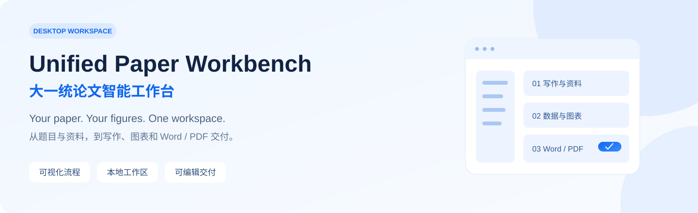

**From a title and source materials to papers, figures, and submission workflows.**

Four connected modules · Editable workflows · Built-in Codex SDK · Word / PDF · Smart submission

[简体中文](README.md) · [Paper examples](#see-the-paper-output) · [Feature tour](#inside-the-application) · [Getting started](docs/GETTING_STARTED.md) · [Roadmap](docs/ROADMAP.md) · [Contributing](CONTRIBUTING.md)

Unified Paper Workbench is a **local desktop workspace for the academic paper lifecycle**. Writing, figures, journal/author preparation, and smart submission share one workspace. Edit prompts, add your own steps, configure models and concurrency, inspect Word/PDF outputs, and follow submission status in the GUI.

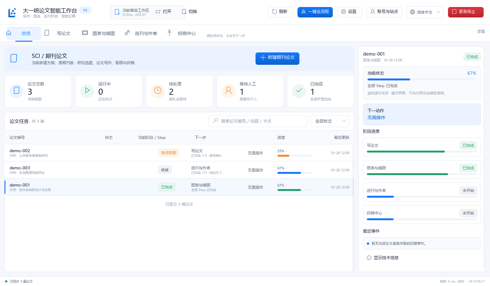

> **Early open-source preview.** The current locally verified desktop version is `0.12.0b11`. Full workflows still depend on legacy workspace templates; clean installation and public release packaging are active work. Screenshots use fictional tasks in an isolated workspace.

## See the paper output

Equations, architecture diagrams, algorithms, comparison plots, ablations, and results tables in manuscript layout.

<table>
<tr><th width="50%">Methods and system design</th><th width="50%">Results and figures</th></tr>
<tr>
<td valign="top"><a href="docs/assets/paper-method-example.png">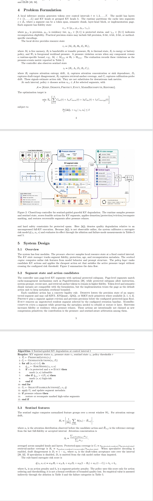</a></td>
<td valign="top"><a href="docs/assets/paper-results-example.png">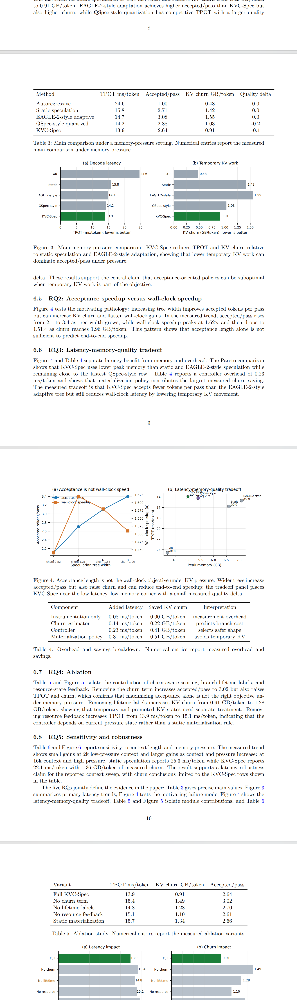</a></td>
</tr>
</table>

Click either image for the full-resolution excerpt. These user-provided pages demonstrate document and figure presentation; they are not evidence of independently verified experiments or publication acceptance.

## Why a workbench?

A paper is more than a chat response. You need to know which materials were used, which stage is running, which files were produced, and what requires your attention.

The application manages queues and stage state. Codex SDK sessions handle content tasks. File-level checks determine whether required outputs are present and acceptable.

## What is here

| Workflow | Capabilities |
|---|---|
| Journal papers | Topic development, reference work, staged writing, revisions, figure handoff |
| Undergraduate theses | Title and school requirements, humanities/social science and software project prompt schemes |
| Figures | Figure planning, data checks, plotting scripts, manuscript integration |
| Deliverables | Undergraduate Word documents and PDF previews; journal TeX/PDF; direct PDF and folder actions |
| Execution | Per-paper sessions, concurrency, pause/resume, workflow snapshots |
| Workflow editing | Edit per-step prompts; add, reorder, or remove custom steps inside a module |
| Models and usage | SDK-discovered models and reasoning options, per-module/per-step overrides, token limits, concurrency |
| Built-in Codex SDK | Browser authorization or device-code login from the application, with a dedicated session per paper |
| Accounts and sites | Email, submission systems, external services, sites, and journals; personal information masked by default |
| Automated submission | Site login, forms, uploads, final-submit policy, receipt checks, pause and manual handoff |
| Status monitoring | Scheduled local checks, on-demand checks, and follow-up handling for actionable submission states |

## Inside the application

These are real application captures with isolated fictional records. Model choices are demo data; actual availability comes from the user's SDK account. No model calls, live account connections, or journal submissions were performed for the showcase.

### Configure each module and each step

Set default models, reasoning effort, and concurrency per module. Each step can inherit those defaults or use its own model, reasoning effort, and token limit.

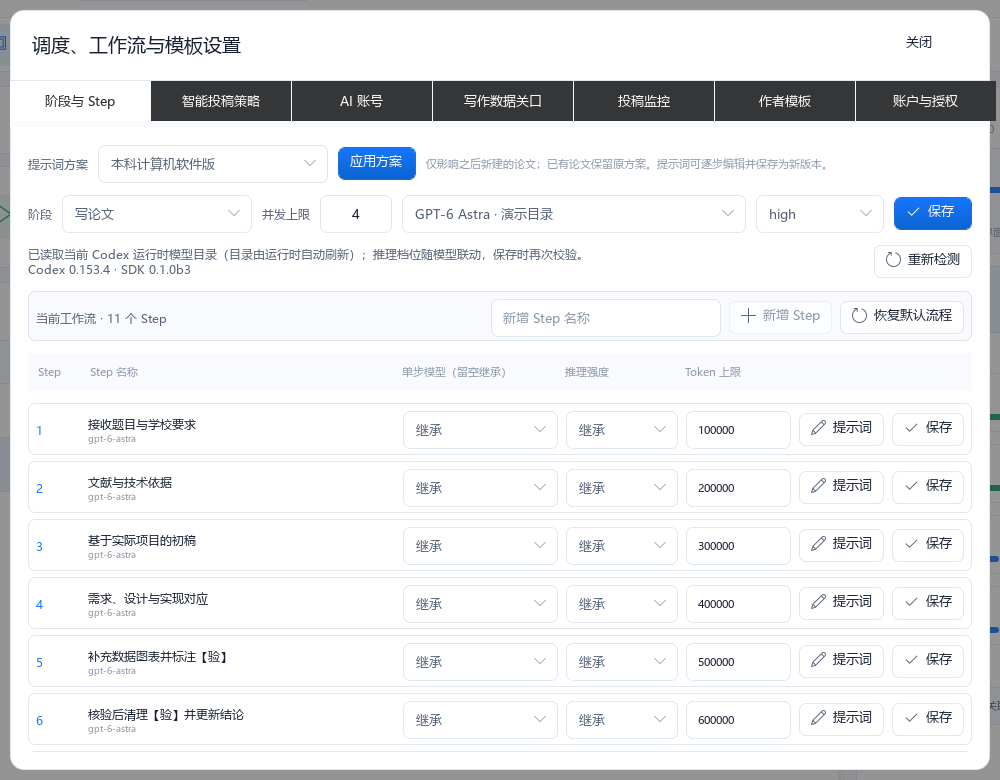

### Make the workflow your own

Add steps, edit full prompts, and change their order. Step 11 in this example was actually added and saved through the workflow store in the isolated demo.

<table>
<tr><th width="50%">Add, reorder, and remove steps</th><th width="50%">Edit and save complete prompts</th></tr>
<tr>
<td><a href="docs/assets/workbench-custom-step.png">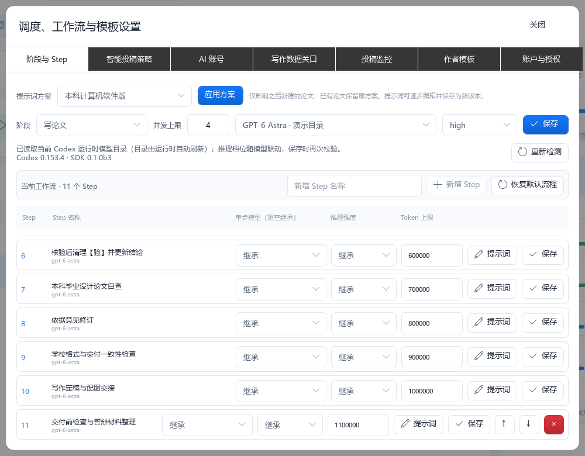</a></td>
<td><a href="docs/assets/workbench-prompt-editor.png">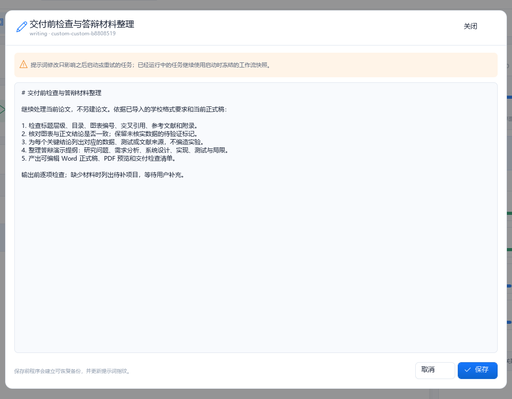</a></td>
</tr>
</table>

The four top-level modules are fixed; steps inside them are customizable. Changes apply to subsequently started or retried tasks. Running tasks retain their workflow snapshot.

### Connect AI through the built-in SDK

The AI account tab supports ChatGPT browser authorization and device-code login. The application manages queues, concurrency, retries, and module handoffs; SDK sessions perform the content tasks.

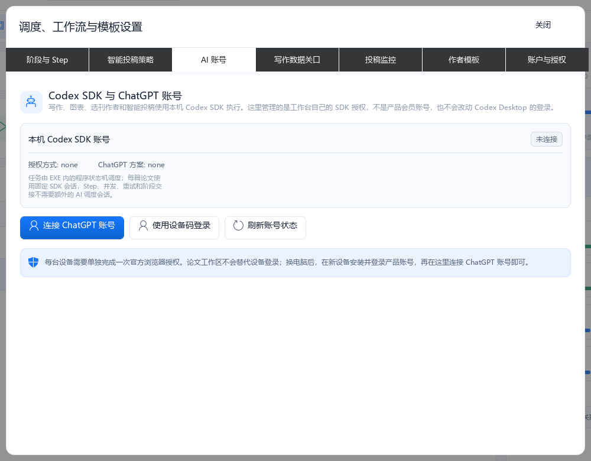

### Manage accounts, sites, and journals together

Browse email, submission-system, and external-service accounts alongside sites and journal records. Related source records are grouped for display. **Hide personal information is enabled by default**, masking emails and login names in both lists and details. A trusted local credential broker fills passwords into the browser without handing them to AI.

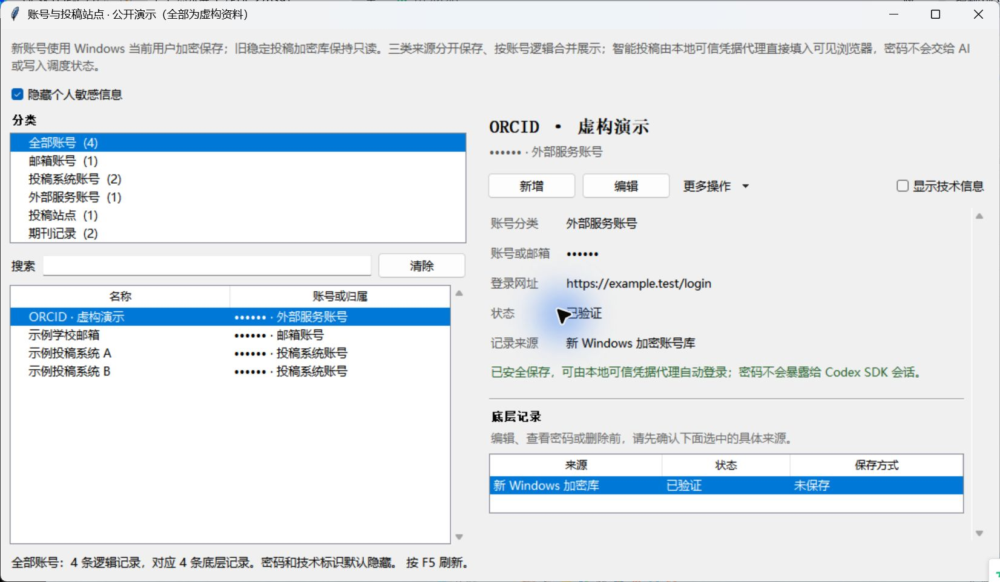

View the submission-site registry

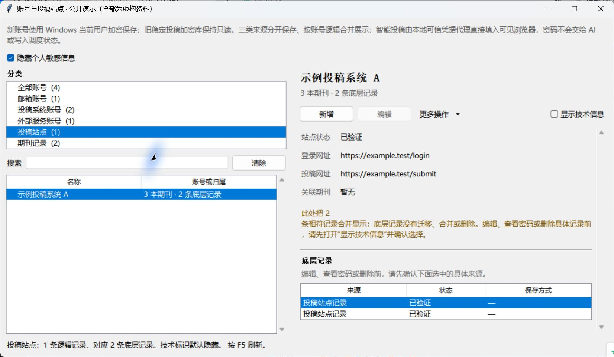

### Automate submission and track what happens next

The submission center queues manuscripts and follow-up work. On supported, authorized sites, Smart Submission handles login, forms, and uploads, applies the selected final-submit policy, and checks receipts. Tasks can pause for user action and resume afterward.

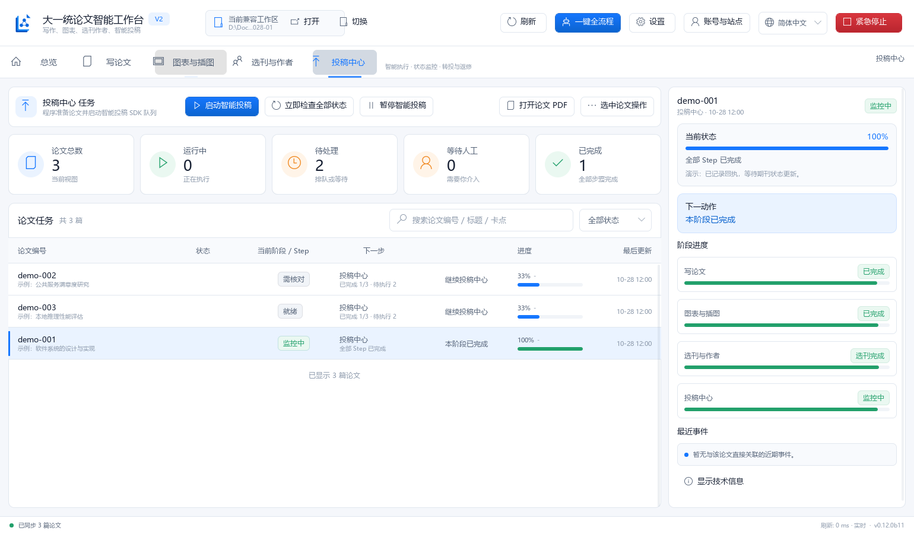

<table>
<tr><th width="50%">Choose submission policies</th><th width="50%">Schedule status checks</th></tr>
<tr>
<td><a href="docs/assets/workbench-submission-policy.png">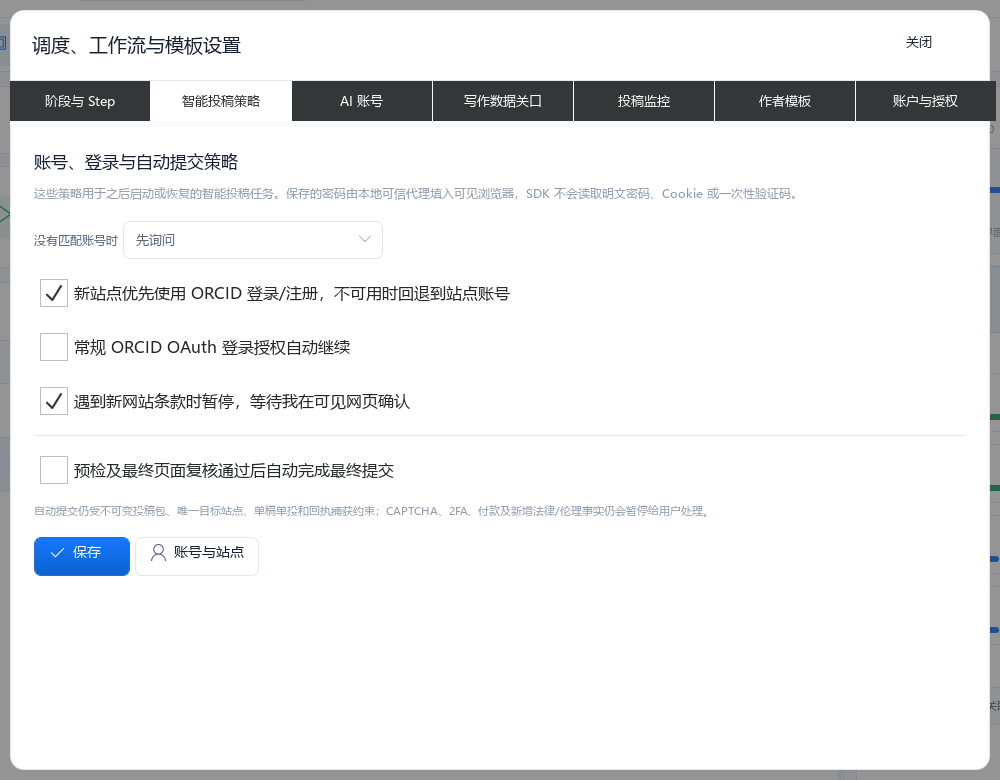</a></td>
<td><a href="docs/assets/workbench-submission-monitor.png">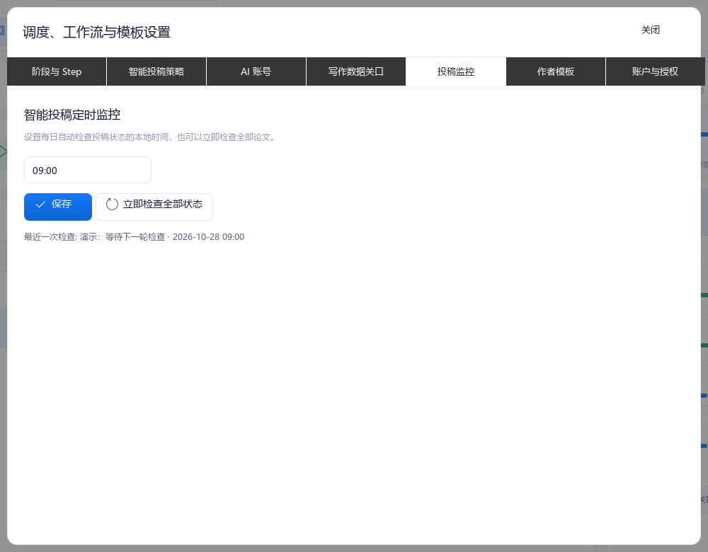</a></td>
</tr>
</table>

Configure missing-account handling, ORCID login/authorization, terms confirmation, final submission, and a daily local check time. Scheduled monitoring requires the local application to be running; site verification and user decisions retain a manual handoff.

### Open the final deliverable directly

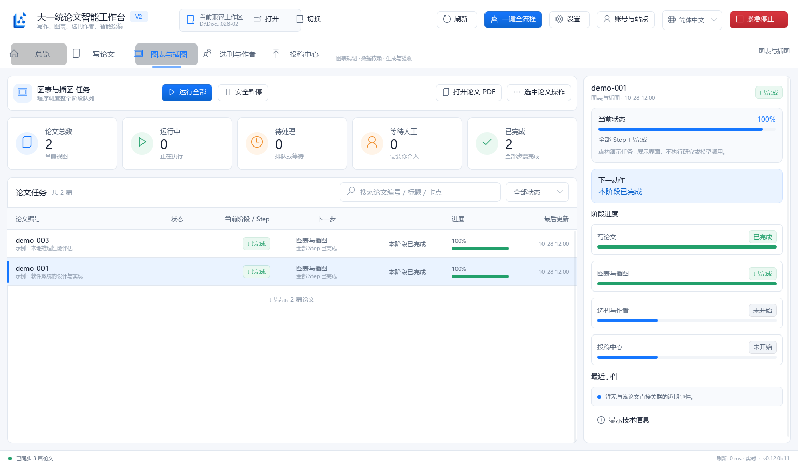

## Start here

Read [Getting started](docs/GETTING_STARTED.md) for the current installation scope and required workspace templates. Windows is the verified desktop environment. A publicly downloadable release is not implied by the presence of a version number in this README.

Bring your own supported ChatGPT/Codex credentials. AI execution can consume paid model usage. **Local workspace storage does not mean offline inference**: connected services receive the inputs required for their tasks.

Microsoft Word on Windows is currently required for native Word pagination and PDF rendering in the undergraduate delivery workflow.

## Boundaries

- Clean-clone end-to-end operation is not yet claimed; legacy module templates are being separated from local workspace data.
- Cross-platform desktop support has not been verified.
- References, research claims, and data require verification. Simulated data must remain disclosed unless replaced with actual verified evidence.
- The application does not guarantee publication, academic acceptance, or support for every journal website.

## Contribute

The highest-impact areas are clean installation, portable workspace templates, Word styles, reproducible figures, error recovery, and documentation. See [CONTRIBUTING.md](CONTRIBUTING.md) and the [roadmap](docs/ROADMAP.md).

If this is useful to you, a Star helps others discover the project. Specific bug reports and focused pull requests help make it usable.

## License

Project-owned source is available under [GNU AGPL v3.0](LICENSE), SPDX `AGPL-3.0-only`. Third-party components retain their own terms; see [THIRD_PARTY_NOTICES.md](THIRD_PARTY_NOTICES.md).
