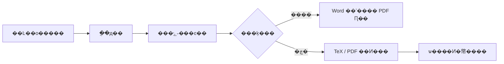

**����Ŀ�����ϣ������ġ�ͼ�����Զ���Ͷ�塣**

�Ĵ�ģ����� �� �ɱ�����ʾ�� �� ���� Codex SDK �� Word / PDF �� ����Ͷ������

[English](README.en.md) �� [���İ���](#�ȿ����IJ���) �� [����ʵ��](#����ʵ��) �� [���ٿ�ʼ](docs/GETTING_STARTED.md) �� [·��ͼ](docs/ROADMAP.md) �� [���빱��](CONTRIBUTING.md)

---

��һͳ��һ�� **�����ڱ��ص� AI ����ȫ�������湤��̨**��д���ġ�ͼ�����ͼ��ѡ�������ߡ�����Ͷ���ĸ�ģ����ͬһ������������������Ա༭ÿһ����ʾ�ʡ������Լ��� Step������ģ���벢������ֱ�Ӳ鿴 Word / PDF �����Ͷ��״̬��

> **��ԴԤ��״̬**��Դ����� AGPL-3.0����ǰ����У��汾Ϊ `0.12.0b11`����������������ʷ������ģ���������ɾ���װ�빫�����а���������������߽��[���ٿ�ʼ](docs/GETTING_STARTED.md)��������ͼʹ���鹹��ʾ�������˺ţ����İ�����Դ������ע��

## �ȿ����IJ���

��ʽ�Ƶ���ϵͳ�ܹ�ͼ���㷨���Ա�ʵ��ͼ������ͼ�ͽ�����񣬷Ž�ͬһ�������Ű��С�

<table>
<tr><th width="50%">������ϵͳ���</th><th width="50%">�����ͼ���Ű�</th></tr>
<tr>
<td valign="top"></td>
<td valign="top"></td>
</tr>
</table>

���ͼƬ�ɲ鿴ԭʼ��ͼ������Ϊ�û��ṩ�����Ľ�ѡ������չʾ�ĵ���ͼ��Ч������ͼ�е�ʵ����ֵ�ͽ��۲������Ѻ����о���¼��֤����

## Ϊʲô������

д��������ɢ�������촰�ڡ��ĵ����ű���ͼƬ���ļ���֮�䡣����Ҫ֪���IJ�ֻ�ǡ�AI �ش���ʲô���������� **������һ���������ķݲ��ϡ�������ʲô����һ���ô���ʲô**��

��һͳ����Щ��Ϣ�Ž��ɻָ������Ĺ�������AI ��������������񣬳������Ŷӡ��׶�״̬�Ͳ����顣

## �����������ʲô

| ���� | ����̨�ṩ������ |
|---|---|
| �ڿ����� | �о�ѡ�⡢�����������ֲ�д�����޸���ͼ������ |
| ���Ʊ�ҵ���� | ������Ŀ������ѧУҪ��ѡ��������ƻ�����������ʾ�ʷ��� |
| ������ͼ�� | ͼ���滮�����ݺ˶ԡ����ɽű���ͼ�����ϣ��鿴�׶β��� |
| Word / PDF ���� | ���� Word ��ʽ�����Ű�Ԥ�����ڿ� TeX / PDF��ֱ�Ӵ����� PDF �����Ŀ¼ |
| ��ƪ���Ĺ��� | �������С���ͣ�������ÿƪ���ĵĹ̶��Ự�����̿��� |
| ��ʾ�������̱��� | ��ģ��༭ÿ����ʾ�ʣ����ӡ�����ɾ���Զ��� Step���������������ĵ����̿��� |
| ģ������������ | �ӵ�ǰ SDK Ŀ¼���ģ�ͺ�������λ������ģ��򵥲�ģ�͡�Token ���޺Ͳ��� |
| ���� Codex SDK | ������������ ChatGPT �˺ţ�֧���������Ȩ���豸���¼��ÿƪ���ı����Լ���ִ�лỰ |
| �˺���Ͷ��վ�� | ͳһ�鿴���䡢Ͷ��ϵͳ���ⲿ�������ڿ���¼��Ĭ�����ظ�����Ϣ��ƾ���ɱ��ش������� |
| �Զ���Ͷ�� | Smart Submission �ν�վ���¼���������ϴ����ύ�������ִ�˶ԣ�֧����ͣ���˹��ӹ� |
| Ͷ��״̬��� | ������ʱ�䶨ʱ����������飬���ܴ�����״̬���ν�������������� |

## ����ʵ��

���¾�Ϊ��ʵ�������棬ʹ�ø��빤�������鹹��¼��ģ��Ŀ¼Ϊ��ʾ���ݣ�ʵ�ʿ�ѡ�����û� SDK ��⣻��ʾδ����ģ�͡�δ������ʵͶ���˺š�δ�ύ�����

### ÿ��ģ�顢ÿ�� Step����������

���������л�ģ�飬�ֱ����� **�������ޡ�Ĭ��ģ�͡�����ǿ��**������ Step ���Լ̳�Ĭ��ֵ��Ҳ���Ե�������ģ�͡�����ǿ���� Token ���ޡ�

### ������ִ�����Լ�������

Ϊ����ģ������ Step���༭������ʾ�ʣ��ٵ���ִ��˳��ͼ�е� 11 ��������ǰ��������������������ͨ���������洢������������Զ��岽�衣

<table>
<tr><th width="50%">������������ɾ�� Step</th><th width="50%">ֱ�ӱ༭��������ʾ��</th></tr>
<tr>
<td></td>
<td></td>
</tr>
</table>

�Ĵ�ģ��Ŀǰ�̶������Զ������ģ���ڵIJ��衣�޸ĺ�ķ�������֮�����������Ե���������������������ʱ�����̿��ա�

### ���� SDK�������������� AI

ͨ�� **AI �˺�**ҳ���� ChatGPT��֧���������Ȩ���豸���¼����������С����������Ժͽ׶ν��ӣ�SDK �Ựִ��ÿƪ���ĵľ�������

### �˺š�վ�����ڿ���һ������

���䡢Ͷ��ϵͳ���ⲿ����Ͷ��վ����ڿ���¼�����������ͬһ�˺ŵIJ�ͬ��Դ�ɺϲ�չʾ��**�����ظ���������Ϣ��Ĭ�Ͽ���**������͵�¼�˺����б���������ͬʱ�ڵ��������ɱ��ؿ���ƾ�ݴ�������������������� AI��

�鿴Ͷ��վ���������¼����

### �Զ���Ͷ�壬���ܳ�������״̬

Ͷ�����İѸ���ͺ���״̬�Ž����С�Ͷ��ֻʹ�� Smart Submission�����������һ���Ȩ��վ���д�����¼���������ļ��ϴ�������ѡ����ִ�������ύ���˶Ի�ִ����Ҫ�û������Ļ��ڿ�����ͣ�������

<table>
<tr><th width="50%">Ͷ������������</th><th width="50%">��ʱ���Ͷ��״̬</th></tr>
<tr>
<td></td>
<td></td>
</tr>
</table>

���������˺�ȱʧ������ORCID ��¼����Ȩ������ȷ�ϡ������ύ���أ��Լ�ÿ��״̬���ʱ�䡣�Զ�����ɱ��س������У�����վ����֤����Ҫ�˹��������������ᱣ��������ڡ�

### ������һ����ȷ�Ľ����յ�

�ڡ�ͼ�����ͼ��ѡ�����ģ���� **������ PDF**���� **ѡ�����IJ��� �� �򿪵�ǰ�׶β���Ŀ¼** �����Ӧ�ļ��С�

���Ʒ����Կɱ༭ Word Ϊ����Ŀ�꣬TeX ������Ϊ�м�塣Word �Ű�� PDF ��ȾĿǰ��Ҫ���� Microsoft Word��

### ����ͬ����ʹ�ò�ͬ����

- **ԭ�ڿ���**���о����ڿ������������
- **����������ư�**������Ŀ��ѧУҪ��ʼ��֯д����
- **���Ƽ����������**��Χ��������ơ�ʵ�֡�������ͼ����֯���ݡ�

������ִ�����û�󶨵��½����ģ������е����ı����Լ������̿��ա�

## ���ٿ�ʼ

1. �Ķ�[��װ�뵱ǰ�����з�Χ](docs/GETTING_STARTED.md)��Ŀǰ����֧�� Windows ���滷����
2. ׼�����Ĺ�����������ģ�壬�������������Լ��� ChatGPT / Codex SDK �˺š�
3. ѡ����ʾ�ʷ����������������񣻱��Ʒ�����д��Ŀ������ѧУҪ��
4. ��������ʾ������ϡ����ݺͲ���ټ��������׶Ρ�

AI ������Ҫ�û��Լ����˺Ż�ƾ�ݣ������ܲ���ģ��������**���ع���̨����������ģ��**��ִ�� AI ����ʱ�������ᷢ�͸������ӵķ���

## ������

����������кͽ׶�״̬��Codex SDK ִ�о������ݲ��裬�ļ�������ܶ�����顣֧������ʱ�л��������ĺ�Ӣ�ģ�����������ֹͣ������ֹͣ�����Զ��ƽ������尲ȫ��ͣ��Ϊ������ִ�е�����Ϊ׼��

## ��ǰ�߽�

- Windows ����Ϊ��ǰ��֤������û������ macOS / Linux �Ѿ����á�
- �����о���������������ʷģ���ģ���빤�ߣ���ǰ�ֿ⻹���������õ�һ�����а档
- ģ�Ϳ�����ȡ�����˺ź͵�ǰ SDK ���ص�Ŀ¼�������һ��Ӳ�������Ƶ�����֧�֡�
- ģ���������ڵ��Ի���ȷ��¶��ģ���о������ܵ�������ɵ���ʵ���л�ʵ�顣�ο����ס����ۺ������ύ������Ҫ���顣
- ��ԴԤ������ŵ����¼�á�ѧλͨ���������ڿ�վ�㶼���Զ�������

[��ϸ����������](docs/FEATURES.md) �� [��˽�߽�](PRIVACY.md) �� [��ȫ����](SECURITY.md)

## һ����������������õĹ���

�������Ȼ�ӭ��Щ���ף�

- **�ɾ���װ�빤����ģ��**���õ�һ�����ص��û�Ҳ�������ʾ��
- **Word ��ͼ��**��ѧУģ�塢�Ű淴�����ɸ��ֻ�ͼʾ����
- **�ɿ���������**�������Ŀ��㡢�ļ���ڡ��ָ����̺ʹ�����ʾ��
- **�ĵ�������**��Ӣ��˵������װָ�ϡ���ʾ��Ƶ������ʾ����

�ȿ� [����ָ��](CONTRIBUTING.md) �� [·��ͼ](docs/ROADMAP.md)�����ύ Issue �� PR��

����������������ã���ӭ Star ��ע������չ��Ҳ��ӭ���ž���ʹ���������Ľ�����

## ����֤

��Ŀ����Դ���� [GNU AGPL v3.0](LICENSE)��`AGPL-3.0-only`������������ͬ����Ҫ��������֤�������������ѭ�������ɣ��� [THIRD_PARTY_NOTICES.md](THIRD_PARTY_NOTICES.md)��
