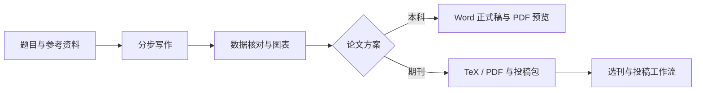

**从题目与资料，到论文、图表与自动化投稿。**

四大模块接力 · 可编排提示词 · 内置 Codex SDK · Word / PDF · 智能投稿与监控

[English](README.en.md) · [论文案例](#先看论文产出) · [功能实拍](#功能实拍) · [快速开始](docs/GETTING_STARTED.md) · [路线图](docs/ROADMAP.md) · [参与贡献](CONTRIBUTING.md)

### [⬇ 下载 Windows 安装预览版](https://github.com/TYSJY/unified-paper-workbench/releases/tag/v0.12.0b11-preview)

内置 Python、Qt 和 Codex SDK · 首次安装自动建立空白工作区 · [安装与依赖说明](docs/WINDOWS_PREVIEW.md)

---

大一统是一个 **运行在本地的 AI 论文全流程桌面工作台**。写论文、图表与插图、选刊与作者、智能投稿四个模块在同一个工作区接力；你可以编辑每一步提示词、添加自己的 Step、设置模型与并发，并直接查看 Word / PDF 产物和投稿状态。

> **开源预览状态**：源码采用 AGPL-3.0。Windows `0.12.0b11` 安装预览版附带干净工作区模板，已验证安装、首次工作区初始化与隔离 GUI 启动；完整付费 AI 研究流程与跨电脑验证仍在完善。软件截图使用虚构演示任务与账号，论文案例来源单独标注。

## 先看论文产出

公式推导、系统架构图、算法、对比实验图、消融图和结果表格，放进同一份论文排版中。

<table>
<tr><th width="50%">方法与系统设计</th><th width="50%">结果与图表排版</th></tr>
<tr>
<td valign="top"></td>
<td valign="top"></td>
</tr>
</table>

点击图片可查看原始大图。以上为用户提供的论文节选，用于展示文档与图表效果；截图中的实验数值和结论不构成已核验研究或录用证明。

## 为什么做它？

写论文往往散落在聊天窗口、文档、脚本、图片和文件夹之间。你需要知道的不只是“AI 回答了什么”，还包括 **做到哪一步、用了哪份材料、生成了什么、下一步该处理什么**。

大一统把这些信息放进可恢复的论文工作区。AI 负责具体内容任务，程序负责排队、阶段状态和产物检查。

## 你可以用它做什么

| 场景 | 工作台提供的能力 |
|---|---|
| 期刊论文 | 研究选题、资料整理、分步写作、修改与图表交接 |
| 本科毕业论文 | 输入题目、导入学校要求，选择人文社科或计算机软件提示词方案 |
| 数据与图表 | 图表规划、数据核对、生成脚本与图文整合，查看阶段产物 |
| Word / PDF 交付 | 本科 Word 正式稿与排版预览；期刊 TeX / PDF；直接打开正文 PDF 或产物目录 |
| 多篇论文管理 | 并发队列、暂停与继续、每篇论文的固定会话及流程快照 |
| 提示词与流程编排 | 按模块编辑每步提示词；添加、排序、删除自定义 Step，保留运行中论文的流程快照 |
| 模型与用量控制 | 从当前 SDK 目录检测模型和推理档位，配置模块或单步模型、Token 上限和并发 |
| 内置 Codex SDK | 在软件内连接 ChatGPT 账号，支持浏览器授权与设备码登录；每篇论文保持自己的执行会话 |
| 账号与投稿站点 | 统一查看邮箱、投稿系统、外部服务与期刊记录；默认隐藏个人信息，凭据由本地代理处理 |
| 自动化投稿 | Smart Submission 衔接站点登录、表单、上传、提交策略与回执核对，支持暂停和人工接管 |
| 投稿状态监控 | 按本地时间定时检查或立即检查，汇总待处理状态，衔接退修与后续处理 |

## 功能实拍

以下均为真实软件界面，使用隔离工作区和虚构记录。模型目录为演示数据，实际可选项由用户 SDK 检测；演示未调用模型、未连接真实投稿账号、未提交稿件。

### 每个模块、每个 Step，都能配置

在设置里切换模块，分别设置 **并发上限、默认模型、推理强度**；具体 Step 可以继承默认值，也可以单独设置模型、推理强度与 Token 上限。

### 让软件执行你自己的流程

为现有模块新增 Step，编辑完整提示词，再调整执行顺序。图中第 11 步“交付前检查与答辩材料整理”就是通过工作流存储新增并保存的自定义步骤。

<table>
<tr><th width="50%">新增、排序与删除 Step</th><th width="50%">直接编辑并保存提示词</th></tr>
<tr>
<td></td>
<td></td>
</tr>
</table>

四大模块目前固定，可自定义的是模块内的步骤。修改后的方案用于之后启动或重试的任务，已运行任务保留启动时的流程快照。

### 内置 SDK，在软件里连接 AI

通过 **AI 账号**页连接 ChatGPT，支持浏览器授权与设备码登录。程序负责队列、并发、重试和阶段交接，SDK 会话执行每篇论文的具体任务。

### 账号、站点与期刊，一处管理

邮箱、投稿系统、外部服务、投稿站点和期刊记录按分类管理；同一账号的不同来源可合并展示。**“隐藏个人敏感信息”默认开启**，邮箱和登录账号在列表与详情中同时遮挡。密码由本地可信凭据代理填入浏览器，不交给 AI。

查看投稿站点与关联记录界面

### 自动化投稿，还能持续跟踪状态

投稿中心把稿件和后续状态放进队列。投稿只使用 Smart Submission，在已适配且获授权的站点中处理登录、表单和文件上传，按所选策略执行最终提交并核对回执；需要用户处理的环节可以暂停后继续。

<table>
<tr><th width="50%">投稿策略由你决定</th><th width="50%">定时检查投稿状态</th></tr>
<tr>
<td></td>
<td></td>
</tr>
</table>

可以配置账号缺失处理、ORCID 登录与授权、条款确认、最终提交开关，以及每日状态检查时间。自动监控由本地程序运行；遇到站点验证或需要人工决定的事项，界面会保留处理入口。

### 给论文一个明确的交付终点

在“图表与插图”选中论文，点击 **打开论文 PDF**；从 **选中论文操作 → 打开当前阶段产物目录** 进入对应文件夹。

本科方案以可编辑 Word 为交付目标，TeX 可以作为中间稿。Word 排版和 PDF 渲染目前需要本机 Microsoft Word。

### 给不同论文使用不同方案

- **原期刊版**：研究与期刊稿件工作流。
- **本科人文社科版**：从题目和学校要求开始组织写作。
- **本科计算机软件版**：围绕需求、设计、实现、测试与图表组织内容。

方案和执行配置会绑定到新建论文；在运行的论文保留自己的流程快照。

## 快速开始

1. 下载 [Windows 安装预览版](https://github.com/TYSJY/unified-paper-workbench/releases/tag/v0.12.0b11-preview)，安装后从桌面或开始菜单打开，无需先安装 Python。
2. 首次安装会准备空白工作区和流程模板，在设置中连接自己的 ChatGPT / Codex SDK 账号。
3. 选择提示词方案，创建论文任务；本科方案填写题目并导入学校要求。
4. 按界面提示检查资料、数据和产物，再继续后续阶段。

AI 服务需要用户自己的账号或凭据，并可能产生模型用量。**本地工作台不等于离线模型**，执行 AI 任务时相关输入会发送给你连接的服务。

## 工作流

程序管理队列和阶段状态，Codex SDK 执行具体内容步骤，文件产物接受独立检查。支持运行时切换简体中文和英文；顶部“紧急停止”用于停止后续自动推进，具体安全暂停行为以正在执行的任务为准。

## 当前边界

- Windows 桌面为当前验证环境；没有宣称 macOS / Linux 已经可用。
- 安装包提供干净模板与 GUI；完整研究执行仍取决于模型授权、输入材料及 Word / LaTeX 等外部依赖，尚未宣称跨电脑完成全部流程。
- 模型可用性取决于账号和当前 SDK 返回的目录；不会把一个硬编码名称当成已支持。
- 模拟数据用于调试或明确披露的模拟研究，不能当成已完成的真实调研或实验。参考文献、结论和最终提交材料需要核验。
- 开源预览不承诺论文录用、学位通过或任意期刊站点都能自动操作。

[详细能力与依赖](docs/FEATURES.md) · [隐私边界](PRIVACY.md) · [安全反馈](SECURITY.md)

## 一起把它做成真正好用的工具

我们优先欢迎这些贡献：

- **独立用户试用**：在不同 Windows 电脑验证安装、工作区与第一篇示例。
- **Word 与图表**：学校模板、排版反馈、可复现绘图示例。
- **可靠性与体验**：清晰的卡点、文件入口、恢复流程和错误提示。
- **文档与语言**：英文说明、安装指南、演示视频和匿名示例。

先看 [贡献指南](CONTRIBUTING.md) 与 [路线图](docs/ROADMAP.md)，再提交 Issue 或 PR。

如果这个方向对你有用，欢迎 Star 关注后续进展，也欢迎带着具体使用问题来改进它。

## 许可证

项目自有源码以 [GNU AGPL v3.0](LICENSE)（`AGPL-3.0-only`）发布。商用同样需要遵守许可证；第三方组件遵循各自许可，见 [THIRD_PARTY_NOTICES.md](THIRD_PARTY_NOTICES.md)。
