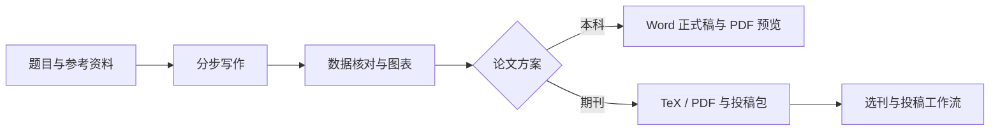

**从一个题目，到看得见进度的论文工作区。**

写作 · 图表 · Word / PDF · 选刊与投稿流程

[English](README.en.md) · [快速开始](docs/GETTING_STARTED.md) · [能力与限制](docs/FEATURES.md) · [路线图](docs/ROADMAP.md) · [参与贡献](CONTRIBUTING.md)

---

大一统是一个 **运行在本地的 AI 学术写作桌面工作台**。把题目、学校要求、参考资料、分步写作、图表和交付文件放在同一个工作区里，用可视化界面管理进度、模型、提示词和需要人工处理的环节。

> **开源预览状态**：源码采用 AGPL-3.0。当前桌面校验版本为 `0.12.0b11`。完整流程仍有历史工作区模板依赖，干净安装与公共发行包正在整理；具体边界见[快速开始](docs/GETTING_STARTED.md)。截图由真实 Qt 界面渲染，使用虚构演示任务，不展示真实论文或账号。

## 为什么做它？

写论文往往散落在聊天窗口、文档、脚本、图片和文件夹之间。你需要知道的不只是“AI 回答了什么”，还包括 **做到哪一步、用了哪份材料、生成了什么、下一步该处理什么**。

大一统把这些信息放进可恢复的论文工作区。AI 负责具体内容任务，程序负责排队、阶段状态和产物检查。

## 你可以用它做什么

| 场景 | 工作台提供的能力 |
|---|---|
| 期刊论文 | 研究选题、资料整理、分步写作、修改与图表交接 |
| 本科毕业论文 | 输入题目、导入学校要求，选择人文社科或计算机软件提示词方案 |
| 数据与图表 | 图表规划、数据核对、生成脚本与图文整合，查看阶段产物 |
| Word / PDF 交付 | 本科 Word 正式稿与排版预览；期刊 TeX / PDF；直接打开正文 PDF 或产物目录 |
| 多篇论文管理 | 并发队列、暂停与继续、每篇论文的固定会话及流程快照 |
| 模型与提示词 | 从当前 SDK 目录检测模型和推理档位，配置阶段或单步参数 |
| 选刊与投稿工作流 | 管理投稿包和状态；投稿只使用 Smart Submission，具体站点依赖用户授权与适配 |

### 给论文一个明确的交付终点

在“图表与插图”选中论文，点击 **打开论文 PDF**；从 **选中论文操作 → 打开当前阶段产物目录** 进入对应文件夹。

本科方案以可编辑 Word 为交付目标，TeX 可以作为中间稿。Word 排版和 PDF 渲染目前需要本机 Microsoft Word。

### 给不同论文使用不同方案

- **原期刊版**：研究与期刊稿件工作流。
- **本科人文社科版**：从题目和学校要求开始组织写作。
- **本科计算机软件版**：围绕需求、设计、实现、测试与图表组织内容。

方案和执行配置会绑定到新建论文；在运行的论文保留自己的流程快照。

## 快速开始

1. 阅读[安装与当前可运行范围](docs/GETTING_STARTED.md)。目前优先支持 Windows 桌面环境。
2. 准备论文工作区与流程模板，在设置中连接自己的 ChatGPT / Codex SDK 账号。
3. 选择提示词方案，创建论文任务；本科方案填写题目并导入学校要求。
4. 按界面提示检查资料、数据和产物，再继续后续阶段。

AI 服务需要用户自己的账号或凭据，并可能产生模型用量。**本地工作台不等于离线模型**，执行 AI 任务时相关输入会发送给你连接的服务。

## 工作流

程序管理队列和阶段状态，Codex SDK 执行具体内容步骤，文件产物接受独立检查。支持运行时切换简体中文和英文；顶部“紧急停止”用于停止后续自动推进，具体安全暂停行为以正在执行的任务为准。

## 当前边界

- Windows 桌面为当前验证环境；没有宣称 macOS / Linux 已经可用。
- 完整研究流程仍需整理历史模块的模板与工具，当前仓库还不是零配置的一键发行版。
- 模型可用性取决于账号和当前 SDK 返回的目录；不会把一个硬编码名称当成已支持。
- 模拟数据用于调试或明确披露的模拟研究，不能当成已完成的真实调研或实验。参考文献、结论和最终提交材料需要核验。
- 开源预览不承诺论文录用、学位通过或任意期刊站点都能自动操作。

[详细能力与依赖](docs/FEATURES.md) · [隐私边界](PRIVACY.md) · [安全反馈](SECURITY.md)

## 一起把它做成真正好用的工具

我们优先欢迎这些贡献：

- **干净安装与工作区模板**：让第一次下载的用户也能完成演示。
- **Word 与图表**：学校模板、排版反馈、可复现绘图示例。
- **可靠性与体验**：清晰的卡点、文件入口、恢复流程和错误提示。
- **文档与语言**：英文说明、安装指南、演示视频和匿名示例。

先看 [贡献指南](CONTRIBUTING.md) 与 [路线图](docs/ROADMAP.md)，再提交 Issue 或 PR。

如果这个方向对你有用，欢迎 Star 关注后续进展，也欢迎带着具体使用问题来改进它。

## 许可证

项目自有源码以 [GNU AGPL v3.0](LICENSE)（`AGPL-3.0-only`）发布。商用同样需要遵守许可证；第三方组件遵循各自许可，见 [THIRD_PARTY_NOTICES.md](THIRD_PARTY_NOTICES.md)。
