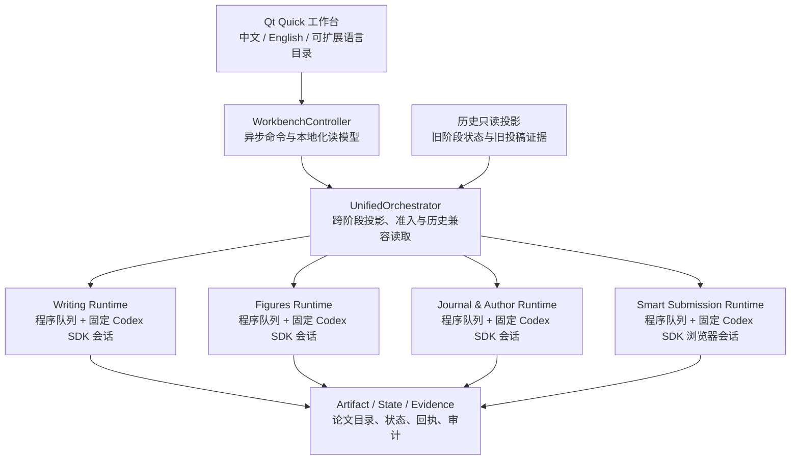

# 架构说明

## 当前产品定位（0.11.3）

大一统论文智能工作台是一个 Windows 单机“模块化单体”：一个正式 EXE、一套可切换论文工作区、一个统一状态投影，以及四个按阶段隔离的执行模块。Qt Quick 是唯一正式桌面壳层；旧 Tk 经典控制台和旧稳定投稿执行入口已退出产品路径。



## 分层职责

### 1. 产品与呈现层

- `unified_paper_orchestrator/ui_next/qml/`：品牌头部、阶段导航、操作栏、虚拟化论文列表、详情、确认框和响应式布局。
- `unified_paper_orchestrator/ui_next/i18n.py` 与 `locales/`：QML 和 Python 读模型共用的语言目录、回退与持久化。
- `unified_paper_orchestrator/ui_next/models.py`：只在内存中搜索、筛选、切换阶段，不扫描磁盘。
- `unified_paper_orchestrator/ui_next/read_model.py`：把各时期状态投影为稳定的状态、进度、下一动作和安全摘要，不回写业务数据。

### 2. 应用协调层

- `ui_next/controller.py` 只负责把用户意图交给现有应用服务；耗时操作进入线程池。
- `orchestrator.py` 负责统一状态、跨阶段准入、工作区交接和历史兼容读取。
- `full_pipeline.py` 负责从写作到智能投稿的连续交接；它不调用 AI 决定谁占并发槽。
- 调度、并发、Step 顺序、暂停和恢复属于程序逻辑；模型只处理阶段内需要语言理解或生成的工作。

### 3. 阶段执行层

| 阶段 | 主要执行器 | 会话规则 | 阶段完成依据 |
|---|---|---|---|
| 写论文 | Writing SDK runtime | 一篇论文一个固定会话，按配置 Step 顺序执行 | 当前工作流全部 Step 与产物契约通过 |
| 图表与插图 | Figures SDK runtime | 一篇论文一个固定会话 | 图表 Step 与图表产物契约通过 |
| 选刊与作者 | Journal/Author SDK runtime | 一篇论文一个固定会话 | 选刊、作者资料和投稿包契约通过 |
| 投稿中心 | Smart Submission program + SDK runtime | 一篇论文一个固定网页会话 | 提交回执、稿号或明确监控/人工状态落账 |

阶段内部调优提示词仍由各阶段自己的配置管理，本次产品切割不改写这些提示词。

## 投稿单路线

0.11.1 起，新版只允许下面的可执行路径：

```text
选刊作者投稿包完成
        ↓
程序扫描合格论文并完成本地预检
        ↓
写入 Smart 路线与 online queue
        ↓
程序并发槽派发固定 Codex SDK 会话
        ↓
网页 / 邮箱 / 回执证据落账
        ↓
监控、返修、转投或完成
```

- Qt 投稿页不会调用旧 `start_stage("submission")`。
- 旧稳定投稿文件只用于读取历史稿号、确认网址、回执和重复投稿风险；不再新增队列或自动回退。
- 历史状态仍保留，是为了证据连续性，不代表旧执行器仍是产品功能。
- 账号与站点是独立业务窗口，不是经典控制台入口。

## 状态与文件

当前工作区根目录由用户选择并显式显示。主要状态位于工作区 `state/`，论文产物位于 `stages/`；程序源码和正式 EXE 不再要求论文必须存放在源码目录中。

关键原则：

- 任务状态、论文文件和网页/邮件证据分别保存，但通过论文 ID、attempt、route revision 和会话 ID 关联。
- 统一状态是 UI 读模型和跨阶段准入依据；各 SDK journal 仍保存阶段级恢复细节。
- 旧外部项目和旧投稿状态是兼容输入，不是新版写入目标。
- `state/**` 可能包含账号元数据、浏览器证据和本地凭据，不进入 Git。

## 运行不变量

- 一篇论文在一个阶段同一时刻最多一个执行租约。
- 同一篇论文的同一 Step 重试沿用冻结的模型、推理强度、提示词指纹和固定会话。
- 上游阶段未完成时不自动进入下游；人工越级必须留下显式事件。
- 暂停在当前 Step 或网页动作结束后生效，不强杀正在写文件的动作。
- 已有稿号、回执或最终点击不确定时，禁止创建第二次投稿尝试。
- 确定性动作不调用模型；网页语义无法可靠确定时才交给 SDK 或人工接管。
- Qt 启动失败时明确失败，不回退到行为不同的旧控制台。

## 多语言扩展

- `zh_CN.json` 是回退目录，`en_US.json` 是首个第二语言目录。
- 所有语言目录必须拥有相同叶子键；测试会阻止缺键发布。
- 新语言文件提供 `_meta.code`、`label`、`short_label` 和完整键集后会自动出现在语言选择器中。
- 语言选择保存到工作区 UI 偏好，不修改论文内容或阶段提示词。

## 发布与恢复

- 正式构建只发布 `dist/UnifiedPaperOrchestrator.exe`。
- PyInstaller 包含 QML、图标、语言目录和必要执行器，明确排除经典 `ui.main_window`。
- 构建前运行完整测试，候选 EXE 通过 CLI 探针后才替换 `dist/`。
- 0.11.1 EXE 与本次英文布局修复前源码快照独立保存在 `releases/`；需要恢复时回退完整版本，不在新版中重新混入旧入口。
