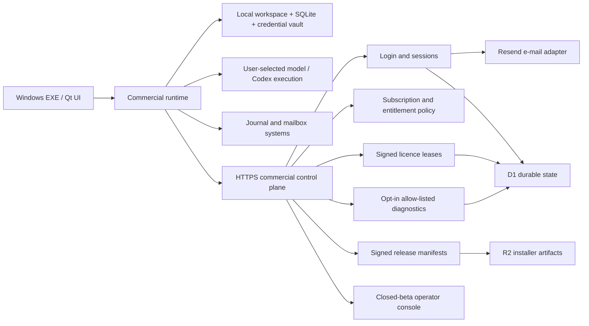

# Commercial control-plane architecture

## Decision

The commercial product is a local-first Windows desktop application backed by
a small cloud control plane. Manuscripts and workflow execution stay local;
the cloud service owns identity, subscriptions, device activation, signed
policy, signed updates, and optional privacy-minimised diagnostics.

## Desktop responsibilities

- select and switch a local paper workspace;
- execute writing, figures, journal/author, and submission workflows;
- keep workflow state and generated artifacts locally;
- store model and site credentials in local protected storage;
- maintain a random installation/device identity;
- verify purpose-bound signed licences and release manifests;
- allow bounded offline operation;
- gate only new commercial actions when entitlement is unavailable;
- never force-kill an already running paper because a refresh failed.

The 0.12.0b3 source tree has two immutable build profiles:

- `Internal` keeps commercial enforcement disabled, performs no commercial
  network request by default, and preserves the 0.11.6 local behaviour.
- `CustomerClosedBeta` forces account and licence enforcement, removes runtime
  control-plane configuration, rejects development keys, and enters read-only
  mode after entitlement expiry without deleting local papers.

The selected `distribution_policy.json` and public-only trust keyring are
staged by `tools/prepare_release_profile.py` and embedded by PyInstaller. They
are not user preferences and cannot be disabled from the customer UI.

## Control-plane responsibilities

- one-time-code login and bearer sessions;
- closed-beta applications, invitation codes, allow-list admission, and
  operator review;
- subscription plan and device-limit policy;
- activation, refresh, revocation, and licence audit;
- policy catalogue, multipart installer upload, signed release publication,
  byte-range download, and release rollback;
- administrator audit records and bounded manual-code fallback for operated
  closed-beta incidents;
- diagnostic receipt after strict desktop and server validation.

Two compatible control-plane adapters now exist:

- `commercial_control_plane/` is a deterministic loopback implementation that
  uses SQLite for contract, desktop, and offline-lease tests. It must never be
  exposed as a customer service.
- `product_site/worker/control-plane/` is the production-shaped Cloudflare
  Worker used by either Sites or a direct Workers deployment. It uses D1 for
  identity, applications, sessions, subscriptions, devices, licence audit,
  release metadata, and operator audit; R2 stores customer installers; Resend
  is the e-mail delivery adapter; the website, member centre, invite
  activation, and operator console use the same API origin.

Both adapters preserve the same signed desktop contracts. Website access
control and product-account access are separate boundaries: Sites must allow a
visitor to reach the public origin before the application's invite/allow-list
policy can run.

If a Sites workspace forbids public access, the saved Sites version remains a
rollback baseline and `product_site/scripts/cloudflare-deploy.mjs` deploys the
same compiled Worker directly. Its ignored resource-state file prevents later
deployments from silently provisioning a second D1 database or R2 bucket.

The production Worker implements deterministic routing and state transitions.
It does not ask a model to authenticate users, allocate devices, issue
licences, publish releases, or decide subscription state.

## Signed contracts

All envelopes use canonical JSON, Ed25519, a signing-domain separator, key ID,
and an explicit purpose:

- `license` cannot be replayed as `release`;
- `release` cannot be replayed as `policy`;
- product, audience, device, user, expiry, and entitlement claims are verified
  locally;
- the cached licence has an offline grace window and clock-rollback guard.

Machine-readable schemas are under `contracts/commercial/`.

## Key custody

The repository and EXE contain public keys only. Production private keys must
be generated and held by a managed KMS/HSM or an equivalently controlled
offline signing service. The release pipeline injects a reviewed public key
using `tools/inject_commercial_public_key.py`.

The checked-in keyring is intentionally empty. An internal build can therefore
preserve local compatibility without trusting a commercial issuer. A customer
build fails before packaging unless `-CommercialPublicKeyPath` identifies a
valid reviewed Ed25519 public key; private keys are rejected and never enter
the repository or EXE.

The 0.12.0b3 closed-beta Worker currently receives its private key through a
secret Sites environment variable. That is acceptable only for a bounded
candidate. Public paid release still requires managed KMS/HSM custody,
rotation, revocation, and recovery procedures.

## Release path

The customer build freezes its HTTPS origin and reviewed public key. The
operator then builds a per-user Windows installer and publishes it with
`tools/publish_customer_release.ps1`. The tool:

1. reads the administrator key from an external file;
2. computes installer size and SHA-256;
3. performs retryable R2 multipart upload;
4. completes the upload and requests a purpose-bound signed release envelope;
5. reads the public latest-release endpoint and verifies the returned version,
   channel, hash, and size.

The desktop independently verifies the envelope, product ID, signature,
artifact size, and SHA-256 before accepting an update. The download endpoint
supports byte ranges for resumable transfers.

## Failure semantics

- network unavailable with a valid cached lease: continue;
- lease expired but inside offline grace: continue and recommend refresh;
- grace or subscription expired: block new entitled starts;
- malformed/tampered licence or wrong product/audience/device: block;
- update signature/hash/size mismatch: reject artifact;
- diagnostic contract violation: keep or reject locally; never upload raw data.
