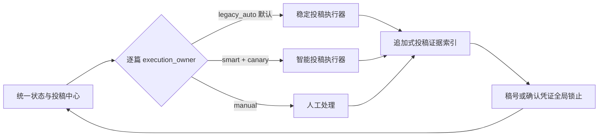

# 双轨投稿策略

> **历史文档：** 本策略适用于 0.11.0 及更早版本。0.11.1 已结束产品双轨：新版只执行 Smart Submission，旧稳定投稿仅保留历史只读证据。当前设计以 `docs/ARCHITECTURE.md` 和 `docs/RELEASE_0.11.1.md` 为准。

## 决策

稳定投稿和智能投稿长期并存，不做“新系统最终替代旧系统”的默认假设。

| 通道 | 定位 | 默认状态 | 适用范围 |
|---|---|---|---|
| 稳定投稿 | `New project 11 + auto-paper-submission skill` | 默认生产通道 | 日常投稿、监控、修回和成熟站点 |
| 智能投稿 | Smart Submission | 暂停或单篇试运行 | 新适配器验证、精细证据链、确有优势的任务 |
| 人工处理 | 用户直接处理 | 按论文显式选择 | 自动化不适合或需要本人完成的动作 |

统一项目不是第三个投稿执行器。它只负责逐篇路由、跨通道互斥、证据聚合、冲突提示和界面展示。



## 路由与状态不变量

每篇论文在统一状态中保存：

```json
{
  "execution_owner": "legacy_auto",
  "mode": "production",
  "revision": 1
}
```

- `execution_owner` 只能是 `legacy_auto`、`smart` 或 `manual`。
- `mode` 只能是 `production`、`shadow` 或 `canary`。
- 默认永远是 `legacy_auto + production`。
- 仅创建、导入或预检 Smart 记录不改变 owner。
- 路由切换使用 revision/CAS；陈旧界面不能覆盖较新的决定。
- 任一路径在在线队列、执行中、最终提交结果不明或已有终态证据时，拒绝切换。
- owner 不是 `legacy_auto` 时，Master Scheduler 和 submission adapter 都拒绝写稳定投稿队列。

## 有效状态与证据优先级

统一界面把“事实状态”和“允许谁执行”分开：

1. 任一路径有已接收证据：显示已接收并锁止两条路径。
2. 任一路径有稿号、有效确认网址或存在的本地确认文件：显示已投稿/监控并锁止两条路径。
3. 已尝试最终提交但结果未知：显示待核对并锁止两条路径。
4. 没有上述证据时：只采用 `execution_owner` 对应通道的状态。
5. Smart 的 `blocked`、`waiting`、`monitoring`、`submitted` 或 `accepted` 字符串本身不是终态证据。

禁止按更新时间简单选择“最新状态”，也禁止 Smart 仅因存在记录就取得控制权。

## 智能投稿开放方式

### 本地预检

- 必须选择论文，不默认批量处理全部论文。
- 不改变 `execution_owner`。
- 当前仍会写 Smart state/audit，因此不称为真正 shadow。

### 真正影子模式的完成条件

- 提供 `persist=False` 或等价只读入口。
- 不修投稿包、不导入凭据、不写队列、不创建浏览器任务。
- 至少比较 20 次决策并覆盖 3 类投稿系统；目标一致率不低于 95%。

### 单篇试运行

- 用户逐篇显式选择；一次只允许一篇。
- 切换为 `smart + canary` 后才允许在线入队。
- 已有其它 Smart 在线队列或执行任务时拒绝启动。
- 不自动改投，不处理已有 active 投稿或稿号的论文。
- 建议累计至少 10 次单篇在线动作或观察 30 天，再决定哪些站点可以长期选择性使用。

稳定投稿始终保留为默认通道，不存在因达到 canary 指标就自动下线稳定投稿的阶段。

## Token 成本

本地文件字符量不是实际计费 token，但可以作为相对负载代理。当前抽样：

- 稳定投稿的 automation、prompt 和 state 约 64.8k 字符。
- Smart 的 automation、prompt、state、账号和站点材料约 307k 字符。
- Smart 基础上下文约为稳定投稿的 4.7 倍，单论文任务还会重复加入作者、期刊、声明、manifest 和 metadata 片段。

主要成本来自 scheduler/worker 分层、重复上下文、浏览器健康检查、恢复与清理、并行会话和完整文件片段嵌入。下一步应让 scheduler 只传 2–8 KB 的紧凑任务信封：

```text
paper_id
execution_owner / action
target lock
verified author and declaration fields
upload paths
evidence references
hard-stop flags
```

浏览器、邮箱和审计正文只在执行任务确实需要时按引用加载。

## 账号迁移边界

- 旧 DPAPI 库是加密主库；Smart 旧明文记录是兼容数据。
- 绝不把 DPAPI 批量解密后写入 Smart 明文文件。
- 新增账号默认写 DPAPI。
- Smart 记录只有显式确认后才复制到 DPAPI；当前执行器仍依赖旧字段，因此复制后先保留明文，待 resolver 支持 `credential_ref` 并完成回归测试后再单独清理。
- 每次写入前备份，删除前二次确认，审计不含秘密。

## 立即暂停 Smart 的条件

以下任一情况出现一次即暂停 Smart canary：

- 产生重复投稿风险；
- 操作错误期刊、错误草稿或错误论文；
- 最终提交后无法确认结果；
- 没有证据却写入已投稿、监控中或已接收；
- 密码、验证码或私人邮件内容进入日志、聊天或普通审计；
- 状态损坏、跨进程争用或无法恢复的半写入。

回滚只暂停 Smart 并保留状态和证据。只要发生过上传、网页写入或最终提交尝试，就不能自动交回稳定投稿重新提交；必须先核对，必要时只能让稳定通道接管监控。

## 后续度量

按论文、站点和动作类型持续记录：

- 实际输入/输出 token；
- 调度器和执行任务回合数；
- 工具调用数和人工干预次数；
- 成功率、p95 完成时间；
- 陈旧任务、等待授权和重复恢复次数；
- 每个有效投稿事件的 token 成本。

这些指标用于判断 Smart 在哪些局部任务上值得使用，不用于证明稳定投稿必须被替代。
