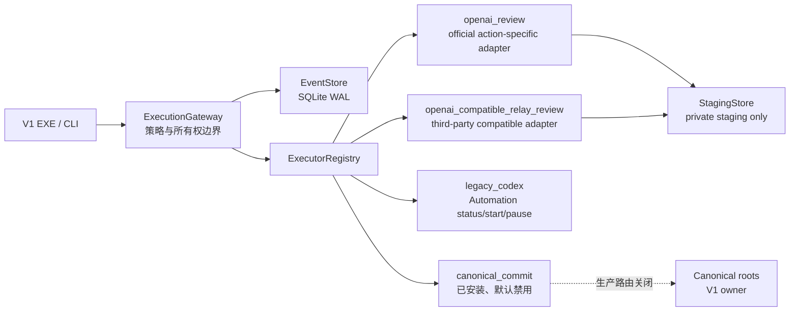

# 0.4.4 快速多执行器网关

## 状态与目标

0.4.4 在不修改 V1 界面、现有业务功能和内部 Prompt 的前提下，引入同进程
`ExecutionGateway`。它把“任务意图与权限校验”和“具体执行方式”分开，但不接管现有生产流程。

当前边界是：

- V1 GUI 仍是唯一产品界面。
- 写论文、画图、选刊作者的现有内部 Prompt 不改。
- 稳定投稿仍由原自动投稿流程负责；Smart 投稿仍由其现有调度器和可见 worker 负责。
- 网关没有投稿、终稿提交或其他 final-submit action。
- 网关中的正式写入门已经安装，但默认和生产路由始终关闭；正式产物 owner 仍是 V1 既有工作流。

本文描述 0.4.4 当前代码合同。加入独立中转执行器后，先前记录的全量测试数量、EXE 时间/大小/哈希与“已完成验收”结论均已过期；必须在最终源码冻结后重新运行全量测试、构建和 verifier。真实联网 canary 也不能预先视为成功。

## 总体运行路径



`ExecutionGateway` 不是第二个调度器。它不常驻、不轮询队列、不自动重试，也不在执行器失败时切换到
其他执行器。每次执行都必须由显式命令或受控调用触发。

## `dispatch_owner` 原子隔离

每个任务在 SQLite 中持久化 `dispatch_owner`，值只能是 `kernel` 或 `gateway`。网关提交时会把信封 owner
固定为 `gateway`；普通 V2 内核任务保持 `kernel`。

所有权不是仅靠上层约定：

- `claim_task` 在同一事务内按 `task_id + status + dispatch_owner` 条件领取并更新。
- `complete_task`、审批决定、取消和重新入队都核对持久化 owner。
- 内核 dispatcher 只领取 `kernel` 任务，网关只领取 `gateway` 任务，双方不能“偷取”对方任务。
- 实验性 V2 HTTP API 和 V2 直接 CLI 拒绝创建声明为 `gateway` 的信封，也拒绝审批、取消、重试或
  显式执行已有的 gateway-owned 任务。
- 直接内核 dispatcher 只放行 deterministic 的 `system.noop` / `artifact.verify`、`human`，以及只读
  `legacy.plan`。模型调用和有副作用的执行器必须经过 `ExecutionGateway`。

因此，本地 V2 API 不能伪造或改变网关任务的执行所有权；创建和变更 gateway-owned 任务必须经过
网关表面。

## 网关责任

网关负责：

1. 校验 `stage + action + executor` 白名单。
2. 校验网络、工具和可写根目录能力。
3. 建立持久、幂等的 `TaskEnvelope` 与事件记录。
4. 为需要审批的任务建立与完整任务意图绑定的审批记录。
5. 显式领取一个 gateway-owned queued 任务并调用指定执行器。
6. 对论文审阅结果执行确定性 validator，并在远程调用前后复核全部输入 SHA-256。
7. 只把合格审阅结果写入 private staging。

网关不负责：

- 自动派发、自动重试、自动故障转移或后台心跳。
- 把 API 审阅结果直接覆盖到论文正式目录。
- 执行稳定投稿或 Smart 投稿。
- 在缺少 key、model、审批或权限时回退到 Codex、浏览器或通用 OpenAI 端口。

## 官方 OpenAI 与第三方兼容中转审阅执行器

### 只有 action-specific 路由

0.4.4 开放两个彼此隔离、不能互换或自动 fallback 的审阅 action：

```text
writing.review_round_1.canary -> openai_review
writing.review_round_1.compatible_relay_canary -> openai_compatible_relay_review
```

第一条仍是原有官方 OpenAI 路由，固定官方端点，合同不因新增中转而改变。第二条是独立第三方兼容路由，固定
`endpoint_base_url=https://www.qilinapi.com`、`wire_api=responses` 和
`provider_profile=qilinapi_responses_v1`。网关要求 action/executor/provider/endpoint digest 精确匹配；官方失败任务不能改写 executor 后重试，中转 canary 必须新建任务。

历史通用执行器 `openai_api` 仅为持久化信封/导入兼容而保留，永久标记为 unavailable。无论传入什么
prompt，它都返回 `OPENAI_GENERIC_ROUTE_DISABLED`，不会构造客户端或发起请求。后续每个模型 action
都必须有独立 adapter、输入哈希合同、能力策略、validator 和 staging/commit 边界。

### 输入与 Prompt 不变性

两个审阅 action 读取同一组版本化输入：

- `ideas/<paper_id>.md`
- `refs/<paper_id>/references.md`
- `refs/<paper_id>/literature_map.md`
- `refs/<paper_id>/novelty_check.md`
- `papers/<paper_id>/draft_v3.tex`
- `prompts/07_review_round_1.md`

信封保存路径、角色和 SHA-256，不把全文写进 SQLite。Prompt 07 按其已声明的 fallback 规则在内存渲染，渲染结果作为
Responses API 的 `instructions`；上述五份论文文件按固定角色组装为 `input`。官方 action 把两者发送到 OpenAI
官方 API；中转 action 把两者发送给第三方麒麟兼容端点。20 份内部 Prompt 文件均保持原字节，任何 action 都不会改写它们；但“未改写”不等于“未披露”，Prompt 07 的渲染正文仍会随论文输入离开本机。

中转 action 必须声明 `third_party_data_disclosure_ack=true` 并使用持久的 required approval。审批 intent 绑定完整信封，包括输入哈希、所选 model、固定 endpoint、provider profile/assurance 与预算；操作者必须看到并原样回传完整 `intent_sha256`。缺少披露确认、审批或任一绑定字段时 fail closed。

### 网络与请求边界

#### 官方 `openai_review`

官方执行器只进行一次 `client.responses.create(...)`：

```python
response = client.responses.create(
    model=model,
    instructions=instructions,
    input=input_text,
    store=False,
    max_output_tokens=max_output_tokens,
)
```

- 固定官方端点 `https://api.openai.com/v1`，忽略 `OPENAI_BASE_URL`。
- `httpx.Client(..., trust_env=False)`，不继承 `HTTP_PROXY`、`HTTPS_PROXY` 或 `ALL_PROXY`。
- 默认直连并记录 `transport_policy=direct_no_env_proxy`。必须使用本机代理时，只读取独立的
  `UNIFIED_OPENAI_HTTPS_PROXY`，且只接受无凭据、显式端口的 HTTP loopback URL；通过后记录
  `transport_policy=explicit_loopback_proxy_no_env`。远程 host、用户信息、路径、query、fragment 和其他 scheme
  全部拒绝，代理 URL 本身不写入 ledger。
- SDK `max_retries=0`，任务允许一次显式请求，不由 SDK 自动放大调用次数。
- 若连接中断后无法确定 API 是否已接受或计费，该任务不得普通重试。重新入队必须由操作者显式传入
  `--acknowledge-possible-duplicate-charge`，承认可能的重复请求/计费；该 acknowledge 只记录人工决定，不是“上次未执行”的证明。
- `allowed_tools` 必须为空，不声明 web search、browser、code interpreter 或函数工具。
- 联网前检查 `estimated_input_tokens + max_output_tokens <= token_budget`；响应后再以
  `usage.total_tokens` 检查预算。前者是保守估算，不是服务端强制的总 token 限额。
- 生产客户端在调用后关闭；异常只留下稳定错误码和紧凑错误类型，不把原始异常内容写进合同。

如果运行环境需要代理但没有提供满足合同的显式 loopback CONNECT 代理，官方执行器会 fail closed；0.4.4 不会静默重新启用继承代理。

#### 第三方 `openai_compatible_relay_review`

中转执行器不是 `openai_review` 的 base URL 开关，而是独立 adapter：

- 只接受 `writing.review_round_1.compatible_relay_canary`，固定 base URL
  `https://www.qilinapi.com`，SDK 的 Responses 路径为 `/responses`；不从 `OPENAI_BASE_URL`、Codex
  `config.toml` 或其他任意配置读取 endpoint。
- 独立读取 `UNIFIED_RELAY_API_KEY`、`UNIFIED_RELAY_MODEL`，需要代理时只读取
  `UNIFIED_RELAY_HTTPS_PROXY`；不会读取或复用 `OPENAI_API_KEY`、`OPENAI_MODEL`、
  `UNIFIED_OPENAI_HTTPS_PROXY` 或 Codex `auth.json`。
- key 只存在于交互脚本及其子进程内存，不进入 SQLite、staging manifest、日志、命令行参数或磁盘配置。
- action 必须经过显式第三方数据披露确认和完整 intent SHA256 审批；创建任务本身不联网，审批后仍需显式单次派发。
- `provider_kind=third_party_openai_compatible_relay`、
  `provider_profile=qilinapi_responses_v1`、
  `provider_assurance=third_party_claim_unverified`。这些字段明确表示“接口按第三方兼容声明接入”，不证明请求最终到达 OpenAI，也不证明第三方返回的模型名称对应某个真实上游模型。
- 与官方执行器相同，`store=False`、无 tools、`max_retries=0`，输入前后做 SHA-256 校验，模糊失败不得自动重试，也不会自动转回官方/Codex 路由。

中转的无 key preflight 只能验证固定 `/responses` 端点可达并要求认证，不能证明 key 有效、响应结构满足合同、usage 真实或上游模型身份。只有真实联网 canary 返回并通过下文 receipt 校验后，才有本项目意义上的联网执行证据。

### 结果与 staging

通过结构 validator 和输入二次 SHA-256 后，仅写入：

```text
state/v2/staging/<run_id>/<task_id>/review_round_1.md
state/v2/staging/<run_id>/<task_id>/result.json
```

manifest 包含返回的 model、response ID、endpoint、transport policy、usage、输入/Prompt 哈希、验证结果、
`provider_kind`、`provider_profile`、`provider_assurance`、
`execution_attempt_token_sha256`、`source_unchanged: true` 和 `canonical_write: false`。首个 canary 只有 TeX 源码证据，不包含渲染 PDF 或
figure 像素；`evidence_scope=tex_source_only_no_rendered_figures` 不能被解释成视觉图件验收。

官方 profile 要求官方 endpoint/provenance；中转 profile 则必须保留 `third_party_claim_unverified`，不能把第三方响应包装成官方证据。两条路径都必须从真实 response JSON 取得非空 response ID 与正数 usage，并与 task/run、claim token、review hash 和输入 manifest 交叉绑定；离线 replay、手写 JSON 或第三方网页中的模型配置不能替代真实 canary。

`StagingStore` 只接受标准 `run_<32 hex>/task_<32 hex>`，拒绝 symlink、junction 和其他 Windows reparse
point；每任务用跨进程锁串行发布。两个文件在临时目录和原子 rename 后都按精确 bytes/hash 复核，manifest
还必须绑定 task/run/review hash 和本次原子 claim 写入 task row 的 `execution_attempt_token_sha256`。

正常的 queued dispatch 不接受事先存在的 task staging 目录，也不会把预存 pair 视为幂等结果。只有任务已处于
`running`、操作者显式调用 recovery，且 receipt 中的 `execution_attempt_token_sha256` 与该 task row 的本次 claim 精确一致时，才能
对账既有 pair。相同 pair 的幂等读取仅属于这个显式 recovery 边界；预存、旧 attempt 或 token 不匹配的 receipt 一律拒绝。

## `legacy_codex` Automation 兼容适配器

`legacy_codex` 不是占位描述器。它真实包装 V1 的 `SchedulerAutomationController`，支持：

```text
legacy.automation.status
legacy.automation.start
legacy.automation.pause
```

目标 stage 仅限 `writing`、`figures`、`journal_author`、`submission`。

- `status` 调用 `read_statuses`，只返回紧凑的 id/exists/status 统计，不需要审批。
- `start` / `pause` 调用 `set_enabled`，只切换对应 Codex Automation 配置；不执行论文、画图、选刊、
  投稿业务，也不取得业务状态写入权。
- start/pause 必须有显式 `operation_id`，任务策略必须为 `approval_policy=required`，且网络、工具和
  writable roots 全为空。
- 创建审批时，`intent_sha256` 绑定完整任务信封；执行前网关再次核对持久审批与当前信封，防止审批后
  意图漂移。
- 除审批外还需要独立 control latch：构造执行器时 `allow_control=True`，或仅在当前进程显式设置
  `UNIFIED_V2_ALLOW_LEGACY_AUTOMATION_CONTROL=1`。默认 latch 关闭。

`legacy.apply` 永久拒绝。这个端口只提供调度配置的受控启停能力，不改变稳定投稿、Smart 投稿或其他 V1
业务的生产 owner。

示例：

```powershell
# 只读状态可显式创建并执行
python -m unified_paper_orchestrator gateway-legacy-automation status writing --execute

# start/pause 必须先给出稳定 operation_id；创建后处于 waiting_approval
python -m unified_paper_orchestrator gateway-legacy-automation pause writing `
  --operation-id "pause-writing-20260712-01"
python -m unified_paper_orchestrator gateway-approve "<task_id>" `
  --intent-sha256 "<任务输出中显示的完整 intent SHA256>" `
  --note "approved control change"
python -m unified_paper_orchestrator gateway-dispatch "<task_id>"
```

即使任务已经批准，control latch 未开启仍会安全阻断。

## Canonical commit gate

### 已安装，但默认和生产路由关闭

注册表已经安装 `CanonicalCommitExecutor` / `CanonicalCommitter`，action 为
`artifact.canonical_commit`。默认构造没有 `CanonicalCommitAuthorization`，因此执行器 unavailable；默认
`ExecutionGateway` 也没有 `allow_canonical_route=True`。

`gateway-status` 应保持：

```text
canonical_writes_enabled: false
canonical_write_owner: v1_existing_workflows
canonical_write_switch: backend_router_legacy_only
canonical_gate_installed: true
canonical_gate_authorized: false
canonical_route_enabled: false
canonical_production_writes_enabled: false
```

这些生产字段不会因为测试中构造一个授权 committer 而变为 true。0.4.4 没有公开的生产 canonical-submit
CLI；V1 仍是唯一正式产物 owner。

### 双重授权与完整意图审批

隔离测试或以后受控接入要同时满足：

1. 构造 `CanonicalCommitter` 时提供完整 `CanonicalCommitAuthorization`、canonical roots、staging roots
   和独立 control root。
2. `CanonicalCommitExecutor` 的 staging roots 必须与该网关唯一 staging root 精确绑定。
3. 构造 `ExecutionGateway(..., allow_canonical_route=True)`，打开网关额外 latch。
4. 任务必须是 `system:artifact.canonical_commit -> canonical_commit`，零网络、零工具、恰好一个授权
   writable root 和一个带 SHA-256 的 staging artifact。
5. 任务先进入 `waiting_approval`。审批者必须把界面/记录中显示的完整 envelope
   `intent_sha256` 原样回传；`gateway.approve(..., expected_intent_sha256=...)` 会拒绝缺失或不匹配值。

审批 SHA 覆盖完整任务信封，而不只是目标路径；执行前会再次核对，任何意图漂移都阻止写入。

### 唯一写入原语

授权后，`CanonicalCommitter` 仍逐层 fail closed：

- staging 与 canonical roots 必须真实存在；control root 必须能安全创建/解析。三类 roots 彼此不相同且不能
  互相嵌套。
- 对根目录、路径的每个组成部分、目标、临时文件、备份和 journal 做 symlink、Windows junction/
  reparse-point 防护；不跟随 link-like 路径。
- staging artifact 在获取锁前后都按真实文件重新计算 SHA-256。
- 目标使用显式 CAS：不存在必须声明 `expected_exists=false`；已存在必须同时提供当前 SHA-256。
- 跨进程 `FileLock` 保证单写者；相同 `commit_id + request_digest` 幂等，相同 ID 的不同意图拒绝。
- 覆盖既有文件前把 preimage 备份到私有 control namespace。
- 同目录临时文件写入、`fsync`、`os.replace` 原子发布，再校验 post-image SHA-256。
- `active_commit.json` journal 支持崩溃恢复；无法证明目标状态时停止，不盲目覆盖。
- `canonical_audit.jsonl` 只保存 commit ID、路径标识、授权 ID 和前后/备份 SHA-256 等紧凑元数据，
  不记录文件正文。audit append 是提交线性化点。
- 所有 canonical 错误都带 `fallback_allowed=false`；没有旁路写入器，也不回退到 V1 或其他 executor。

## 崩溃与恢复边界

所有任务都没有后台 lease、心跳或自动接管。如果进程在远程请求期间留下 `running` 且没有完整 staging
receipt，系统不会重放，因为无法证明请求是否已计费或已完成；应先人工诊断。

若 review 的两文件 receipt 已完整原子发布、但 SQLite complete 崩溃，可显式调用
`recover_review_task(...)` 或 CLI `gateway-recover-review`。恢复器只接受仍为 `running` 的任务，并重新验证 manifest、review bytes、response
ID、usage、validator、输入角色/哈希、当前源文件及 receipt/task row 的 `execution_attempt_token_sha256`；通过后只更新 ledger，
不再调用 API。Automation start/pause 的
对应恢复器只用 `read_statuses` 证明当前配置已达到批准的 ACTIVE/PAUSED 目标，不会再次调用 `set_enabled`。

Canonical commit 是例外，因为它具有独立的 lock、transaction journal 和 hash-only audit ledger。
若 canonical 文件与 audit 已完成，但 SQLite 任务终态写入时崩溃，可通过网关的显式
`recover_canonical_task(task_id, expected_intent_sha256=...)` 编程接口，把 audit 中已证明的幂等结果重新
对账到任务 ledger。该方法：

- 只接受 `gateway` owner、`artifact.canonical_commit`、状态仍为 `running` 的任务；
- 必须再次提供原批准的完整 intent SHA-256；
- 不自动运行，也不绕过生产 route latch。

这些都不是 V2 HTTP 恢复端点或后台 lease；缺少完整 receipt/状态证明时一律停止。

## 常用命令

查看能力和安全开关（不启动 worker）：

```powershell
python -m unified_paper_orchestrator gateway-status
```

只创建审阅任务，不联网：

```powershell
python -m unified_paper_orchestrator gateway-review-canary "<paper_id>" `
  --model "<approved-model-id>"
```

显式执行一次：

```powershell
python -m unified_paper_orchestrator gateway-review-canary "<paper_id>" `
  --model "<approved-model-id>" `
  --token-budget 50000 `
  --max-output-tokens 8000 `
  --timeout-seconds 600 `
  --execute
```

创建第三方兼容中转任务时必须先确认数据接收方；任务创建后停在 `waiting_approval`，不能用 `--execute` 跳过审批：

```powershell
python -m unified_paper_orchestrator gateway-relay-review-canary "<paper_id>" `
  --model "<relay-model-id>"
python -m unified_paper_orchestrator gateway-approve "<task_id>" `
  --intent-sha256 "<任务输出中显示的完整 intent SHA256>" `
  --note "approved third-party data disclosure"
python -m unified_paper_orchestrator gateway-dispatch "<task_id>"
```

该审批明确覆盖 Prompt 07 渲染正文和五类论文输入将发送给固定第三方 endpoint；它不表示项目已验证中转的上游模型身份。

查询、重新入队和单次派发：

```powershell
python -m unified_paper_orchestrator gateway-task "<task_id>"
python -m unified_paper_orchestrator gateway-retry "<task_id>"
# 仅当上次 API 结果模糊时，必须显式承认可能重复计费
python -m unified_paper_orchestrator gateway-retry "<task_id>" `
  --acknowledge-possible-duplicate-charge
python -m unified_paper_orchestrator gateway-dispatch "<task_id>"
```

`gateway-retry` 只接受 `blocked`、`retryable_failure` 或 `waiting_human`，且不会自动 dispatch；它不接受
`running` 或已成功任务。普通失败不需要 duplicate-charge acknowledge；只有账本标记为“API 可能已执行”的模糊结果才强制要求该参数。

仅在任务已是 `running` 且存在完整证据时显式对账：

```powershell
python -m unified_paper_orchestrator gateway-recover-review "<task_id>" `
  --input-manifest-sha256 "<任务 recovery_intent 中显示的 SHA256>"
python -m unified_paper_orchestrator gateway-recover-automation "<task_id>" `
  --intent-sha256 "<原审批 intent SHA256>"
```

## 真实 canary 与发布验证

不要在命令行参数、文档或聊天中粘贴 API key。官方和第三方中转使用彼此独立的交互脚本与环境变量；脚本用隐藏输入临时设置进程级 key，执行完清除 key，再运行独立 verifier：

```powershell
# 官方 OpenAI
powershell -ExecutionPolicy Bypass -File tools/run_live_review_canary.ps1

# 固定麒麟第三方兼容端点；会要求显式确认数据披露并批准完整任务意图
powershell -ExecutionPolicy Bypass -File tools/run_live_relay_review_canary.ps1
```

也可只运行完成度验证：

```powershell
python tools/verify_release_044.py
```

verifier 同时检查：

- 源码版本与 20 个内部 Prompt 哈希；
- EXE mtime 不早于关键源码/打包输入的最新 mtime、CLI 版本、Windows `FileVersion`/`ProductVersion`、单文件
  `dist/`、网关 help 命令与 packaged `gateway-status` 的所列字段；
- 一个真实、已完成的审阅任务与其精确 action/executor/provider profile 相符：官方 profile 要求 `openai_review`、官方 endpoint 和官方 provenance；中转 profile 要求 `openai_compatible_relay_review`、固定麒麟 endpoint、required approval、数据披露确认和 `provider_assurance=third_party_claim_unverified`，并明确报告 `official_openai_endpoint_proven=false`、`upstream_model_identity_verified=false`；
- 两种 profile 都要求真实 response JSON 中的非空 response ID、返回 model、正的真实 token usage、通过的 validator、未变输入和恰好两个 staging 产物；同时
  限定其精确目录为 `<run_id>/<task_id>`、枚举目录恰好两文件，并把 `result.json` 与 task/run/response/model/usage/
  input hashes/review SHA 及 task row `execution_attempt_token_sha256` 交叉绑定；
- 历史正式 `review_round_1.md` 哈希未改变。

输出 `INCOMPLETE` 表示缺少必要证据（例如尚无真实 canary），`FAIL` 表示已有证据不符合合同，只有 `PASS`
才表示上述列举的合同证据全部成立；它不自动证明未列出的产品质量、业务正确性或真实评审质量，更不能把中转 `PASS` 解释为官方 OpenAI endpoint 或上游模型身份已验证。中转代码接入后的全量测试、EXE 重建与真实联网 canary 均须以最终重跑结果为准；旧 EXE 哈希和测试统计已过期，在刷新前发布 verifier 应保持 `INCOMPLETE` 或按实际失败证据报告 `FAIL`。

## 后续扩大权限的门槛

新增 action 至少需要独立 adapter/validator、最小能力集、输入 manifest、稳定错误码、staging/shadow
对比和明确的生产 owner。高风险写入还必须走完整意图审批与 canonical gate。首个 canary 成功本身不能授权
扩大生产写入，更不能改变稳定投稿或 Smart 投稿的 owner。
