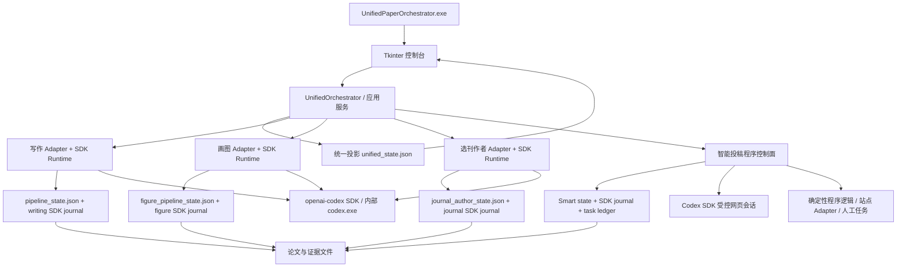
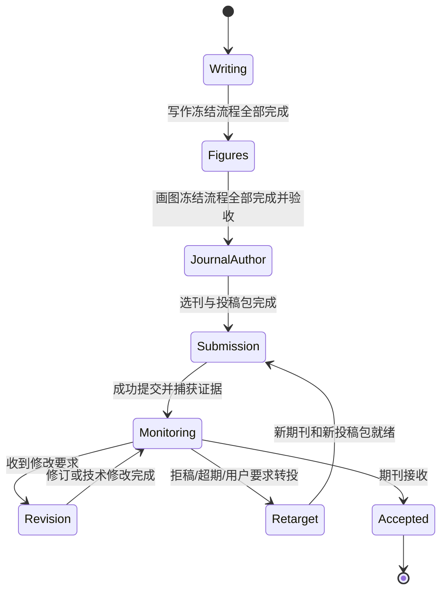
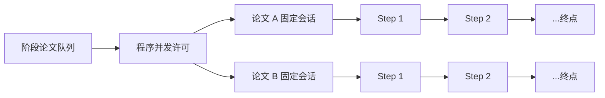
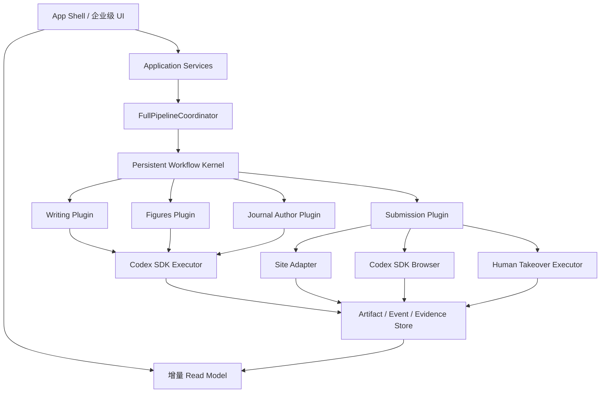

# 大一统论文智能体：现行架构、运行逻辑与改造基线

> 核对日期：2026-07-20  
> 当前源码版本：`0.10.24`（整体治理起始基线为 `0.10.21`）  
> 唯一产品入口：`dist/UnifiedPaperOrchestrator.exe`  
> 源码根目录：`D:\Documents\大一统`  
> 当前论文工作区：`D:\PaperProjects\UnifiedPaper-Main`

## 1. 文档目的

本文以当前实际源码、当前工作区清单和当前状态文件为准，回答四个问题：

1. 这个项目现在到底由哪些部分组成，各部分如何协作；
2. 一篇论文从写作到投稿的真实执行、状态和文件流是什么；
3. 当前设计中哪些部分已经可靠，哪些部分仍然容易卡顿、混乱或浪费资源；
4. 本轮八项改造应落在哪些模块，如何逐项实施、验证和回退。

本文取代 `PROJECT_PANORAMA_2026-07-14.md` 对“当前生产架构”的描述。旧文档仍可作为演进历史参考，但其中“只有写作使用 SDK”“画图和选刊仍依赖 Automation”等结论已经过时。

## 2. 可恢复基线

本轮改造开始前已经建立只读源码/配置快照：

```text
D:\Documents\大一统\releases\source-backups\0.10.21-goal-baseline-20260720T172013
```

校验结果：

- 源目录纳入快照的文件：314 个；
- 快照文件：314 个；
- 相对路径清单完全一致；
- 排除了 `.git`、`build`、`dist`、`releases`、`tmp`、运行时 `state` 和缓存；
- 当前 Git 工作树已有大量历史修改和未跟踪文件，因此本轮不能只依赖 `git reset` 回退。

后续每一项改造采用以下恢复策略：

1. 修改前备份本项涉及的源码、Prompt 或运行状态；
2. 只修改本项明确拥有的模块；
3. 先运行定向测试，再运行跨模块回归；
4. EXE 先构建到 `build/release_candidate`，不覆盖现有 `dist`；
5. 验证通过后才提升为正式 EXE；
6. 涉及工作区状态迁移时，额外备份当前工作区状态，不能拿源码快照代替运行数据备份。

## 3. 一句话架构结论

当前项目是一个 Windows 单机“模块化单体”，不是四个完全独立的软件，也不是微服务：

- 一个 Tkinter EXE 负责 UI、应用服务和统一投影；
- 写作、画图、选刊作者分别拥有自己的 JSON 事实账本、产物目录和 Codex SDK 运行时；
- 智能投稿拥有独立程序状态机、账号/站点库、网页执行器、监控和转投逻辑；
- `unified_state.json` 汇总四阶段状态，并保存跨阶段准入、投稿路线和生命周期元数据；
- `unified_paper_orchestrator_v2/` 是正在被部分生产路径复用的内部工作流内核，不是第二个产品，也不是另一个 V2 EXE。



## 4. “V1、V2、Legacy、SDK”在当前项目中的真实含义

项目历史较长，同一个词在不同阶段曾代表不同东西。当前应统一按下面理解。

### 4.1 唯一产品

唯一产品是：

```text
dist/UnifiedPaperOrchestrator.exe
```

源码入口是 `unified_paper_orchestrator/app.py`。没有单独发布的“V2 EXE”。

### 4.2 当前用户所说的 V2

当前产品中的 V2，实际指已经迁入 EXE 内部的本地 SDK 执行路径：

- 程序负责队列、并发、Step 顺序、暂停边界、重试和产物验收；
- 一篇论文固定一个 SDK 会话；
- 同一篇论文的多个 Step 在固定会话中依次发送；
- 不再由 AI 每分钟检查队列或决定下一篇/下一步；
- 不在 ChatGPT Codex 桌面任务列表创建十个调度会话。

### 4.3 `LegacyAdapter` 不等于当前仍使用旧 AI 调度器

`WritingAdapter`、`FigureAdapter`、`JournalAuthorAdapter` 仍继承 `LegacyAdapter`，`UnifiedOrchestrator.backend_router` 也仍初始化为 `legacy_only`。这是兼容命名和旧 JSON 公共契约，并不代表前三阶段仍由旧 Automation 执行。

实际启动逻辑是：

1. 校验本程序独立 Codex SDK 账号；
2. 尝试停用对应旧 Automation；
3. 写入原有阶段 JSON 队列/命令；
4. 唤醒 EXE 内 SDK Runtime；
5. SDK Runtime 以程序逻辑执行固定论文会话。

这个命名漂移会误导 UI、文档和维护者，应在后续架构收口中逐步改为 `StageAdapter` / `CompatibilityStateAdapter`，但不能为了改名一次性破坏旧状态格式。

### 4.4 API Key 模式的真实能力

当前四阶段完整生产执行并不是“直接用 OpenAI API Key 跑全流程”。前三阶段和智能网页 Worker 使用 `openai-codex` SDK、程序独立 `CODEX_HOME` 和内部 `codex.exe`，认证来自本程序连接的 ChatGPT/Codex 账号。

现有 API Key 路径主要用于连接检查和受限审阅实验，尚未成为四阶段生产后端。内部持久化值仍保留 `legacy_codex` 以兼容旧配置，但用户界面和只读诊断统一显示为“Codex 账号模式（四阶段 V2 SDK）”；历史 Automation 只作为暂停的回退诊断，不再决定当前模式是否可运行。

### 4.5 `unified_paper_orchestrator_v2/`

该目录提供：

- `TaskEnvelope`、`TaskResult`、`ArtifactRef` 等版本化合同；
- SQLite `EventStore`；
- `WorkflowKernel`；
- deterministic、human、Codex SDK、legacy、review 等执行器端口；
- 审批、幂等、claim、重试、事件和只读模型基础。

它目前是“内部工作流内核/实验基础”，并被智能投稿的程序任务账本部分复用，但尚未成为前三阶段唯一事实源。正常用户不应运行 `python -m unified_paper_orchestrator_v2` 来启动产品。

## 5. 目录与工作区模型

### 5.1 源码与论文数据已分离

源码根目录：

```text
D:\Documents\大一统
```

当前活动论文工作区：

```text
D:\PaperProjects\UnifiedPaper-Main
```

工作区由 `%LOCALAPPDATA%\UnifiedPaperOrchestrator\workspaces.json` 选择，当前清单为：

```text
workspace.json
state/
stages/
  writing/
  figures/
  journal_author/
  submission/
```

`workspace.json` 记录工作区 ID、名称、各阶段相对路径、旧目录别名和导入来源。切换工作区会重启 EXE；如果检测到运行中的阶段任务，UI 会阻止切换，避免任务写入错误目录。

### 5.2 仍然存在的双份 Prompt 风险

当前活动工作区是从旧目录复制建立的，Prompt 在以下两处各有一份独立文件：

```text
D:\PaperProjects\UnifiedPaper-Main\stages\writing\prompts
D:\Documents\项目控制平台\edge-llm-research\prompts
```

生产 EXE 使用活动工作区中的 Prompt；测试默认禁用用户工作区注册表，仍绑定旧兼容目录。两份文件目前字节一致，但不是链接。

因此，任何经用户批准的内置 Prompt 修改都必须：

1. 分别备份两份原文件；
2. 以相同字节修改两处；
3. 更新代码内 SHA-256；
4. 更新 `tests/contracts/v1_internal_prompts.json`；
5. 运行 Prompt 完整性与写作运行时测试。

否则会出现“源码测试通过但生产工作区没生效”或“生产已改但构建测试拒绝”的分裂状态。

## 6. 状态与事实来源

当前不是单一数据库。每个阶段仍持有自己的事实，统一状态主要是读模型和跨阶段控制元数据。

| 范围 | 主要事实文件 | 作用 | 是否权威 |
|---|---|---|---|
| 写作业务 | `stages/writing/controller/pipeline_state.json` | session、命令、Step、流程快照、阶段设置 | 写作业务事实 |
| 写作运行 | `state/writing_sdk_dispatch.json` | 固定 thread/turn、运行状态、Token、验收和重试 | SDK 运行事实 |
| 画图业务 | `stages/figures/controller/figure_pipeline_state.json` | 论文队列、命令、步骤和产物路径 | 画图业务事实 |
| 画图运行 | `state/figure_sdk_dispatch.json` | 固定会话、Turn、步骤验收 | SDK 运行事实 |
| 选刊作者业务 | `stages/journal_author/controller/journal_author_state.json` | 选刊、作者资料、投稿包、流程快照 | 选刊作者业务事实 |
| 选刊作者运行 | `state/journal_author_sdk_dispatch.json` | 固定会话、Turn、步骤验收 | SDK 运行事实 |
| 稳定投稿 | `stages/submission/controller/auto_submission_panel_state.json` | 旧稳定投稿通道状态 | 仅稳定投稿路线权威 |
| 智能投稿 | `state/smart_submission/smart_submission_state.json` | Smart 工作流、站点、账号绑定、监控、转投 | Smart 路线业务事实 |
| 智能投稿运行 | `state/smart_submission/sdk_dispatch.json` | 固定 SDK 网页会话与 Turn | Smart SDK 运行事实 |
| Smart 程序账本 | Smart state 相邻 SQLite | 程序任务、幂等、claim 和事件 | Smart 程序任务事实 |
| 统一状态 | `state/unified_state.json` | 四阶段投影、准入、投稿路线、归档、统一队列 | 阶段状态是投影；路线/准入/生命周期元数据是控制事实 |
| 论文产物 | 各阶段 `papers/<paper_id>/`、`refs/`、`ideas/` | TeX、PDF、数据、图表、投稿包和证据 | 文件产物事实 |

### 6.1 为什么不能把 `unified_state.json` 当成唯一数据库

`UnifiedOrchestrator.sync()` 会扫描各阶段状态和目录，重新计算：

- 四阶段状态；
- 当前阶段；
- 下一动作；
- 自动准入；
- Smart/稳定投稿的有效投影。

但它同时保留：

- `submission_routes`；
- `stage_admission_overrides`；
- `archived_papers`；
- 生命周期与统一队列历史。

所以它是“派生读模型 + 少量跨阶段控制事实”的混合文件。这是当前可用的兼容方案，但长期应把事件/任务/审批/租约逐步迁入持久化工作流内核，并让 UI 只读专门的 read model。

## 7. 一篇论文的真实四阶段流程



### 7.1 自动准入

程序按每篇论文自己的冻结流程判断完成，而不是固定写死“必须 Step 10”：

- 写作完成后自动准入画图；
- 画图完成后自动准入选刊作者；
- 选刊作者完成后自动准入投稿；
- 用户可右键人工越级，系统记录上游状态、证据、原因和时间；
- 下游已有历史目录不能反向伪造上游完成。

阶段页只显示已经准入该阶段的论文。这一原则是正确的，应保留。

### 7.2 写作阶段

默认 10 个内置步骤：

1. 寻找并确定研究 idea；
2. 收集并核验参考文献；
3. 撰写初稿；
4. 升级投稿稿件；
5. 补齐图表与结果结构；
6. 使用真实数据清理稿件；
7. 第一轮审稿；
8. 根据审稿修改；
9. 投稿成熟度清理；
10. 最终投稿强化。

当前特征：

- 流程最多可配置 50 步；
- Step 1 必须保留；
- 内置步骤只能保留从 Step 1 开始的连续前缀；
- 自定义步骤只能追加在内置步骤后；
- 新建任务时冻结流程版本、Prompt 路径和每步执行配置；
- 每步可指定模型、推理强度和 Token 上限；
- 一篇论文固定一个 SDK 会话，Step 顺序执行；
- 论文之间按程序并发，当前可配置 1–10；
- 旧写作 Automation 必须处于暂停状态；
- Step 5 数据关口支持严格确认和自动信任策略；
- 进入 Step 6 代表当前数据已被用户确认，Step 6 负责清理标记，不得删除或改写真实数值；
- 每一步必须通过文件指纹、语义合同和完成事件才能推进。

### 7.3 画图阶段

默认流程围绕 Step 1–3：

- Step 1：参考图/视觉研究，可按流程配置关闭；
- Step 2：图表计划、逐图说明和数据需求；
- Step 3：生成图表、编译并形成提交产物。

当前特征：

- 一篇论文固定一个 SDK 会话；
- 流程快照在入队时冻结；
- Step 2→3 的交付依赖受保护；
- 动态队列会在论文完成后立即补充空闲槽；
- 并发可配置 1–4；
- 真实数据不齐时停在数据等待点，不占用持续 AI 调度；
- 产物通过计划、manifest、原始图、TeX 引用和编译新鲜度等确定性验收。

### 7.4 选刊作者阶段

该阶段把“选刊”“作者资料”“投稿包”组合起来，支持合并模式和精细模式：

- 读取画图阶段提交包；
- 应用用户期刊偏好；
- 生成或补齐 `author_info.md`；
- 选择目标期刊；
- 生成期刊适配投稿包；
- 一篇论文固定一个 SDK 会话；
- 并发可配置 1–6；
- 新任务冻结流程和模型配置；
- 作者模板是跨论文的默认事实来源，每篇论文仍保存自己的副本。

### 7.5 智能投稿阶段

智能投稿已经不是“让一个 AI Prompt 自己调度所有论文”。当前程序状态机先把每篇论文投影为明确阶段、动作和执行器。

核心阶段包括：

```text
LOCAL_PREFLIGHT
DISCOVERY
SESSION_REQUIRED
SITE_EXECUTION
WAITING_FINAL_APPROVAL
FINAL_ACTION_CLAIMED
RECEIPT_CAPTURED
MONITORING
ACTION_REVIEW
TECHNICAL_CORRECTION
SCIENTIFIC_REVISION
RETARGET_STATUS_CHECK
RETARGET
ACCEPTED / REJECTED / STOPPED
```

执行器分工：

| 执行器 | 负责内容 |
|---|---|
| `deterministic` | 队列、状态判断、预检、幂等、监控计划、转投决策框架 |
| `site_adapter` | 已知投稿系统的字段、上传、结果核验等确定性动作 |
| `codex_sdk_browser` | 页面语义不确定、动态表单和受控网页交互 |
| `ai_semantic` | 需要理解文本的期刊要求、返修或转投辅助 |
| `human` | CAPTCHA、2FA、网站条款、法律事实、支付等必须人工处理的动作 |

当前默认设置已经包含：

- AI 调度决策关闭，程序控制面为 `program_v1`；
- 一篇论文一个固定 Codex SDK 网页会话；
- 自动最终提交开启；
- 账号缺失时允许自动注册；
- 邮箱优先监控，必要时回退期刊后台；
- 每日监控时间可配置；
- Windows 任务计划程序 + 应用内 claim 回退；
- 旧 Smart Automation 退役并保持暂停；
- 拒稿自动转投开启；
- 用户可发起指定期刊或按条件选刊的转投请求。

智能投稿的目标方向是正确的：程序负责确定性控制，AI 只处理语义和页面不确定性。但实现仍集中在超大模块中，站点适配覆盖和人工接管体验尚不完整。

## 8. 并发、会话和 Token 逻辑

正确的并发单位是“论文”，不是“Step”。



当前前三阶段已大体遵循这一模型：

- 调度和容量判断由本地程序完成，不调用模型；
- 每篇论文固定一个会话；
- Step 完成事件会立即推动同一论文的下一 Step；
- 不为十个 Step 创建十个独立会话；
- 模型、推理强度和 Token 上限按 Step 解析；
- 重试必须绑定同一论文、同一步骤、同一 Prompt 和产物基线；
- 不可用模型应阻塞并明确显示，不能偷偷换模型。

需要继续收口的地方是：三套 SDK Runtime/Dispatcher 重复实现了相似的队列、固定会话、暂停、恢复和状态回调逻辑，应逐步抽出共享工作流引擎，而不是继续复制第四套、第五套。

## 9. UI 架构与卡顿根因

### 9.1 当前结构

`UnifiedControlPanel` 当前约 9,484 行，承担了：

- 所有标签页和对话框构建；
- 四阶段实时表；
- 工作区切换；
- Prompt/模型设置；
- 账号与站点入口；
- 智能投稿、监控、转投和凭据恢复；
- 归档/删除；
- 技术日志脱敏；
- 应用服务调用和结果解释。

这已经超出单一窗口类的合理职责。

### 9.2 已确认的卡顿来源

1. `refresh()` 在 Tk 主线程直接调用 `orchestrator.sync()`；
2. `sync()` 会扫描四阶段状态、目录并进行写作完成重验；
3. 每次刷新会删除 Treeview 全部行再完整插入；
4. `render_stage_tables()` 又会同步读取各 SDK 实时状态；
5. 每 2 秒轮询当前标签页，同时检查 Smart 监控和统一投影 mtime；
6. 所有主要标签页在启动时一次性创建；
7. `TaskRunner` 全窗口同一时间只允许一个后台 UI 操作，长任务会让其他按钮显示“后台任务忙”；
8. `main_window.py` 和 `smart_submission.py` 过大，任何刷新路径都容易意外做额外工作。

### 9.3 分辨率问题

当前窗口外框会按屏幕缩放，但内部存在：

- 顶部按钮使用固定横向 `pack`，不能自动换行或折叠；
- 阶段操作按钮数量多，低宽度下直接超出可视区；
- 某些对话框固定 `1380x860`；
- Treeview 列宽大多固定；
- 字体、DPI、间距和信息密度没有统一设计令牌；
- “常用操作、管理、更多”之间功能归属不稳定。

所以“窗口尺寸响应式”并不等于整个 UI 响应式。

## 10. EXE 与 CMD 窗口

当前 PyInstaller 使用：

```text
--onefile --console
```

`app.py` 在无参数 GUI 模式下随后调用 `FreeConsole()`。这保留了同一个 EXE 的 CLI 输出能力，但 Windows 启动时仍可能先创建并闪现 CMD 窗口。

部分按钮和内部任务还会启动子进程：

- 工作区重启已经使用 `CREATE_NO_WINDOW`；
- Windows 任务计划命令已经隐藏；
- ACL 工具已经隐藏；
- Notepad/Explorer 是用户明确要求打开的可见程序，应保留；
- LaTeX、期刊策略修复和 Smart 某些检查调用没有统一使用隐藏进程策略；
- Codex SDK 内部会启动 `codex.exe` 和短生命周期 MCP 子进程，也应统一设置无窗口启动。

目标不是粗暴禁止所有外部进程，而是建立一个统一 Windows 进程启动层：后台工具全部无窗口，只有用户明确要求查看的浏览器、Explorer、Notepad 或人工接管页面可见。

## 11. 当前代码规模与结构性风险

| 文件 | 行数（约） | 风险 |
|---|---:|---|
| `smart_submission.py` | 21,482 | 状态、监控、授权、转投、调度、迁移集中在一个文件 |
| `ui/main_window.py` | 9,484 | UI、应用服务和业务规则耦合 |
| `writing_sdk_runtime.py` | 3,924 | 写作运行边界复杂 |
| `writing_sdk_dispatch.py` | 3,612 | 调度、恢复、验收逻辑集中 |
| `orchestrator.py` | 3,074 | 投影、路线、归档、删除、准入和阶段控制耦合 |
| `smart_credential_broker.py` | 2,972 | 多站点账号恢复/注册分支快速膨胀 |
| `account_site_store.py` | 2,865 | 凭据、审计和站点元数据集中 |

当前 83 个测试文件覆盖了大量单元、合同和安全边界，这是项目的重要资产；但缺少一个真正生产级、可恢复的“写作→画图→选刊作者→智能投稿”持续编排器和对应端到端状态测试。

## 12. 当前架构做得比较好的地方

1. 已经把前三阶段 AI heartbeat 调度迁为程序事件调度；
2. 一篇论文一个固定会话，避免十步十会话；
3. 流程、模型和 Prompt 在任务入队时冻结快照；
4. Prompt、输入、产物和 Turn 有指纹与验收；
5. 自动阶段准入与人工越级并存；
6. 工作区已从源码目录独立出来并可切换；
7. 智能投稿开始使用程序状态机而不是 AI 负责所有调度；
8. 投稿最终动作有幂等授权、未知结果核验和回执证据；
9. 全阶段归档/彻底删除已经有统一生命周期边界；
10. 旧 EXE 在新构建验证通过前可以保留。

## 13. 目前主要问题与优先级

### P0：直接影响日常使用

1. UI 主线程同步扫描和全表重绘导致卡顿；
2. 顶部操作区不可自适应，低分辨率显示不全；
3. 多个按钮语义重复或作用域不清；
4. GUI EXE 仍以 console 子系统打包，启动会闪 CMD；
5. 缺少显式“人工接管当前网页并完成后继续”的标准状态；
6. 没有持久化的一键全流程 Coordinator；
7. Prompt 在活动工作区与兼容测试根存在两份，修改容易分裂；
8. UI/文档仍显示“V1 兼容”等过时描述，用户难以判断实际执行器。

### P1：稳定性与维护成本

1. 三套 SDK 调度器高度相似但没有共用引擎；
2. `smart_submission.py` 和 `main_window.py` 过大；
3. 多份 JSON + SDK journal + Smart SQLite 的恢复边界复杂；
4. `unified_state.json` 同时承担投影与部分控制事实；
5. ORCID 目前更多被视为可能的人工授权卡点，尚无“站点支持时 ORCID 优先、失败再邮箱”的明确策略；
6. 后台子进程没有统一隐藏/超时/取消封装；
7. 全窗口只有一个 `TaskRunner`，互不冲突的操作也会相互阻塞。

### P2：产品化与观感

1. Tk 默认风格和颜色缺少统一视觉系统；
2. 信息层级弱，技术状态与用户动作混在一起；
3. 缺少空状态、骨架加载、非阻塞进度反馈和统一 Toast；
4. 对话框尺寸、边距、按钮命名和危险动作样式不一致；
5. Git 历史和发布标签不足，当前工作树长期不干净；
6. 架构文档和版本说明存在时间漂移。

## 14. 本轮八项改造的落点与验收标准

### 14.1 单处引用最多 3 篇

落点：写作 Step 3 `03_write_draft_tex.md`。

原因：Step 3 是所有可交付写作流程都必须经过的首次完整正文生成步骤；即使用户把流程截短为 3 步，该规则也能生效。

规则应明确：

- 一个 `\cite{}` 最多包含 3 个引用键；
- 禁止用长连续范围表达大量引用，例如 `[13--25]`；
- 超过 3 篇时必须拆分到各自真正支撑的 claim/句子；
- 不得为了拆分而丢失、编造或错配参考文献。

需要同步：活动工作区 Prompt、兼容根 Prompt、代码 SHA-256、Golden Contract 和定向测试。

### 14.2 新账号 ORCID 优先

落点：

- `smart_credential_broker.py`；
- `submission_site_adapters.py`；
- Smart 设置与账号/站点 UI；
- Smart state 中新增版本化认证偏好。

建议策略：`orcid_first_then_email`。

流程：

1. 已有可用站点账号或会话时直接复用，不重复注册；
2. 新站点支持 ORCID 登录/注册时优先选择 ORCID；
3. ORCID 会话可自动复用时继续；
4. ORCID 要求用户授权、2FA 或额外确认时进入人工接管；
5. 站点不支持或 ORCID 失败时回退保存邮箱/密码注册；
6. 不得因“优先 ORCID”无限循环或覆盖已有账号。

验收：策略可见、可回退、注册幂等、已有账号不受影响。

### 14.3 人工修改/接管网页

落点：Smart Program 的 Human Executor、浏览器上下文、Smart UI。

新增标准动作：

```text
人工接管当前页面
人工处理完成并继续
取消接管并保持暂停
```

程序必须保存并显示：论文、站点、当前动作、浏览器上下文、开始时间和恢复点。人工接管时释放 AI/程序当前网页 lease，用户完成后从原动作重新探测，不盲目重复最终提交。

验收：页面可直接打开；用户可修改；恢复后不丢任务、不重复提交；CAPTCHA/2FA/条款等均复用同一机制。

### 14.4 前端性能与响应式

落点：拆分 UI read model、刷新控制器和各阶段 View。

第一阶段不换框架，先完成低风险性能改造：

- `orchestrator.sync()` 移出 Tk 主线程；
- 以文件 mtime/版本令牌驱动增量读；
- Treeview 按差异更新，不再每 2 秒全部删除重建；
- 仅刷新当前可见标签页；
- 重型标签页和对话框延迟构建；
- 不同域使用独立后台任务通道；
- 工具栏支持折叠到“更多”；
- 对话框尺寸限制在当前屏幕工作区内；
- 统一 DPI、字体和最小列宽策略。

验收：刷新期间窗口可拖动；常用按钮点击有即时反馈；1366×768、1920×1080 和高 DPI 下无关键按钮丢失。

### 14.5 隐藏不必要 CMD

落点：构建脚本、`app.py`、统一进程启动工具及各后台 subprocess 调用。

验收：

- 双击 GUI EXE 不出现 CMD 窗口；
- 后台 Codex、MCP、LaTeX、PowerShell 和任务计划调用不弹窗；
- Explorer、Notepad、浏览器和人工接管页面按用户动作正常显示；
- CLI 诊断能力仍有明确入口，不能因改为 windowed 而静默失效。

### 14.6 按钮与交互清理

先建立按钮清单，按“对象 + 动作 + 作用域”重命名：

```text
运行选中论文
运行本阶段全部待处理论文
本 Step 后暂停选中论文
本 Step 后暂停本阶段全部论文
```

重复入口合并到每阶段统一操作栏；低频/技术功能放入“更多”；危险操作统一放右键和二次确认。不能只删按钮而保留不可达功能，也不能只改文案而不修作用域。

### 14.7 企业级视觉升级

建议保留 Tkinter 作为本轮稳定基线，建立一套可复用设计系统：

- 颜色、字体、间距、圆角感、状态色和表格密度令牌；
- 左侧主导航或清晰顶级导航；
- 顶部显示工作区、运行模式和全局任务状态；
- 阶段页采用“主操作 + 次操作 + 更多”的层级；
- 状态用 Badge、进度和下一动作表达；
- 技术详情默认折叠；
- 空状态、加载状态、错误状态和成功反馈统一。

视觉可以参考微信桌面端的信息克制和 GitHub 的状态/导航层级，但不照抄品牌资源。若 Tk 主题能力成为瓶颈，再评估 Qt/PySide；本轮不应在业务尚未稳定时直接全量换框架。

### 14.8 一键跑完全程

应新增持久化 `FullPipelineCoordinator`，而不是写一个依次点击四个按钮的脚本。

输入：

- 新建论文数量/并发数量；
- 工作区；
- 写作流程和模型快照；
- Step 5 策略，默认 `auto_trust`；
- 画图、选刊作者、Smart 投稿配置快照；
- 投稿路线固定为 Smart；
- 是否在必须人工处理时弹出接管任务。

状态示例：

```text
CREATED
WRITING
WAITING_WRITING
FIGURES
WAITING_FIGURES
JOURNAL_AUTHOR
WAITING_JOURNAL_AUTHOR
SMART_SUBMISSION
MONITORING
COMPLETED / BLOCKED / PAUSED
```

核心规则：

1. 并发数量表示同时处理的论文数量，不产生额外 AI 调度器；
2. 同一论文必须按阶段顺序推进；
3. 某篇论文等待人工时，其他论文继续；
4. 每次重启后可从持久状态恢复；
5. 每个阶段继续使用自己的产物合同和固定 SDK 会话；
6. 阶段完成事件自动入队下一阶段；
7. 最终提交由 Smart 的幂等最终动作完成；
8. 已有任务不能因一键流程而被重复导入或重复投稿；
9. 暂停在当前 Step/网页动作完成后的安全边界生效；
10. UI 显示整批、单篇、阶段、Step、模型、会话和卡点。

## 15. 推荐目标架构

不建议为这个单机 Windows 产品引入微服务或 Kubernetes。最合理的目标仍是“模块化单体 + 持久化工作流内核 + 隔离执行器”。



迁移原则：

- 不新建一个“V3 产品”；
- 不一次性重写全部 JSON；
- 先抽公共接口，再把现有生产路径逐阶段接入；
- 文件产物继续由阶段目录持有；
- 任务、租约、幂等、审批、人工接管和恢复逐步进入内核；
- UI 只通过应用服务和 read model 工作，不再直接理解所有 JSON 细节。

## 16. 本轮实施顺序

1. 冻结与验证基线；
2. 完成本文档；
3. 修改 Step 3 单处引用上限并同步 Prompt 封印；
4. 实现 ORCID 优先且可回退；
5. 实现标准人工接管/修改/继续；
6. 统一隐藏后台进程窗口；
7. 先做 UI 主线程、增量刷新、响应式和按钮语义治理；
8. 在稳定交互基础上完成视觉系统；
9. 实现持久化一键全流程 Coordinator；
10. 运行跨模块回归、构建候选 EXE、验证启动和回退后再发布。

这个顺序有两个约束：

- 视觉重构不能先于刷新/状态边界，否则只是把卡顿界面换皮；
- 一键全流程不能先于阶段动作和人工接管标准化，否则会把现有模糊按钮自动点一遍，无法可靠恢复。

## 17. 每项改造的统一完成定义

每个项目只有同时满足以下条件才算完成：

1. 功能按用户场景可用；
2. 旧功能的定向回归通过；
3. 状态文件格式兼容或有可恢复迁移；
4. 没有更改未授权的内部 Prompt；
5. 没有覆盖当前正式 EXE；
6. 有修改前备份和明确恢复路径；
7. UI 能说明“正在做什么、作用于谁、下一步是什么”；
8. 文档记录实际变化，不继续使用过时架构描述。

## 18. 本轮实施记录

### 18.1 写作 Step 3 单处引用上限

完成时间：2026-07-20。

- 修改文件：生产工作区与兼容测试根中的 `03_write_draft_tex.md`；
- 修改位置：写作要求第 17 条；
- 单个引用位置以及单个 `\cite{}` 最多 3 个引用 key；
- 禁止 `[13--25]`、`[13–25]` 这类大范围压缩和 4 篇以上引用簇；
- 超过 3 篇时按文献实际支撑的 claim 分散到相邻句子或段落；
- 不允许为了拆分而删除、编造或错配文献；
- 没有增加新的运行时拦截器；
- 新 Prompt SHA-256：`3DF365C23EBC2640B792C64ED7421103CAA2CB1D2EC9AD03BE1D75E9E3D67601`；
- 生产副本、兼容副本、代码封印和测试合同已一致；
- 定向回归：18 项 Prompt/工作流测试和 138 项 Writing SDK 测试通过；
- 修改前回滚点：`releases/source-backups/0.10.21-citation-rule-prechange-20260720T173557/`。

### 18.2 新站点 ORCID 优先登录/注册

完成时间：2026-07-20。

真实流程调整为：

```text
已有匹配投稿站点账号
  → 继续原账号登录，不改变行为

没有匹配投稿站点账号
  → 检查是否启用 ORCID 优先
  → 检查页面是否存在真实可点击的 ORCID 登录控件
  → 检查账号中心是否存在可由本地凭据代理读取的 ORCID 加密凭据
      ├─ 条件满足：ORCID OAuth 登录 → 常规授权 → 回跳投稿站点
      └─ 任一条件不满足：点击 ORCID 前自动回退原站点注册
```

实现边界：

- ORCID 是新站点无账号时的默认首选，已有站点账号不受影响；
- ORCID 密码只由本地凭据代理从 DPAPI 引用读取，不进入 Codex SDK；
- ORCID OAuth 支持同页跳转和弹窗回跳；
- 只在官方 `orcid.org` Origin 填写 ORCID 凭据和执行授权；
- 普通常规授权默认自动完成；验证码、2FA、邮箱验证仍转为可恢复人工任务；
- ORCID 登录成功后创建的是投稿站点到既有 ORCID 加密凭据的引用，不复制明文密码；
- 没有已保存 ORCID 凭据时不会盲点 ORCID，也不会阻塞，直接沿用原站点注册；
- 账号策略界面增加 ORCID 首选开关和准确说明；
- 当前真实账号库尚未发现可自动填充的 ORCID 账号，因此在用户通过“账号与站点”保存 ORCID 凭据前，生产行为会安全回退到站点注册；
- 设计依据：ORCID 官方将 ORCID 登录描述为科研系统中更省事的首选登录方式，并规定它采用 OAuth 登录、授权、回跳流程；
- 定向回归：210 项通过、39 个子测试通过；
- 修改前回滚点：`releases/source-backups/0.10.21-orcid-first-prechange-20260720T174850/`。

已识别但与本项无关的基线问题：

- `test_credential_broker_retry_is_a_completed_monitor_outcome` 在修改前对应函数未变化的情况下仍失败；
- 当前断言期望监控重试把 `workflow_status` 从 `queued` 改为 `monitoring`，实际仍为 `queued`；
- `record_smart_credential_broker_state` 的当前函数与本项修改前备份 SHA-256 完全一致，证明不是 ORCID 改造引入；
- 为避免掩盖问题，本轮回归明确将它记为 1 个基线失败，而没有修改测试或偷偷放宽断言。

### 18.3 智能投稿单篇人工接管、修改与继续

完成时间：2026-07-20。

新增用户动作：

- `手动修改当前页面`；
- `修改完成并继续`；
- 两个入口同时出现在智能投稿常用操作区、更多操作和单篇右键菜单；
- 每次只允许选择一篇，以免页面归属不明确。

真实状态逻辑：

```text
论文空闲/等待
  → 立即从在线队列移出
  → 只把该论文设为 manual_takeover
  → 校验投稿系统允许的 Origin
  → 聚焦其受控 Chrome 真实页面

论文正在执行 SDK Turn
  → 标记 requested
  → 当前 Turn 正常收尾
  → 禁止再给该论文派发后续 Turn
  → Turn 结果落账后自动转为 active
  → 其他论文继续占用自己的并发槽运行

用户点击“修改完成并继续”
  → 再次验证页面仍存在且 Origin 正确
  → 写入 completed + reconcile_pending
  → 只把该论文重新加入在线队列
  → 原固定 SDK 会话先检查当前页面，再从未完成项继续
```

实现边界：

- 人工接管状态保存在该论文自己的 Smart 记录中，不切换全局 `mode`，不暂停其他论文；
- 同一投稿站点打开多个页面且无法用已保存 URL/投稿编号唯一匹配时拒绝随机选页；
- 已领取但结果未知的最终提交动作禁止人工接管，避免重复提交；
- 已提交、监控中、已接收和已停止论文不通过这个“表单修改”入口重开；
- 页面聚焦使用受控 CDP 的 `Browser.getWindowForTarget`、恢复窗口和 `Page.bringToFront`，不另开不受控浏览器；
- Codex SDK 不接收密码；人工完成后新增的运行时通道约束要求保留现有字段、选择和上传文件，不从头重填表单；
- SDK Turn 的最终落账会识别待接管标记，先保存 Turn 结果作为恢复快照，再把论文停在人工状态；
- 程序计划器把 `requested/active` 明确投影为人工执行器，`reconcile_pending` 明确投影为一次受控 SDK 页面复核。

验证：

- 人工接管专项测试 7 项通过；
- Smart 程序计划、CDP 控制和 SDK Runtime 全量 55 项通过；
- UI/投影/仓库约束 57 项通过；
- Smart hardening 71 项通过，仍只有 18.2 已记录的同一个基线失败；
- 修改前回滚点：`releases/source-backups/0.10.21-manual-takeover-prechange-20260720T181500/`。

### 18.4 GUI 与后台子进程无控制台闪窗

完成时间：2026-07-20。

问题被拆成两个独立根因处理：

1. 正式 EXE 原来以 `--console` 打包，进入 Python 后才调用 `FreeConsole()`，双击启动时会先创建再释放控制台，因此可能闪现 CMD；
2. Codex SDK 内部 `codex.exe app-server`、LaTeX、兼容 CDP/Node 检查和预算守护进程属于控制台子进程，原实现没有在所有生产入口统一传入 Windows 无窗口标志，因此点击部分按钮也可能弹窗。

当前实现：

- 正式构建继续保留 `--console`，同时使用 PyInstaller `--hide-console hide-early`；双击 EXE 时由 bootloader 在最早期隐藏它自己创建的控制台；
- 从已有 PowerShell/CMD 启动时仍保留 CLI 输出，不改成会吞掉诊断信息的纯 `--windowed` 程序；
- 新增集中式 `windows_subprocess.py`，统一生成 `CREATE_NO_WINDOW + STARTF_USESHOWWINDOW/SW_HIDE` 参数；
- 只把 `openai_codex.client` 模块内持有的 `subprocess` 替换为委托代理，专门隐藏 SDK 自己启动的 `codex.exe app-server`；不会修改全局 `subprocess.Popen`，也不会影响 Explorer、Notepad、Chrome 等用户明确要求看到的 GUI；
- 写作、画图、选刊作者、智能投稿和 V2 通用 Codex SDK 执行器均在创建真实 SDK Client 前启用该策略；测试注入的假 Client 不受影响；
- `latexmk`、`pdflatex`、兼容 CDP Python helper、Node 检查、Windows Job Object 预算进程统一无窗口启动；
- 已有任务计划、Windows ACL 工具、CLI relay 和工作区重启原本已设置无窗口标志，继续保留；
- 本项没有覆盖当前正式 EXE，候选 EXE 留到最终跨模块回归完成后统一构建。

验证：

- PyInstaller 当前环境明确支持 `--hide-console hide-early`；
- SDK/构建/LaTeX/投稿策略专项回归 217 项通过；
- Windows 预算进程与入口回归 58 项通过；
- 全部修改文件已通过 `py_compile`；
- 修改前回滚点：`releases/source-backups/0.10.21-no-console-prechange-20260720T184500/`；
- 该回滚点内的 `RESTORE.md` 记录了精确覆盖清单，以及恢复时应删除的两个本项新增文件。

### 18.5 UI 主线程、响应式布局与按钮语义治理

完成时间：2026-07-20。

本项先治理交互边界和刷新机制，没有提前做视觉换肤。主要根因是：窗口启动和每两秒刷新会在 Tk 主线程同步扫描多个项目状态，多个 Treeview 每次全部删除重建，智能投稿一次状态刷新约需 240–330 ms，账号库首次打开约需 1.2 秒；这些工作直接表现为窗口卡顿、选中项跳动和按钮点击后“没有反应”。

当前实现：

- 增加独立的刷新、窗口载入和后台维护执行队列；文件扫描、统一投影同步、SDK 状态、智能投稿状态、账号库恢复和 Prompt 清单读取均离开 Tk 主线程；
- 界面线程只应用已完成的不可变快照；刷新请求带递增序号，旧快照不会覆盖新状态；刷新繁忙时合并请求，不会无限创建线程；
- 总览、阶段表、写作/画图/选刊作者实时表和智能投稿表改为按行差异更新，保留选中项、焦点、滚动位置和未变化行，不再每两秒整表删除重建；
- 智能投稿无参数刷新改为后台请求；需要展示操作结果时可只刷新状态和表格、保留当前结果说明；
- 账号与站点的事务恢复在后台完成，按钮立即返回；管理窗口仍在 Tk 线程创建，避免跨线程创建控件；
- 写作/画图/选刊作者“调度设置与提示词”先在后台读取清单，再创建窗口；
- 定时账号恢复检查移入独立维护队列，避免 90 秒轮询触发页面卡顿；
- 5 个错误调用旧版响应式尺寸函数的弹窗已修正；主要设置、模板、转投和 SDK 会话窗口统一按当前屏幕尺寸计算，不再写死几何尺寸；
- 写作、画图、选刊作者、稳定投稿和智能投稿的常用操作条可按实际宽度自动换行；窄屏不再把最右侧按钮裁掉；
- 顶部移除重复的“论文工作区”和“运行状态”按钮；工作区只保留明确的“切换工作区…”入口，全部运行状态移入“更多”；
- 画图和选刊作者移除与实时任务面板重复的暂停/验收入口；主按钮统一写清“选中论文”还是“全部任务”、暂停发生在当前 Step/任务之后；
- 智能投稿主操作区只保留启动、立即检查、转投、人工修改、完成修改和暂停；本地预检、程序计划、登录恢复等高级动作移入“更多操作”；
- “AI执行与API”更名为“AI 执行与 API 设置”；UI 合同升级为 schema 2，防止后续再次引入旧按钮和模糊文案；
- 查看全部或单阶段运行状态也改为后台读取；
- 没有修改写作、画图、选刊作者或智能投稿的内部任务 Prompt，没有修改任务状态语义，也没有覆盖正式 EXE。

实际窗口冒烟结果（当前 46 篇论文工作区）：

- 主窗口构造约 0.35 秒；
- 完整刷新后台读取约 1.4 秒，但 Tk 主线程最慢一帧约 14–40 ms，窗口持续可交互；
- 未变化的增量刷新后台约 0 ms，主线程应用约 0.1 ms；
- 账号与站点按钮由约 1235 ms 同步阻塞改为约 1.3 ms 返回，窗口约 0.97 秒后台准备完成；
- 写作设置按钮约 0.3 ms 返回，约 0.50 秒后台准备完成；
- 650 px 测试宽度下，写作和智能投稿操作按钮均自动换行，所有按钮右边界位于容器内；
- 主窗口、写作设置和账号管理窗口均完成真实 Tk 创建、刷新与关闭冒烟，没有遗留进程或 Tk 回调异常。

验证：

- UI、安全、投影、账号站点、工作区、Windows 子进程等相关回归 133 项通过、39 个子测试通过；
- Treeview 差异刷新、窄屏按钮换行、异步 Smart 刷新、窗口后台载入和维护队列均增加专项测试；
- 修改文件通过 `py_compile` 和 `git diff --check`；
- 修改前回滚点：`releases/source-backups/0.10.21-ui-performance-prechange-20260720T183750/`；
- 该回滚点的 `RESTORE.md` 给出精确覆盖清单；本项没有新增生产源文件。

### 18.6 企业级视觉系统与真实分辨率验收

完成时间：2026-07-20。

本项没有引入 Web 壳或重写 Tk 界面，而是在当前稳定桌面架构内建立一套集中式语义主题，避免视觉升级同时扩大运行风险。设计参考使用 GitHub Primer 的颜色、排版、布局和 ActionBar 原则，以及 Microsoft Fluent 2 的语义色与 Windows 原生字体原则：

- <https://primer.style/product/primitives/color/>
- <https://primer.style/product/getting-started/foundations/typography/>
- <https://primer.style/product/getting-started/foundations/layout/>
- <https://primer.style/product/components/action-bar/>
- <https://fluent2.microsoft.design/color>
- <https://fluent2.microsoft.design/typography>
- <https://learn.microsoft.com/en-us/windows/apps/develop/ui/controls/navigationview>

当前实现：

- 新增 `ui/theme.py` 作为唯一视觉事实源，集中定义画布、表面、边框、正文、弱化文字、强调、成功、提醒、危险和完成等语义 Token；
- 使用 `clam` 作为可控的跨 Windows ttk 基础主题，统一按钮、菜单、页签、表格、输入框、滚动条、分栏、进度条和只读文本区；
- 中文界面优先使用 Microsoft YaHei UI，英文回退 Segoe UI，等宽记录使用 Cascadia Mono/Consolas；
- 顶部改为产品标题、V2 标识、四阶段副标题和单一命令区；主操作使用蓝色，紧急停止保留红色，普通及高级入口使用中性色；
- 5 个顶级导航继续采用顶部页签，符合少量顶级类别的 Windows 导航习惯，也避免在现阶段引入侧栏重排风险；
- 普通“可处理”论文恢复白色中性背景；只有排队、运行、阻塞、完成、越级等具有动作含义的状态才使用语义底色，避免整张表成为同一块浅蓝色；
- 表格行高、标题间距、按钮触点和正文对比度统一；关键文本/背景组合按 WCAG 4.5:1 最低对比度自动测试；
- 没有修改任何阶段 Prompt、任务调度、状态文件、论文产物或账号数据。

真实窗口验收：

- 在当前 46 篇论文工作区启动真实 `UnifiedControlPanel`，完成总览和写作页视觉检查；
- 1000×700 与最低支持尺寸 860×650 均实际创建、截图并关闭；顶部命令区完整，五个顶级页签均可见，窄屏表格通过横向滚动保留全部列；
- 写作常用操作在 1000×700 下无裁切，最低尺寸下仍可访问；
- 所有视觉验收窗口均正常关闭，没有遗留测试进程；
- 新增主题/视觉合同测试 3 项，主题与 UI 合同专项 6 项通过；
- 修改前 Git 只读快照：`refs/codex/backups/0.10.21-enterprise-ui-prechange-20260720`，提交对象 `b5bbd8ead6aaff52210bca9ba7aa6606c152f135`；该快照通过 `git stash create` 和自定义引用建立，没有清空、暂存或改写当前工作区。

### 18.7 可配置并发的一键全流程

完成时间：2026-07-20。

本项新增的是程序状态机，不是新的 AI 调度器，也没有通过 UI 自动点击现有按钮。一次批次的真实链路为：

```text
用户填写本次新建论文数（1-10）
  → 校验当前工作区 Step 5 为“自动信任并继续”
  → 临时设置各阶段并发并保存 compare-and-swap 恢复令牌
  → 精确新建 N 个写作任务并为每个任务预留唯一论文编号前缀
  → 写作现有工作流全部完成
  → 程序交接到画图现有工作流
  → 画图现有工作流全部完成
  → 程序交接到选刊作者现有工作流
  → 选刊作者现有工作流全部完成
  → 程序切换该论文到 Smart 路线、预检并启动固定 SDK 会话
  → Smart 使用既有自动最终提交与可信回执逻辑完成投稿
  → 状态进入 submitted / monitoring / accepted
  → 批次完成并恢复本批临时修改的并发与投稿策略
```

核心实现：

- 新增 `full_pipeline.py`，以当前工作区的 `state/full_pipeline_state.json` 作为批次协调账本，使用独立文件锁、修订号和审计事件持久化；
- 新增 `ui/full_pipeline_window.py`，集中展示每篇论文的预留编号、真实论文编号、当前阶段、实时状态、总进度、当前动作和错误；
- 主界面新增“一键全流程”和持久摘要；原“新建论文任务”改为更准确的“仅新建写作”，避免与全流程入口混淆；
- 一个数字同时表示“本次新建数量”和期望并发；写作最多 10、画图最多 4、选刊作者最多 6、智能投稿使用本次数量，超过阶段容量的论文继续由该阶段本地排队；
- 写作仍是一篇论文一个固定 SDK 会话，并在同一会话内执行该论文配置好的所有 Step；画图和选刊作者继续使用各自固定 SDK 会话；
- 写作命令新增批次 ID、批次槽位和唯一预留编号前缀；协调器不依赖论文标题猜测身份；
- 阶段是否完成只读统一投影中的正式阶段状态，阶段交接调用现有公开程序动作，不解析 Prompt 文本、不扫描某个偶然文件名猜进度；
- 每次交接先写 `dispatching` claim，再执行阶段动作，成功后写 `succeeded`；同一论文同一阶段不会因两次轮询而重复加入队列；
- 临时错误按 5、30、120 秒最多重试 3 次，之后只把该论文标为需要处理；其他论文继续运行；协调器线程本身遇到投影读取等意外异常会记录到账本并退避重试，不会静默退出；
- “暂停后续自动交接”只暂停 Coordinator，不会强制杀死正在执行的 SDK Step；“继续自动交接”从持久账本恢复；
- 关闭 EXE 时仅停止当前进程的轮询线程，不删除批次；重新打开同一工作区后自动恢复未完成批次；
- Step 5 若仍为严格模式，一键窗口会要求管理密码后切换为工作区级自动信任；既有硬故障仍由写作阶段处理；
- Smart 临时启用自动最终提交，并在批次结束后通过 compare-and-swap 恢复旧值；如果用户运行中手工修改设置，恢复逻辑保留用户的新值；
- 最终完成只接受 Smart 正式状态中的 `submitted`、`monitoring` 或 `accepted`；Smart 内部原有可信确认页、稿件编号和回执证据规则没有被绕过；
- 建立批次失败时立即还原已经应用的临时设置，把失败批次转为可查看的历史记录并释放活动批次位置，用户可直接重试；
- 没有修改写作、画图、选刊作者或智能投稿的内部 Prompt。

界面与验证：

- 主窗口 860×650 时顶栏自动换为两行，全部主按钮仍可见；
- 一键全流程窗口 820×540 时启动、暂停、继续、刷新和 Step 5 设置均可见；宽表保留水平滚动；
- 9 项协调器专项测试通过，覆盖自动信任、精确 N 个任务、阶段并发上限、身份绑定、四阶段幂等交接、三次重试、启动失败回滚、暂停/重启恢复、用户设置保护和线程异常恢复；
- 全流程、UI 合同、主题和 UI 安全定向回归 50 项通过、1 项环境性跳过；
- 视觉检查只读取当前 46 篇论文工作区，没有启动真实论文、没有改变论文状态，也没有遗留测试进程；
- 修改前 Git 只读快照：`refs/codex/backups/0.10.21-full-pipeline-prechange-20260720`，提交对象 `bcef67a4a9a579dbec1d3b6e3050794a9b5f6a4d`；恢复步骤记录在 `releases/source-backups/0.10.21-full-pipeline-prechange-20260720/RESTORE.md`。

### 18.8 最终架构状态对齐、全量回归与正式发布

完成时间：2026-07-20。

最终审计发现，内部持久化值 `legacy_codex` 已经代表当前 Codex 账号执行模式，但只读诊断、主界面状态栏和 AI 设置说明仍沿用“部分阶段由 V1 Automation 执行”的旧解释。该漂移不会直接改变任务，却会让用户误以为历史 Automation 是四阶段生产 owner，并把一个实际可运行的账号模式误报为不可用。

本轮收口：

- 保留 `legacy_codex` 内部值，避免破坏既有设置文件、模式锁和任务快照；
- 用户可见名称统一为“Codex 账号模式（四阶段 V2 SDK）”；API 密钥模式明确为“连接检测 / 私有审阅”；
- `ai-execution-status` 在账号模式下只用本地 `openai-codex` SDK 与内置 CLI 是否可用判断被动就绪，不启动进程、不联网，也不再依赖历史 Automation 消费探针；
- 写作 owner 为本地 SDK 事件调度器，画图和选刊作者 owner 为本地 SDK 工作流，智能投稿 owner 为程序控制的 SDK 网页工作流；
- 历史 Automation 保留为 `paused_compatibility_fallback`，`remaining_v1_stage_owner=none`；
- API 密钥模式仍不拥有四阶段生产执行权，不允许静默切换执行来源；
- 没有修改任何阶段内部 Prompt；本轮唯一 Prompt 修改仍是用户批准的写作 Step 3 单处最多 3 篇引用规则。

最终验证：

- 源码全量回归：`1229 passed, 54 subtests passed`；
- 正式构建脚本在隔离打包前再次完整复跑：`1229 passed, 54 subtests passed`；
- `--version`、`--help`、只读 `ai-execution-status`、SDK/CLI 嵌入探针全部通过；
- 候选 EXE 真实启动后只出现产品主窗口，没有 CMD；界面成功读取当前 46 篇论文工作区，随后正常关闭且没有遗留进程；
- 上述 GUI 验收没有点击“一键全流程”、没有新建论文、没有启动任何阶段、没有修改论文或投稿状态；
- 正式文件：`dist/UnifiedPaperOrchestrator.exe`；
- ProductVersion / FileVersion：`0.10.22`；
- 文件大小：`154854674` 字节；
- SHA-256：`A3692A65A594EBE847A0E49154E52849A3F854804E641B56A2E62D27D11B3A74`；
- 发布记录：`state/release_promotion_0.10.22.log`。

最终回退链：

- 全目标开始前源码/配置基线：`releases/source-backups/0.10.21-goal-baseline-20260720T172013/`；
- 企业视觉与一键全流程前 Git 只读引用分别为 `refs/codex/backups/0.10.21-enterprise-ui-prechange-20260720`、`refs/codex/backups/0.10.21-full-pipeline-prechange-20260720`；
- 0.10.21 正式 EXE：`releases/exe-backups/0.10.21-pre-0.10.22-20260720T204338/UnifiedPaperOrchestrator-0.10.21.exe`；
- 状态语义对齐前的 0.10.22 EXE：`releases/exe-backups/0.10.22-pre-status-alignment-20260720T212000/UnifiedPaperOrchestrator-0.10.22.exe`，其 `RESTORE.md` 说明只替换 EXE、不触碰论文工作区和状态账本。
