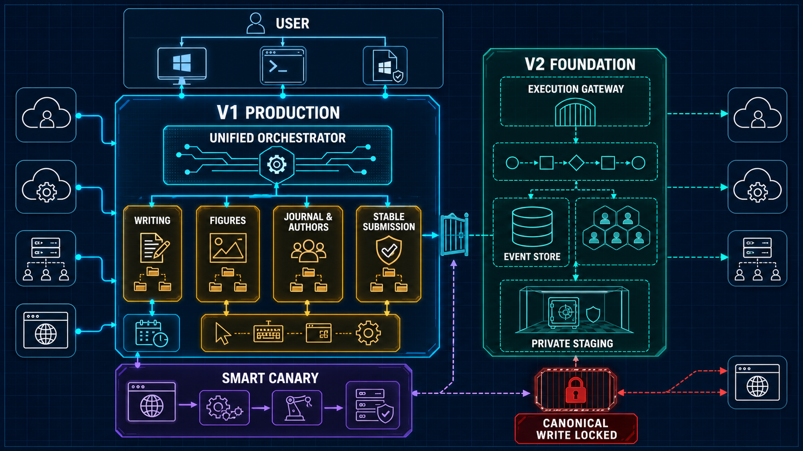
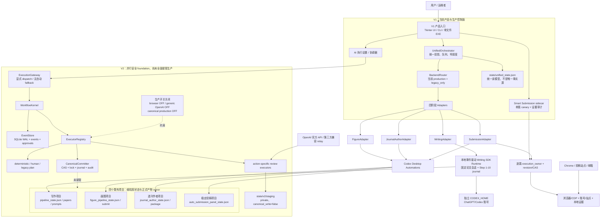
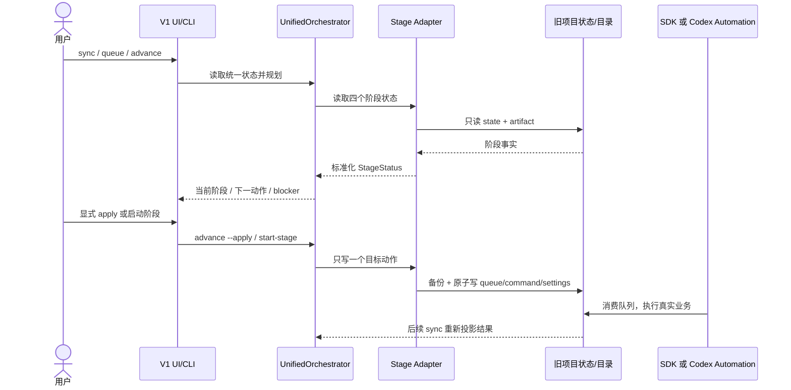
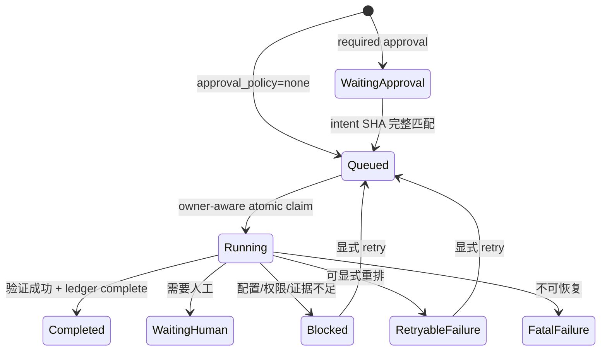

# 大一统论文智能体控制台：项目全景梳理

> 调研基线：2026-07-14（Asia/Taipei）  
> 当前产品版本：0.5.7  
> 当前分支：`codex/stabilize-and-cleanup`  
> 调研方法：源码与文档交叉阅读、Git/运行态盘点、只读健康检查、全量离线测试、EXE 元数据核验、V2 SQLite 一致性检查。未执行联网 canary、付费模型请求或真实投稿。

## 1. 一页结论

这个项目不是一个已经把所有能力收进单一代码库的“论文 SaaS”，而是一个 **Windows 本地、状态驱动、安全优先的论文生产控制平面**。它把写作、画图、选刊/作者、投稿四个既有项目编排成一条流水线，同时保留各旧项目对自身状态和产物的所有权。

当前最准确的定位是：

- **V1 是产品与生产面**：Tkinter/CLI/单文件 EXE、统一投影、逐篇队列、四阶段桥接、写作本地 Codex SDK、稳定投稿和 Smart Submission 都在 V1 产品面。
- **V2 是并行 foundation**：它已经具备版本化任务合同、SQLite 事件账本、审批、执行器注册、staging 和 canonical writer 安全原语，但没有接管完整四阶段生产；默认 canonical 写入、浏览器执行和通用 OpenAI 执行均关闭。
- **迁移还未达到“复制后直接运行”的状态**：源码基线未封存、四个外部根路径硬编码、DPAPI/Chrome/Codex 身份不可直接跨机复用、Automations 位于仓库外，且写作 journal 仍有一个 `waiting_event` 记录。
- **功能质量基础不错，发布工程仍需收口**：全量测试为 `907 passed, 54 subtests passed`，Ruff 通过，EXE 版本和新鲜度正确；但发布验证器仍硬编码 0.4.4，因此当前对 0.5.7 必然报 FAIL，且没有与当前 EXE 绑定的成功 live canary。

因此，本项目 **可以迁移，但不建议现在直接搬目录并切换生产**。推荐先做一个短周期“迁移加固冲刺”，满足本报告第 9 节的冻结门槛后再搬。

## 2. 项目思路与设计原则

### 2.1 它解决的实际问题

四个论文阶段原本各自拥有目录、JSON 状态、Prompt、队列和 Codex 调度器。统一控制台解决的是跨项目协作问题：

1. 把分散状态投影成一张统一论文表；
2. 推断一篇论文当前处于哪个阶段、下一步应该做什么；
3. 只向对应旧项目写入一个窄动作，不在总控内直接写论文、画图或在线投稿；
4. 把高风险副作用放在明确的 owner、审批、安全门和证据合同之后；
5. 在不停止 V1 生产的前提下，用 V2 逐步建立更可靠的任务内核。

### 2.2 当前实际遵循的架构原则

- **桥接而非大爆炸重写**：旧项目仍是细粒度事实源和产物 owner，总控只投影与编排。
- **本地优先**：状态、论文、浏览器证据、账号元数据和审计都保存在本机。
- **默认失败关闭**：状态损坏、身份不明、路径漂移、证据不足、审批意图不匹配时停止，不猜测成功。
- **副作用显式化**：`advance` 默认 dry-run；V2 模型/副作用任务必须通过 `ExecutionGateway`；提交路线逐篇显式选择。
- **一条任务一个 owner**：V1/V2、稳定投稿/Smart、kernel/gateway 都用所有权字段隔离，避免双写或重复投稿。
- **证据高于状态字符串**：稿号、确认 URL、签名本地证据才会锁定投稿完成；单纯的 `submitted`/`monitoring` 文本不算终态证明。
- **写作事件驱动**：写作不再依赖模型 heartbeat，而是用固定 Codex SDK 会话、完成事件、artifact 门禁和 crash journal 推进。
- **Prompt 原字节保护**：20 份用户调优 Prompt 被视为产品合同，运行时以 SHA-256 保护，不由迁移逻辑改写。

## 3. 架构全景

### 3.1 Image Gen 架构认知全景图

下图用于快速建立系统心智模型；精确调用关系以 3.2 的 Mermaid 图和源码为准。



### 3.2 当前真实架构图



### 3.3 生产数据流



关键点是：总控的 `unified_state.json` 是聚合读模型，不应替代四个旧项目状态；真实业务完成后仍需从旧项目重新投影。

### 3.4 V2 任务与审批边界



`dispatch_owner=kernel|gateway` 不只是展示字段，它参与 create、claim、complete、approve、retry 的数据库条件；实验 HTTP API 不能领取 gateway-owned 任务。

## 4. 代码与模块职责

| 层 | 关键模块 | 当前职责 | 当前定位 |
|---|---|---|---|
| 入口与交互 | `app.py`、`__main__.py`、`ui/` | EXE/CLI 分流、Tkinter 页面、用户确认、后台任务显示 | 生产入口 |
| 统一控制 | `orchestrator.py`、`models.py`、`projection.py` | 聚合状态、统一队列、阶段推断、逐篇投稿路由、一次推进一个动作 | 生产核心 |
| V1 兼容缝 | `backend_router.py` | 为未来逐 action 迁移保留 seam；production 仍为 `legacy_only` | 已安装，未切换 |
| 旧项目桥接 | `adapters/base.py`、`writing.py`、`figures.py`、`journal_author.py`、`submission.py` | 读取/写入各旧项目状态、备份、生成命令、投影统一 StageStatus | 生产核心 |
| 写作执行 | `writing_sdk_dispatch.py`、`writing_sdk_runtime.py`、`writing_completion.py` | 固定会话、Step 1-10 顺序、论文间并发、事件推进、artifact/Prompt/hash 门禁、崩溃恢复 | 新生产路径 |
| 写作质量门 | `writing_*_gate.py`、`writing_output_contract.py` | 文献、新颖性、证据、LaTeX、输出结构与重试约束 | 已实现并持续加固 |
| 稳定投稿 | 外部 `New project 11` + `SubmissionAdapter` | 默认生产投稿，保留成熟安全门 | 默认 owner |
| Smart 投稿 | `smart_submission.py`、账号/浏览器/站点模块 | 单篇 canary、双轨路由、浏览器证据、账号与站点、审计 | 试运行 sidecar |
| AI 来源设置 | `ai_provider_store.py`、`ai_execution*.py` | `legacy_codex` / `api_key` 显式模式、DPAPI key、能力边界 | API 仅有限纵切 |
| V2 合同与账本 | `contracts.py`、`store.py`、`kernel.py` | TaskEnvelope/Result、幂等、owner、审批、事件 | foundation |
| V2 网关与执行器 | `gateway.py`、`executors/`、`staging.py` | action-specific 路由、最小权限、provider provenance、private staging | canary/研发 |
| V2 唯一写入器 | `canonical.py` | staging hash、目标 CAS、单写锁、journal、rollback、hash-only audit | 代码已安装，生产关闭 |
| 安全与持久化 | `io_utils.py`、`windows_security.py`、`credential_vault.py` | 原子写、锁、备份、DPAPI、最小 ACL | 横切基础设施 |
| 发布 | `tools/build_exe.ps1`、`tools/verify_release_044.py` | 全量测试、PyInstaller、CLI probe、发布证据核验 | 构建可用，verifier 过期 |

### 4.1 V1 生产调用链

`GUI/CLI → UnifiedOrchestrator → BackendRouter(legacy_only) → Adapter → 旧项目 state/queue`。

`UnifiedOrchestrator` 当前明确把 `BackendRouter` 构造成 `legacy_only`，且 `stage_execution_backend=None`。这说明 V2 类型和 seam 已进入 V1 代码，但生产 action 并没有被新后端接管。

### 4.2 写作链路已与另外三阶段不同

写作已经从旧 heartbeat Automation 迁到 EXE 内的本地 Codex SDK runtime：

- 每篇论文一个固定 Codex thread；
- 同一论文 Step 1-10 顺序执行；
- Step 1 串行分配论文编号，后续论文可并发；
- 每次 turn 使用 `workspace_write + deny_all`；
- 完成必须同时满足 SDK 完成事件、终端 marker、输入未漂移和预期 artifact；
- journal 不确定窗口默认阻塞，不自动制造第二个 thread/turn。

图表、选刊作者、稳定投稿仍由 Codex Desktop Automations 消费各自旧项目队列。因此当前完整四阶段 owner 是 **本地 SDK + V1 Automation 混合模式**。

### 4.3 投稿是长期双轨，而非临时重复实现

稳定投稿默认 `execution_owner=legacy_auto`；Smart 只有在用户逐篇显式切换为 `smart + canary` 后才能在线运行。路线切换使用 revision/CAS，并在队列运行、最终提交不明或已有终态证据时拒绝。

这条边界应保留到 Smart 在真实站点、凭据代理、影子对比和成功率上达到生产门槛。不能仅因为 Smart 代码多，就推断它已经替代稳定投稿。

### 4.4 V2 当前能做和不能做的事

已经实现：

- 版本化 TaskEnvelope/TaskResult/Artifact/Approval 合同；
- SQLite WAL、`synchronous=FULL`、幂等 key、owner-aware 原子领取；
- loopback API 与 bearer token；
- deterministic/human/legacy plan；
- 官方 OpenAI、第三方 Responses relay、隔离 Codex CLI、Codex SDK profile 的 action-specific review canary；
- private staging、receipt 恢复、provider provenance；
- canonical commit 的锁、CAS、journal、rollback、audit 安全原语。

明确未开放：

- API 密钥模式下的完整四阶段执行；
- 通用 `openai_api` prompt passthrough；
- V2 浏览器副作用；
- V2 canonical production write；
- V2 对 V1 的自动 fallback；
- HTTP API 对 gateway-owned 任务的控制。

## 5. 状态、数据与身份地图

| 路径/系统 | 内容 | 是否事实源 | 敏感性/可迁移性 |
|---|---|---|---|
| `state/unified_state.json` | 38 篇论文统一投影、路线、历史、统一队列 | 聚合读模型 | 必须迁移，但可由四源重新生成；路线/历史不可随意丢 |
| `state/writing_sdk_dispatch.json` | 固定 thread、step、发送不确定性、恢复事务 | 写作调度事实 | **必须一致迁移**，不能凭空重建 |
| 四个外部 `controller/*_state.json` | 各阶段细粒度任务、命令、队列 | V1 生产事实源 | **必须迁移** |
| 四个外部 `papers/`、`prompts/`、`refs/` | 正式论文产物、输入、用户 Prompt | 业务资产 | **必须迁移并校验 hash** |
| `state/smart_submission/` | Smart 状态、账号元数据、截图、页面快照、审计、上传暂存 | Smart 事实与证据 | 状态/证据必须；凭据和浏览器身份不能直接复用 |
| `state/ai_providers/` | provider 设置、profiles、DPAPI secrets | AI 模式配置 | 非秘密配置可迁；密钥必须新机重录 |
| `state/codex_sdk_home/` | 独立 Codex auth、会话、SQLite/log/plugin/cache | 写作身份与恢复辅助 | 加密冷备；新机应重新登录，不假定 `auth.json` 可移植 |
| `state/v2/orchestrator.sqlite3` | V2 tasks/events/approvals/legacy snapshot | V2 事实源 | 停机后一致复制；旧任务绑定绝对路径，不宜迁址后 retry |
| `state/v2/staging/` | review receipt 与私有输出 | V2 成功证据 | 若存在必须与 DB 一起迁移 |
| `state/v2/api_token.local` | loopback API bearer token | 本机访问凭据 | 新机建议重新生成并重新绑定客户端 |
| `state/v2/codex_cli/node_modules/` | 隔离 Codex CLI 二进制/runtime | 缓存/依赖 | 可重建，不是业务数据 |
| `%USERPROFILE%\.codex\automations\` | 图表/选刊/投稿 Automation TOML | 仓库外控制配置 | 新机必须重新注册与验证，不只复制 receipt |
| `dist/UnifiedPaperOrchestrator.exe` | 当前单文件发布物 | 回滚发布物 | 建议带走一份并校验 hash；新机可重建 |
| DPAPI vault / Chrome profiles / cookies | 密码、API key、浏览器会话 | 身份凭据 | 绑定 Windows 用户/机器；只做加密冷备，目标机重新登录/录入 |

## 6. 当前开发现状

### 6.1 代码规模与集中度

| 区域 | Python 文件 | 代码行 |
|---|---:|---:|
| V1 `unified_paper_orchestrator/` | 48 | 45,403 |
| V2 `unified_paper_orchestrator_v2/` | 27 | 10,149 |
| `tests/` | 61 | 26,740 |
| `tools/` | 7 | 1,647 |

最大文件：

| 文件 | 行数 | 判断 |
|---|---:|---|
| `smart_submission.py` | 12,256 | 已超过可安全持续追加功能的规模，是首要拆分对象 |
| `ui/main_window.py` | 3,721 | UI、控制流和业务调用耦合偏重 |
| `writing_sdk_runtime.py` | 3,276 | 写作桥接、恢复、状态合并集中 |
| `writing_sdk_dispatch.py` | 2,887 | 调度合同完整但复杂度高 |
| `account_site_store.py` | 2,398 | 账号、vault 事务、审计职责过密 |
| V2 `gateway.py` | 1,907 | 安全策略集中，后续 action 增长会继续膨胀 |

测试代码量约为产品代码量的一半，这是积极信号；但多个核心文件已进入“改一处影响大面积安全不变量”的阶段。

### 6.2 2026-07-14 运行态快照

| 项目 | 当前观察 |
|---|---|
| 统一投影 | 38 篇；统一队列 0；下一动作：13 写作、10 选刊作者、6 投稿、5 完成、3 等待写作、1 阻塞 |
| 投稿 owner | 37 篇 `legacy_auto`，1 篇 `manual`；全部 route mode 为 `production` |
| Smart | 11 条记录：8 monitoring、2 submitted、1 blocked；在线队列 0。状态文字不等于终态证据 |
| 写作旧状态 | 20 sessions：16 complete、2 queued、1 waiting、1 paused；`scheduling_mode=manual` |
| 写作 SDK journal | 8 个未完成计划：7 queued、1 waiting_event；active/running/recovery 均为 0 |
| 图表/选刊/稳定投稿 Automation | 全部 PAUSED |
| V2 DB | `quick_check=ok`；3 tasks：1 个 kernel noop completed，2 个 gateway review blocked；无 active task |
| V2 staging | 主 staging 没有成功 canary pair；历史 replay 目录只用于回放证据 |

这里最重要的是：迁移前不仅要看 `active_count=0`，还要处理 `waiting_event_count=1`。它可能处于“远端 turn 已发生，但本地账本尚未完成对账”的不确定边界，不能直接删除 journal 或重建任务。

### 6.3 质量与发布证据

| 检查 | 实测结果 | 结论 |
|---|---|---|
| 全量 pytest | `907 passed, 54 subtests passed in 132.41s` | 通过，无 failed/skipped/xfail |
| Ruff | `All checks passed` | 通过 |
| Python AST | 143 个 Python 文件解析通过 | 通过 |
| `doctor` | `PASS_WITH_WARNINGS`，主状态/四外部状态可读，38 篇投影有效 | 可用；writing automation 诊断存在一处显示不一致 |
| AI execution status | `legacy_codex` ready；SDK 0.1.0b3、CLI 0.137.0a4 可用 | 当前本机就绪 |
| EXE | 0.5.7，153,919,364 bytes，SHA-256 `1A09E923...E7C155D`，mtime 晚于最新构建输入 | 发布物新鲜 |
| Authenticode | `NotSigned` | 跨机分发会遇到来源信任/SmartScreen 风险 |
| 发布 verifier | `FAIL`，4 项失败 | verifier 仍期待 0.4.4；且没有当前 EXE 对应 live canary，不能作为 0.5.7 验收器 |

测试套件目前也不是完全隔离的：本次全量测试在真实 `state/backups/` 下留下了 8 个约 1.4 KB 的测试备份。主统一/Smart/四个外部状态抽样 hash 未变，但这仍说明测试默认路径可能触碰生产运行目录，应在迁移前修复为全程临时根。

### 6.4 源码基线现状

这是当前最大的迁移风险：

- Git 只有 2 个提交，没有 release tag；
- 当前有 31 个 tracked 文件修改、大量 untracked 文件、0 staged；untracked 精确数量会随本次文档和图像交付变化，不应作为冻结判据；
- tracked diff 已约 `+15,542 / -1,810`；
- **整个 V2 包、V2 文档/测试以及多项 V1 新模块当前都是 untracked**；
- `state/**` 被整体忽略；
- `origin` 没有可用的远程 URL；
- 两个外部项目没有 Git；另外两个外部目录虽有 `.git`，但都“尚无提交”，且对象库异常膨胀。

所以现在执行 `git clone` 或只复制 tracked 文件，会丢掉大量当前产品代码、全部运行状态和 V2 账本。

### 6.5 版本演进判断

0.4.3 到 0.5.7 的 15 份发布记录集中在约两天内，主要修复写作 SDK、并发、证据门、LaTeX 和多执行器网关。这说明项目处于高强度收敛期，而不是长时间稳定的维护期。建议把接下来一个里程碑命名为“迁移/稳定性发布”，暂停继续叠加新业务入口。

## 7. 已完成、部分完成与未开放能力

| 能力 | 状态 | 说明 |
|---|---|---|
| V1 UI/CLI/EXE | 已实现 | 当前生产入口，版本 0.5.7 |
| 四源统一投影与队列 | 已实现 | 统一状态、队列、阶段推断、dry-run/apply |
| 写作本地 SDK 事件执行 | 已实现并在加固 | 固定会话、artifact gate、并发预算、恢复 journal |
| 图表/选刊/稳定投稿 | 已实现，依赖外部 Automations | 当前均暂停，迁移后需重注册 |
| 双轨投稿与 route CAS | 已实现 | stable 默认、Smart 单篇 canary |
| Smart 本地预检/在线 worker/证据 | 部分实现 | 功能多，但真正只读 shadow、通用站点适配、可信凭据自动填充仍未完成 |
| API key 模式 | 部分实现 | 连接测试 + Prompt 07 私有 staging；不能跑完整四阶段 |
| V2 EventStore/合同/API | foundation 已实现 | 可用于隔离测试和增量迁移 |
| V2 review canary | 代码可用，当前真实证据不足 | 现有 2 个任务 blocked，无当前成功 staging pair |
| V2 browser executor | 未开放 | 明确 reserved/unavailable |
| 通用 OpenAI executor | 永久关闭 | 必须使用 action-specific adapter |
| V2 canonical writer | 安全原语完成，生产关闭 | V1 仍是唯一正式写入 owner |
| 可复现迁移/发布 | 未完成 | Git、路径、凭据、verifier、签名尚未收口 |

## 8. 主要风险与技术债

### P0：迁移前必须处理

1. **封存源码事实基线**  
   当前 Git 不能代表产品。必须把所有应保留源码、测试、文档和 Prompt 归类后提交到一个迁移基线分支，并生成 tag、bundle 和离线 hash manifest。

2. **把四个旧项目根路径参数化**  
   `config.py` 仍硬编码四条 `D:\Documents\...`。当前只有总控根和 V2 根支持环境变量，旧项目根没有；Smart Submission 还把 ASCII 兼容工作区固定为 `D:\Documents\dayi_unified`。最安全的临时方案是目标机复刻相同盘符/目录，并在未修复前重建这一条专用 junction；正确工程方案是增加版本化配置文件或独立环境变量并让 doctor 校验。

3. **建立“数据、身份、缓存”迁移分类**  
   DPAPI 密文、Chrome cookies、Codex `auth.json`、Automation receipt 都不能被当作普通可移植配置。目标机应重新登录/录入；原文件只放加密冷备。

4. **在源机清空不确定运行边界**  
   所有 scheduler/worker 暂停还不够；写作 `waiting_event=1` 必须在源机显式对账或形成书面恢复决策。V2 必须无 queued/running/waiting_approval，浏览器/CDP 关闭，所有 SQLite writer 退出后才能复制。

5. **修复 0.5.7 发布验证器**  
   `verify_release_044.py` 的 `EXPECTED_VERSION` 仍为 0.4.4。应升级为当前版本的通用 verifier，并把“离线结构验收”和“真实联网 canary”分开报告，避免版本正确却必然 FAIL。

6. **隔离测试与生产 state**  
   构建前全量测试不能在真实 `state/backups/` 生成文件。测试必须强制使用临时 `UNIFIED_PAPER_ORCHESTRATOR_ROOT`、临时 HOME/CODEX_HOME 和注入式 backup root。

7. **解除构建脚本对源机用户目录的绑定**  
   `tools/build_exe.ps1` 固定引用 `C:\Users\Administrator\...\python.exe`、该解释器 hash，并覆写 TEMP、APPDATA、PYTHONPATH。目标机不能照搬；应改为从受控构建环境发现解释器和缓存根，再由 lock/manifest 校验版本与 hash。

### P1：迁移后优先收敛

1. 拆分 `smart_submission.py` 为 state store、state machine、gates、dispatch、site adapters、audit；
2. 将 `main_window.py` 中业务操作抽到 application services/presenters，UI 只做交互与展示；
3. 把账号、vault 事务、站点登记从 `account_site_store.py` 拆成独立端口；
4. 为 JSON、Prompt、SQLite 和外部目录建立统一的 migration manifest/schema version；
5. 固定完整构建依赖和工具版本，生成 lock/constraints，并记录 MiKTeX/Chrome/Node 版本；
6. 给 EXE 增加 Authenticode 签名与时间戳；
7. 修复 doctor 中 writing automation “missing” 与 scheduler status 中 legacy fallback “exists”的口径不一致；
8. 为整个 Codex 账号建立跨进程共享许可权威；当前 SDK 只能证明单 app-server 进程内的并发上限；
9. 将外部四项目纳入真正的版本控制或不可变制品仓库，避免只有本机目录事实。

### P2：继续 V2 迁移时的原则

- 不做“一次性切换 V2”；
- 先上只读 shadow，对比 V1/V2 决策；
- 每次只迁一个 action，并通过 `BackendRouter` 显式 owner 切换；
- 第一个 canonical action 应选择低风险、可 CAS、可完整回滚的产物；
- 生产写入只能有一个 owner，禁止 V1/V2 双写；
- 成功 canary 只证明该 action，不自动授权浏览器、投稿或其他模型能力。

## 9. 跨电脑迁移方案

完整操作步骤另见 [迁移运行手册](MIGRATION_RUNBOOK_2026-07-14.md)。本节解释迁移策略和边界。

### 9.1 实际迁移范围与体量

| 根目录 | 当前体量 | Git 状态 | 迁移判断 |
|---|---:|---|---|
| `D:\Documents\大一统` | 约 964 MiB（本次交付后） | 2 commits，大量未提交/未跟踪 | 整体快照；不能只用 Git |
| 写作项目 | 1,133.85 MiB | 无 Git | controller/prompts/papers/refs/ideas 必须迁 |
| 画图项目 | 563.67 MiB | 无 Git | papers/refs/controller 必须；`tmp` 可冷备/重建 |
| 选刊作者项目 | 1,171.40 MiB | `.git` 606 MiB 但无提交 | 业务目录必须；对象库单独冷备 |
| 稳定投稿项目 | 19,046.79 MiB | `.git` 6.30 GiB 但无提交 | 业务包/控制器必须；Chrome profiles 与异常 Git 对象分离 |
| `D:\Documents\大一统_backups` | 约 1.08 GiB | 独立历史备份根 | 进入加密冷备，去重后再决定是否进入热包 |

包括独立备份根在内，全生态原样冷备约 **23.4 GiB**。剔除可重建 runtime、空仓库巨大 `.git` 对象、Chrome profiles、重复迁移包和缓存后，日常运行热数据预计约 **4–6 GiB**；最终数值应以冻结日 manifest 为准。

### 9.2 建议制作两个包

**A. 加密全量冷备**

- 保存所有五个项目、state、浏览器证据、旧迁移包和 `.git` 对象；
- 放在 BitLocker/硬件加密磁盘；
- 用于取证和回滚，不直接在目标机启动；
- 不上传普通网盘，不通过聊天/邮件传输。

**B. 精简运行包**

- 包含当前完整工作树（含 untracked）、四项目 controller/prompts/papers/refs/正式 package、关键 state/journal/DB/staging/audit、当前 EXE；
- 排除 `node_modules`、`state/v2/codex_cli/node_modules`、Python/cache/build/tmp、Codex plugin cache；
- 排除 Chrome profile 作为“可直接登录”的依赖；
- 排除 DPAPI 密文作为“可直接解密”的依赖；
- 目标机重新安装依赖、重新登录、重新注册 Automations。

### 9.3 路径策略

当前最稳妥方案是目标机保持以下目录完全一致：

```text
D:\Documents\大一统
D:\Documents\项目控制平台\edge-llm-research
D:\Documents\论文画图\paper-figure-codex
D:\Documents\期刊选刊与作者
D:\Documents\New project 11
D:\Documents\dayi_unified -> D:\Documents\大一统
```

最后一行是当前 Smart Submission 代码依赖的既有 ASCII 兼容 junction；未参数化前需原样重建。除此之外，不要用广泛 junction/软链临时蒙混，因为项目在 staging、canonical、凭据、删除和 artifact 校验中主动拒绝 symlink/reparse point；某些路径即使“能打开”，也会被安全门 fail closed。如果目标机不能提供 D 盘，应先完成路径参数化，再迁移。

### 9.4 身份与凭据重建

- Codex SDK：在目标机的 `state/codex_sdk_home` 重新授权同一账号；不要假设复制 `auth.json` 后可用。
- Codex Desktop：重新登录，并通过官方 Automation 注册入口重新创建图表、选刊作者、稳定投稿任务；旧 receipt 只作参考。
- AI API：重新录入 OpenAI/relay key，重新做兼容性测试；DPAPI `secrets.local.json` 不能跨 Windows 用户解密。
- 投稿账号：先导出不含密码的账号/站点清单；密码从可信密码管理器在新机重新录入。
- Chrome：新建目标机 profile，逐站登录、验证 2FA/邮箱/CDP；旧 profile 仅冷备，不作为生产身份恢复方案。

### 9.5 迁移验收顺序

1. 只恢复目录和非秘密配置；
2. 安装 Python 3.12、Git、PowerShell、Node、Chrome、MiKTeX/pdflatex、Codex Desktop；
3. 安装精确 Python 依赖并跑全量测试；
4. 重新录入身份与凭据；
5. `doctor`、AI status、scheduler status、V2 DB 检查全部通过；
6. 先只读 sync/dry-run，不启动 scheduler；
7. 做一个不联网、无写入的 shadow 验收；
8. 只开启一篇、一个阶段的 canary；
9. 比较源/目标关键 hash、队列、route revision、稿件终态证据；
10. 目标机稳定后才长期停用源机，且不要双机同时运行 scheduler。

现有 V2 task envelope 中保存了源机绝对输入、staging 和 binary 路径。迁移后这些任务只作为历史账本保留，不编辑、不重试；需要继续的工作应在目标机以新路径创建新 task/approval。

## 10. 下一步研发路线

### 里程碑 A：迁移就绪版（P0，优先于新功能）

交付标准：

1. 所有产品源码、测试、文档和 Prompt 进入可审计 Git 基线；
2. 生成 release tag、`git bundle`、依赖锁和 SHA-256 manifest；
3. 四外部根路径可配置，doctor 显示解析后的唯一真实路径；
4. 提供 `migration export/check/restore-verify` 三个只读或显式工具；
5. DPAPI/Codex/Chrome/Automation 的“不可移植”行为在 UI 和手册中明确；
6. 测试不再触碰生产 state；
7. 新的 0.5.8 verifier 同时验证源码、EXE、版本资源、Prompt、关键合同，并把 live canary 单列为可选证据；
8. 源机写作 `waiting_event` 已对账，迁移冻结报告为 clean。

### 里程碑 B：模块收敛版

1. 拆 Smart monolith；
2. 拆 UI 与 application service；
3. 统一 state/backup/lock/provider 端口；
4. 建立结构化事件/指标，而不是继续扩展自由文本 history；
5. 为四外部项目建立独立 repo 或不可变 artifact registry。

### 里程碑 C：V2 渐进接管

建议顺序：

1. V2 只读 import/projection 与 V1 对比；
2. deterministic artifact verify；
3. action-specific review staging；
4. 一个低风险 canonical artifact commit；
5. 写作某个非关键步骤的显式 owner 迁移；
6. 最后才考虑浏览器/投稿副作用。

每一步都必须具备：输入 manifest、稳定错误码、最小能力集、shadow 对比、审批、receipt、恢复协议、无双写证明和回滚步骤。

### 里程碑 D：生产运营化

- 代码签名、SBOM、依赖漏洞与许可证扫描；
- 自动化离线回归 + 受控 live canary；
- 备份保留、恢复演练和灾难恢复 RPO/RTO；
- 统一可观测性：阶段等待、模型用量、工具调用、人工介入、p95 时延、投稿成功率；
- 双机互斥租约或明确的“唯一运行主机”机制。

## 11. 推荐立即执行的顺序

1. 暂停新功能合并，建立 `migration-baseline-2026-07-14` 源码基线；
2. 在源机处理写作 `waiting_event=1`，确认没有任何不确定 side effect；
3. 路径参数化并补迁移 manifest；
4. 修复测试隔离和 0.5.7 verifier；
5. 制作加密冷备 + 精简运行包；
6. 在目标机保持相同目录进行一次完整恢复演练；
7. 只读验收后，单篇单阶段 canary；
8. 观察稳定一段时间，再决定源机退役。

这比继续扩展 Smart 或直接让 V2 接管生产更重要，因为当前最大的系统性风险不是功能缺少，而是 **唯一事实仍分散在未提交工作树、多个本地目录、机器绑定身份和多份运行账本中**。

## 12. 关键源码证据索引

- V1 生产后端仍为 legacy-only：`unified_paper_orchestrator/orchestrator.py:69-81`
- 四个外部项目硬编码：`unified_paper_orchestrator/config.py:41-44`
- 统一 sync 与一次推进：`unified_paper_orchestrator/orchestrator.py:181`、`:797`
- 投稿逐篇 owner/终态证据：`unified_paper_orchestrator/adapters/submission.py:218-262`
- 写作 SDK event 模式：`unified_paper_orchestrator/adapters/writing.py:25`、`:607-690`
- 写作 thread resume/start 与 sandbox：`unified_paper_orchestrator/writing_sdk_dispatch.py:1193-1234`
- DPAPI current-user：`unified_paper_orchestrator/credential_vault.py:25-70`
- V2 Task owner/approval：`unified_paper_orchestrator_v2/contracts.py:78-115`
- V2 SQLite WAL/FULL/IMMEDIATE：`unified_paper_orchestrator_v2/store.py:142-151`
- V2 production canonical 关闭：`unified_paper_orchestrator_v2/gateway.py:737-741`、`:1265`
- browser/generic OpenAI/canonical executor 关闭说明：`unified_paper_orchestrator_v2/executors/`
- 当前依赖版本：`pyproject.toml:3-9`
- 构建前全量测试与候选发布：`tools/build_exe.ps1:137-191`、`:299-306`
- 过期 verifier 版本常量：`tools/verify_release_044.py:31`

## 13. Image Gen 生成说明

- 模式：内置 Image Gen（非 CLI fallback）
- 用例：`infographic-diagram`
- 目标资产：`docs/assets/architecture-panorama-2026-07-14.png`
- 资产规格：1672 × 941，1,664,703 bytes，SHA-256 `3D1B990AF933F7A6AF00C6131CF822A221D15D970C5E2331518FFE05E3403C33`
- 生成意图：用一张 16:9 蓝图式全景图同时表现 V1 生产控制面、四个 legacy 项目、写作本地 SDK、双轨投稿、V2 安全 foundation、状态存储与外部身份；明确把 V2 canonical/browser 画成关闭状态，避免误导为已接管生产。

最终提示词摘要：16:9 深海军蓝玻璃蓝图风；左侧为青蓝色 `V1 PRODUCTION` 与四座琥珀色 legacy tower，下方为紫色 `SMART CANARY`，右侧为平行而非替代关系的青绿色 `V2 FOUNDATION`，包含 `EXECUTION GATEWAY`、`EVENT STORE`、`PRIVATE STAGING`，并以红锁突出 `CANONICAL WRITE LOCKED`；外围服务只使用无品牌图标；只允许 13 个指定英文大标签，不生成正文、徽标、商标或水印。
