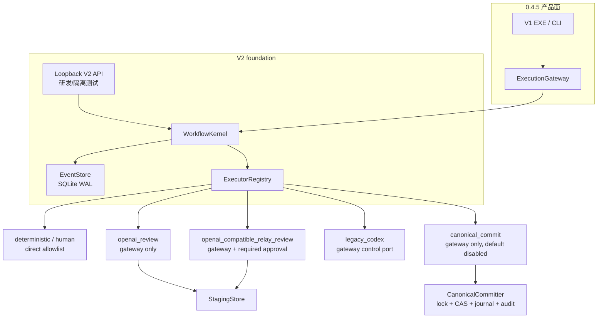
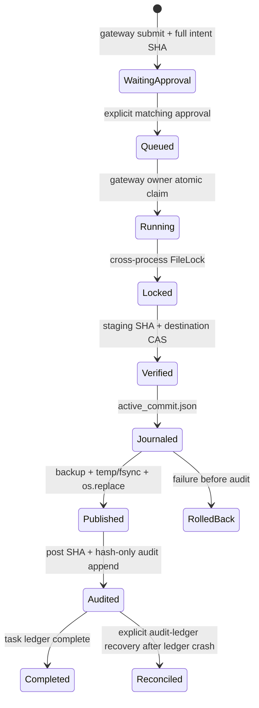

# V2 工作流内核、所有权隔离与 0.4.5 双模式网关

> **命名说明：** 本文描述的是产品内部引用的实验性工作流内核，不是第二个产品 V2，也不是独立 EXE。唯一用户入口始终是 `dist/UnifiedPaperOrchestrator.exe`；四阶段生产流程不得从 `python -m unified_paper_orchestrator_v2` 启动。

> **历史快照说明（2026-07-20）：** 本文主体记录的是 0.4.5 时的迁移边界，其中“四阶段仍由 V1 Automation 执行”等描述不再代表当前生产架构。当前四阶段已经使用 EXE 内程序控制的本地 Codex SDK 工作流；内部 `legacy_codex` 仅作为旧配置兼容值保留。当前权威说明见 [`PROJECT_ARCHITECTURE_AND_REMEDIATION_2026-07-20.md`](PROJECT_ARCHITECTURE_AND_REMEDIATION_2026-07-20.md)。

## 定位

V2 是与 V1 并存的工作流内核，不是对 V1 产品的原地重写。0.4.5 使用 V2 的类型合同、SQLite
`EventStore`、执行器注册表和安全写入原语，但产品接入仍是 V1 EXE/CLI 同进程调用
`ExecutionGateway`。

- V1 GUI、功能和内部 Prompt 保持不变。
- V1 稳定投稿与现有 Smart 投稿继续保留，生产执行 owner 不变。
- V2 loopback HTTP API 仅用于内核研发/隔离测试，不是 0.4.5 网关入口。
- 网关没有后台 worker；实验性 V2 API 的 worker 也只能处理 kernel-owned 任务。

## 产品 AI 执行双模式边界

V1 产品面可以在 `legacy_codex` 与 `api_key` 两种执行来源之间显式切换，但两者不是对称实现。当前能力矩阵如下：

| 能力 | `legacy_codex` | `api_key` | 所有权/写入边界 |
|---|---|---|---|
| 四阶段完整执行 | 支持 | **不支持** | 写作、画图、选刊作者、投稿仍由 V1 Codex Automation 和既有项目逻辑拥有 |
| 配置档连接测试 | 不适用；沿用既有 Codex 安装/登录 | 支持显式、可能计费、只读、零工具 Codex SDK 请求 | 只持久化兼容状态和测试时间，不保存模型回复 |
| Prompt 07 第一轮审阅 | 既有 V1 写作流程 | 仅 `writing.review_round_1.codex_sdk_profile_canary` | API 结果只写 private staging，固定 `canonical_write=false` |
| canonical/论文目录/V1 状态写回 | 既有 V1 边界 | **不支持** | 默认产品 gateway 的 canonical route 仍关闭 |
| 自动跨模式回退 | 不允许 | 不允许 | 模式切换与任务路由均需显式进行；失败时 fail closed |
| 20 份内部 Prompt 源文件 | 不改写 | 不改写 | API 审阅只在内存渲染既有 Prompt 07，不生成替代提示词 |

结论是：API 密钥模式当前只开放连接测试与 Prompt 07 私有暂存审阅，不能完成四阶段生产工作流；完整执行仍走 V1。
这项产品模式选择不扩大 V2 HTTP API 的权限，也不改变 `dispatch_owner` 或 canonical writer 的默认关闭状态。

`python -m unified_paper_orchestrator ai-execution-status` 是独立的只读发布诊断。它只读取 AI provider 设置、
配置档兼容状态、凭据存在性布尔值，以及 `openai-codex`/`openai-codex-cli-bin` 的包元数据与本地路径。
它不解析凭据明文、不输出 endpoint/model/custom headers、不联网、不启动运行时，也不打开、创建或迁移 V2 SQLite。
读取失败时只输出稳定错误码和异常类型，不复制可能含敏感输入的异常原文。

主要实现：

- `unified_paper_orchestrator_v2/contracts.py`：`TaskEnvelope`、`TaskResult`、审批合同。
- `unified_paper_orchestrator_v2/store.py`：带 owner 隔离的 SQLite event/task store。
- `unified_paper_orchestrator_v2/kernel.py`：受限的 direct-kernel dispatcher。
- `unified_paper_orchestrator_v2/gateway.py`：0.4.5 产品策略边界。
- `unified_paper_orchestrator_v2/executors/`：action-specific、legacy 和 canonical adapters。
- `unified_paper_orchestrator_v2/staging.py`：审阅产物 private staging 原子发布。
- `unified_paper_orchestrator_v2/canonical.py`：唯一 canonical writer、journal 与 audit ledger。

## 分层架构



`WorkflowKernel` 仍是创建审批记录和调用 `EventStore` 的共享基础设施；这不意味着所有调用面拥有相同任务
权限。`dispatch_owner` 和每个 surface 的入口检查把产品网关任务与 direct-kernel 任务分开。

## `TaskEnvelope` 与完整意图

每个任务都必须以显式信封表示，主要包含：

- `task_id`、`run_id`、`paper_id`、`stage`、`action`、`executor`。
- `dispatch_owner` 与唯一 `idempotency_key`。
- 输入 artifact 的绝对 URI、schema/media type 和 SHA-256。
- payload 中的 Prompt/输入 manifest 哈希、模型和 action-specific 参数。
- `network_access`、`allowed_tools`、`writable_roots`。
- token 预算、输出上限和超时。
- `approval_policy`。

需要审批时，内核把完整 `envelope.to_dict()` 的 canonical JSON 做 SHA-256，保存为审批
`intent_sha256`，同时保存输入 artifact 哈希。副作用执行前，网关再次计算并比对 intent；审批后修改路径、
输入、目标、执行器、能力或任何其他信封字段都会被检测。

Canonical commit 还要求审批者显式回传看到的完整 intent SHA-256，不能只点一个与内容无关的“同意”。

## EventStore 与 `dispatch_owner` 原子所有权

`EventStore` 使用 SQLite WAL、`synchronous=FULL` 和 `BEGIN IMMEDIATE`，维护 tasks、events、approvals 与
legacy snapshots。`idempotency_key` 是唯一键；同 key 同内容返回原任务，同 key 不同内容拒绝。

任务表持久化 `dispatch_owner`：

- `kernel`：实验性 V2 API/CLI 和 direct dispatcher 的任务。
- `gateway`：只能由 `ExecutionGateway` 创建和推进的任务。

所有权隔离覆盖整个状态转换，而不只是领取：

| 操作 | 原子/持久校验 |
|---|---|
| create | owner 写进 task row 和 envelope；幂等比较也包含 owner |
| claim | `WHERE task_id/status/dispatch_owner` 条件更新 queued → running |
| complete | 必须是同 owner 且当前为 running |
| approve/reject | approval 与 task 联表核对 owner |
| cancel/retry | 读取并核对 owner 后才允许状态变更 |

这使两个 dispatcher 在共享同一个 SQLite 时仍不能互相领取或终结任务。旧 schema-1 数据库采用加法迁移，
既有任务默认归 `kernel`。

## Direct-kernel 与本地 API 边界

V2 本地 API 只允许 loopback 绑定并要求 bearer token，但 loopback/auth 不是唯一安全边界：

- `POST /v2/tasks` 拒绝 `dispatch_owner=gateway`。
- run-once、approve、reject、cancel、retry 在执行前读取 task row，拒绝 gateway-owned task。
- V2 直接 CLI `create-task` 同样拒绝 gateway owner。
- `WorkflowKernel.dispatch_once()` 只领取 `kernel` owner。
- direct dispatcher 仅放行 deterministic 的 `system.noop` / `artifact.verify`、`human` 和只读
  `legacy.plan`；其他模型或副作用 action 返回 `EXECUTION_GATEWAY_REQUIRED`。

因此，V2 HTTP API/直接内核操作面不能创建或改变 gateway-owned 任务。`ExecutionGateway` 内部仍复用
`WorkflowKernel.create_task()` 作为合同和审批基础设施，但 owner 由网关先固定，并且后续只能经 owner-aware
网关方法推进。

## 执行器注册表

| 执行器 | 0.4.5 状态 | 边界 |
|---|---|---|
| `openai_review` | 可配置 | 仅 `writing.review_round_1.canary`；官方 Responses API；只写 private staging |
| `openai_compatible_relay_review` | 可配置、需审批 | 仅 `writing.review_round_1.compatible_relay_canary`；固定麒麟第三方兼容端点；只写 private staging；上游模型身份未验证 |
| `openai_api` | 永久 unavailable | 兼容占位；始终返回 `OPENAI_GENERIC_ROUTE_DISABLED`，永不建 client |
| `legacy_codex` | 已连接真实 controller | `status/start/pause`；start/pause 需 operation ID、审批和 control latch |
| `legacy` | 只读兼容 | 仅 V1 projection 的 `legacy.plan`；`legacy.apply` 永久拒绝 |
| `canonical_commit` | 已安装、默认 unavailable | 需要 construction authorization + gateway latch；生产 route 始终关闭 |
| `deterministic` / `human` | foundation | 内核确定性动作与人工等待语义 |
| `codex_sdk` | 有限产品纵切 | 仅配置档连接测试与 `writing.review_round_1.codex_sdk_profile_canary`；零工具；审阅只写 private staging |
| `browser` | 预留/foundation | 未接入 0.4.5 产品 route |

### 官方 OpenAI 与第三方兼容中转策略

`openai_review` 是 action-specific adapter，而非通用 prompt passthrough。它固定
`https://api.openai.com/v1`、`store=False`、`max_retries=0`、无 tools，并用
`httpx.Client(trust_env=False)`。因此 `OPENAI_BASE_URL` 和继承的 `HTTP_PROXY` / `HTTPS_PROXY` /
`ALL_PROXY` 不会改变目标或传输路径。默认真实执行证据记录
`endpoint_origin=https://api.openai.com/v1` 和 `transport_policy=direct_no_env_proxy`。若运行机器必须经过本地
CONNECT 代理，只允许独立变量 `UNIFIED_OPENAI_HTTPS_PROXY` 显式提供无凭据 HTTP loopback URL；校验通过时
记录 `transport_policy=explicit_loopback_proxy_no_env`，不记录代理地址。任何远程、带用户信息或附加 URL payload
的代理配置都返回 `OPENAI_LOOPBACK_PROXY_INVALID`，不会建 client。

新增中转不会改变 `openai_review` 的 action、endpoint、环境变量或验证合同，也不会把现有官方任务转换为中转任务。

`openai_compatible_relay_review` 是另一条 action-specific adapter，不通过更改 `openai_review` 的 base URL 实现。它固定
`endpoint_base_url=https://www.qilinapi.com`、`wire_api=responses` 和
`provider_profile=qilinapi_responses_v1`，只读取 `UNIFIED_RELAY_API_KEY`、`UNIFIED_RELAY_MODEL` 及可选的
`UNIFIED_RELAY_HTTPS_PROXY`。它不读取 `OPENAI_API_KEY`、`OPENAI_MODEL`、`OPENAI_BASE_URL` 或 Codex
`config.toml`/`auth.json`，也不接管或重试官方任务。key 只存在于交互脚本和子进程内存，不进入磁盘、SQLite、staging manifest、日志或命令行参数。

中转任务强制 `approval_policy=required`，并把 `third_party_data_disclosure_ack=true`、固定 endpoint digest、model、输入哈希和以下 provenance 绑定到完整 intent SHA256：

```text
provider_kind=third_party_openai_compatible_relay
provider_profile=qilinapi_responses_v1
provider_assurance=third_party_claim_unverified
```

因此，第三方兼容声明不能被包装成 OpenAI 官方证据；即使中转 canary 通过，`official_openai_endpoint_proven=false` 与 `upstream_model_identity_verified=false` 仍必须如实保留。

数据边界不是“只发送稿件正文”：两个 action 都会把 Prompt 07 按既有 fallback 规则在内存渲染，并作为 Responses API 的
`instructions` 发送；idea、参考文献、文献图谱、新颖性检查和 `draft_v3.tex` 按固定角色组装为 `input`。官方 action 发送到固定 OpenAI 官方端点，中转 action 发送到固定第三方 endpoint。20 份内部 Prompt 源文件保持原字节，但 Prompt 07 渲染正文与五类输入都会离开本机。

`OPENAI_API_TIMEOUT`、连接错误、服务端错误和 incomplete response 等结果不能证明服务端未执行或未计费。
这类任务默认禁止重排；只有操作者显式使用
`gateway-retry --acknowledge-possible-duplicate-charge` 确认可能产生第二次请求/费用后才能 requeue，确认会写入
ledger 事件，但不被当作“上次请求未执行”的证据。

### Legacy Automation 兼容端口

`LegacyCodexAutomationExecutor` 在默认构造时实例化 V1 `SchedulerAutomationController`：

- `legacy.automation.status` 调用 `read_statuses(stage)`，只返回压缩状态。
- `legacy.automation.start/pause` 调用 `set_enabled(stage, bool)`，只改变 Automation 配置，不执行任何
  论文或投稿业务。
- start/pause 信封必须是零网络、零工具、零 writable roots，并有 operation ID 和 required approval。
- 执行还要求 `allow_control=True` 或当前进程的
  `UNIFIED_V2_ALLOW_LEGACY_AUTOMATION_CONTROL=1`。

这只是控制端口，`production_execution_owner` 仍是 `v1_codex_automation`，
`gateway_business_write_enabled=false`。

## Staging 写入边界

API review 的 `StagingStore` 只接受标准 `run_<32 hex>/task_<32 hex>`，拒绝路径逃逸、symlink、Windows
junction 和其他 reparse point，并用每任务跨进程锁串行发布。在私有临时任务目录完成两文件精确字节验证后，
原子发布整个任务目录，再对正式 pair 做第二次 bytes/hash/manifest binding 验证：

```text
state/v2/staging/<run_id>/<task_id>/review_round_1.md
state/v2/staging/<run_id>/<task_id>/result.json
```

论文目录、V1 业务状态、稳定投稿和 Smart 投稿状态都不属于这个根。review 结果永远标记
`canonical_write=false`。完全相同的已发布 pair 可幂等读取，内容不同则冲突；清理逻辑不对可替换路径执行
递归删除。

`result.json` 必须绑定与 task action/executor 一致的 `provider_kind`、`provider_profile` 和
`provider_assurance`。官方 profile 只能接受官方 endpoint/provenance；中转 profile 必须保留
`third_party_claim_unverified`。两者都必须从真实联网 response JSON 取得非空 response ID、返回 model 和正数
usage，再与输入 manifest、review hash 及本次 claim token 交叉验证；离线 replay 或手工构造 JSON 不构成 live canary。

每次 queued → running 的原子 claim 还会在 task row 写入随机
`execution_attempt_token_sha256`，result manifest 必须精确绑定它。普通 queued dispatch 永远不会把事先存在的
staging pair 当成成功结果，仍会调用 action-specific executor；只有下面的显式 running-task recovery 可以消费
已有 receipt。

## CanonicalCommitter 安全模型

### 三道启用门

Canonical 代码路径虽然已安装，但默认不可执行。一个隔离网关实例要真正启用必须同时有：

1. 有效 `CanonicalCommitAuthorization(actor, reason, capability="v2.canonical.commit", authorization_id)`；
2. 非空 canonical roots、staging roots、独立 control root，且 executor 的唯一 staging root 与网关 staging
   精确相同；
3. `ExecutionGateway(allow_canonical_route=True)` 的额外 route latch。

默认产品 gateway 三项不成立，状态固定报告 V1 owner 和所有 canonical production write 开关为 false。即使
测试实例满足这些条件，也不会改变 default gateway/BackendRouter 的生产 owner。

### 提交状态机



audit append 是线性化点：audit 已存在表示 canonical data 已提交；audit 尚不存在时，恢复器只在能证明
pre/post image 的情况下回滚。状态未知时返回稳定错误并停止，绝不猜测或调用备用写入器。

### 文件系统约束

- canonical、staging、control roots 必须可解析、彼此 disjoint，不能相同或互相嵌套。
- staging source 必须是配置根内的绝对普通文件，并按实际内容两次验证 SHA-256。
- destination 必须是已配置 root 下的安全相对路径，父目录预先存在。
- 每个路径组件都拒绝 symlink，以及 Windows junction/其他 reparse point；journal/backup 路径也重新验证。
- Destination CAS 明确区分“不存在”和“存在且 SHA-256 为 X”，避免覆盖并发变更。
- 跨进程 lock、commit ID/request digest 幂等、私有 preimage backup、同目录临时文件、fsync、原子 replace
  和 post-image hash 共同构成唯一写入协议。
- `canonical_audit.jsonl` 只记录 hash 和最小元数据，不记录稿件正文；错误统一
  `fallback_allowed=false`。

### 显式 receipt-ledger 对账

系统没有自动 lease、心跳或盲目重放。三个有确定性证据的崩溃窗口提供显式、只对账式恢复：

- review：任务必须仍是 `running`，且完整 staging pair 中的 `execution_attempt_token_sha256` 与 task row 的本次
  claim 精确一致；再验证 canonical JSON manifest、两文件 bytes/hash、task/run、response ID、usage、validator、
  输入角色/哈希和当前源文件，最后完成 ledger；不再次调用 API；
- Automation：只通过 `read_statuses` 证明批准的 ACTIVE/PAUSED 目标已经成立；不再次调用 `set_enabled`；
- canonical：通过 transaction journal、hash-only audit、request digest 和 destination hash 对账。

若 review 没有完整 receipt，或 Automation 当前状态不能证明结果，任务停止并返回稳定 blocker；不会为了“恢复”
产生第二次付费调用或控制写入。

其中 canonical 对账接口额外要求：

- 原任务 owner 为 `gateway`、action 为 `artifact.canonical_commit`、状态为 `running`；
- gateway canonical route 仍获授权；
- 调用者再次提供并匹配原审批的完整 `intent_sha256`；
- committer 通过 audit/request digest/destination hash 给出幂等结果，再完成 SQLite task ledger。

这些接口不是 HTTP endpoint，也不是自动 lease。review CLI 为 `gateway-recover-review`，Automation CLI 为
`gateway-recover-automation`；canonical 仍只保留隔离编程接口且默认 route 关闭。

## 错误和无 fallback 原则

`TaskResult` 终态为 `completed`、`waiting_human`、`blocked`、`retryable_failure` 或
`fatal_failure`，失败由稳定 `blocker_code` 表达。典型代码包括：

- API 配置/传输：`OPENAI_API_NOT_CONFIGURED`、`OPENAI_MODEL_REQUIRED`、
  `OPENAI_API_TIMEOUT`、`OPENAI_API_AUTHORIZATION_FAILED`。
- 路由：`EXECUTION_GATEWAY_REQUIRED`、`GATEWAY_DISPATCH_OWNER_MISMATCH`、
  `OPENAI_GENERIC_ROUTE_DISABLED`。
- 审批：`GATEWAY_APPROVAL_INTENT_REQUIRED`、`GATEWAY_APPROVAL_INTENT_MISMATCH`、
  `GATEWAY_APPROVAL_INTENT_DRIFT`。
- canonical：`GATEWAY_CANONICAL_ROUTE_DISABLED`、`CANONICAL_CAS_MISMATCH`、
  `CANONICAL_COMMIT_BUSY`、`CANONICAL_ROLLBACK_FAILED`。

任何缺失权限、凭据、路由或可验证状态都 fail closed；不自动换模型、换 executor、启用代理或走 V1
旁路。

## 运行和验证边界

产品网关状态：

```powershell
python -m unified_paper_orchestrator gateway-status
```

实验性 V2 本地 API 仍可用：

```powershell
python -m unified_paper_orchestrator_v2 serve
```

后者仅用于 foundation，不应作为 0.4.5 网关入口，也不能管理 gateway-owned tasks。

发布完成度 verifier：

```powershell
python tools/verify_release_044.py
```

官方与第三方中转 review canary 的交互脚本：

```powershell
powershell -ExecutionPolicy Bypass -File tools/run_live_review_canary.ps1
powershell -ExecutionPolicy Bypass -File tools/run_live_relay_review_canary.ps1
```

脚本隐藏读取各自 key，只在子执行期间设置隔离的进程环境，不读取 Codex 配置/认证文件，清除 key 后才启动 verifier。中转脚本还要求操作者显式确认 Prompt 07 渲染正文和五类论文输入将发送给固定第三方 endpoint，并批准完整任务 intent SHA256。

verifier 核对 EXE 新鲜度、版本资源和选定发布合同。官方 profile 要求官方 action/executor/endpoint 与 provenance；中转 profile 要求固定 action/executor/endpoint、披露确认、持久审批及 `provider_assurance=third_party_claim_unverified`，并报告官方 endpoint 未证明、上游模型身份未验证。两个 profile 都要求真实 response JSON 中的非空 ID、返回 model、正数 usage、通过的 validator、输入未变化、精确位于 `<run_id>/<task_id>` 的两个 staging 产物、receipt/task row claim token 绑定，以及历史正式 review 哈希未变化。它验证这些列出的证据，不替代全量测试、代码审计或代码签名。

文档、离线 replay、无 key preflight 或“缺少配置时正确 blocked”都不能替代真实 canary 证据。中转接入后的旧 EXE 哈希与测试统计已过期；最终全量测试、重建和真实联网调用必须重新执行，verifier 的 `INCOMPLETE`、`FAIL`、`PASS` 应按其原义保留。
