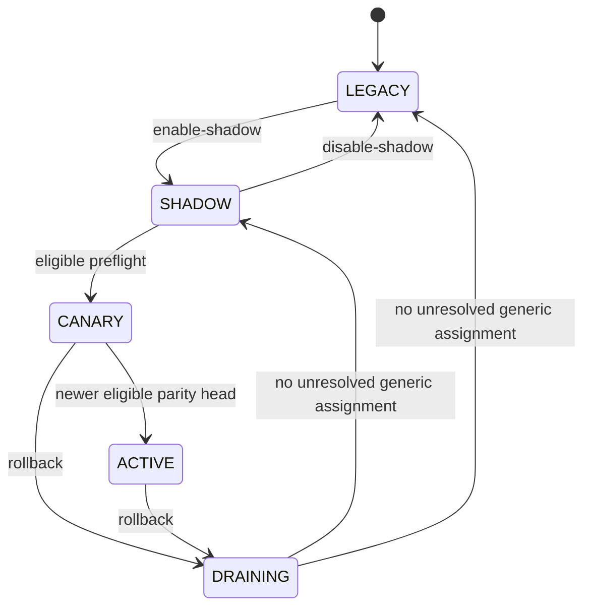

# P8 通用工作流阶段路由候选能力

日期：2026-08-05

## 结论与边界

P8 本轮交付的是独立、默认关闭、可审计的候选路由控制面，不是生产切换。

```text
candidate_routing_ready=true
production_cutover_enabled=false
production_entry_modified=false
default_owner=legacy
```

没有修改 `orchestrator.py`、`config.py`、adapters、生产 CLI 注册或任何现有 Prompt。现有生产入口仍构造 `BackendRouter.legacy_only(...)`，`stage_execution_backend` 仍为空；写作、画图、选刊作者的队列入口仍由旧 runtime 直接拥有。因此本模块不能自行截获或替换生产任务，也不会把旁路数据库状态解释成生产授权。

真正切换生产前，必须另行获得明确授权，把所有阶段 admission/queue 入口接到同一个原子 assignment ledger。仅在 start/pause 层增加 backend seam 不足以保证 exactly-one-writer。

## 文件与隔离

- `unified_paper_orchestrator/workflow/stage_routing.py`：纯路由合同、preflight、状态机、exactly-one-backend dispatch。
- `unified_paper_orchestrator/workflow/stage_route_store.py`：独立 SQLite CAS ledger。
- `tools/workflow_stage_route.py`：旁路管理 CLI；未注册到生产 `__main__`。
- 数据库固定为显式 workspace 下的 `state/v2/workflow-stage-routing.sqlite3`。

路由模块不导入 orchestrator、config、adapters、legacy runtime、shadow scanner 或生产调度入口。数据库拒绝非标准位置、symlink/reparse 路径、非路由 SQLite 数据库和未知表；assignment 与 audit event 不可删除，assignment 的 stage、operation、subject、intent、owner、policy revision 和 preflight pin 均由 SQLite trigger 保持不可变。

原始 operation ID、subject/paper ID 和 intent 不入库，分别用带 schema、字段域和 stage 的 SHA-256 记录。CLI 也只输出指纹。

## 状态机



含义：

- `LEGACY`：所有新 operation pin 到 legacy。
- `SHADOW`：生产写者仍只有 legacy；P5 只读观察可在外部并行运行。
- `CANARY`：只有显式 `canary_opt_in` 的新 operation 候选 generic，其余仍为 legacy。
- `ACTIVE`：符合 admission 证据的新 operation 候选 generic。
- `DRAINING`：新 operation 回到 legacy；既有 generic assignment 保持原 owner，绝不改写。

迁移顺序固定为 `journal-author → figures → writing`。后置阶段只有在所有前置阶段已为 `ACTIVE` 时才能进入 `CANARY` 或 `ACTIVE`。上游阶段 rollback 会在一个 SQLite transaction 中把仍为 `CANARY/ACTIVE` 的下游阶段一并置为 `DRAINING`。

## Preflight 门禁

每份证据绑定：stage、policy revision、workflow version、definition SHA-256、binding SHA-256、output contract SHA-256、comparison head、创建时间和过期时间。报告使用 canonical JSON 计算 evidence SHA-256，反序列化拒绝未知字段、缺失字段和布尔/整数宽松转换。

候选包必须同时满足：

- published、builtin、readonly，且 workflow ID 与 stage 精确对应；
- 所有节点显式 `native_dispatch_ready=True` 和 `production_writer=True`；
- 不含 `legacy-stage` 节点，且不再声明 `requires_runtime_freeze`；
- Codex 的 model、reasoning effort、positive token limit、timeout 已冻结；
- runtime files 与 Prompt seals 已在本次 preflight 重验；
- executor、输出 validators 和 legacy compatibility projection 均可用；
- 进程局部 `allow_candidate` 安全闩显式开启；
- 前置阶段迁移顺序满足。

Parity 必须：

- 固定 comparator `legacy-shadow-comparator-v1`；
- definition/binding/stage 与候选完全相同；
- `mismatch_count=0`；
- critical verdict 恰好覆盖并全部为 `exact` 或 `equivalent`：
  `source.coherent`、`workflow.node_ids`、`node.status`、`node.model`、
  `node.reasoning_effort`、`node.token_limit`、`node.artifacts`、
  `workflow.session_continuity`；
- 达到 policy 中保存的连续通过数、不同 subject 数和最大年龄；未来时间戳拒绝；
- `SHADOW→CANARY` 使用正 head，`CANARY→ACTIVE` 必须严格使用比 canary 更新的 head；`ACTIVE` admission 可复用当前相同 head，但不能倒退。

当前 P4 SCI Pack 有意声明 `native_dispatch_ready=False`、`production_writer=False`、`requires_runtime_freeze=True`，figures/journal-author token limit 仍为空，且 reasoning effort 未冻结。因此三个阶段当前都必须被 preflight 拒绝。这是安全设计，不是待绕过的错误。

## 原子 assignment 与 fallback

`admit()` 使用 `BEGIN IMMEDIATE`，并在同一 transaction 内重新读取 policy、验证 evidence、选择 owner、写入 assignment 与 audit event。`UNIQUE(stage, operation_id_sha256)` 保证并发请求收敛到一个 pin：

- 同 operation、subject、intent 重放返回原 assignment；
- 同 operation 改 subject 或 intent 立即冲突；
- policy 变化、进程重启和 rollback 均不改写已有 owner；
- generic 从 `RESERVED` 进入 `RUNNING` 后，任何异常都落为 `UNCERTAIN`，绝不调用 legacy fallback；
- legacy 调用异常同样为 `UNCERTAIN`，也不会改调 generic；
- 缺少/过期 parity 等普通候选不可用，仅在创建 assignment 之前安全 fallback 到 legacy；
- latch 关闭、候选 identity drift、未持久化/被篡改的 evidence、旧 runtime 副作用未知等安全异常 pin 为 `BLOCKED`，不会静默 fallback；
- 旧 runtime 已 queued/running 的 operation 不会再次 dispatch，而是保留 legacy owner 并阻塞重复调用。

`DRAINING` 不能在 generic assignment 为 `RESERVED`、`RUNNING` 或 `UNCERTAIN` 时结束。`UNCERTAIN` 只能通过显式 reconciliation evidence SHA-256 对账为终态后解除。

## 旁路 CLI

示例：

```powershell
python tools/workflow_stage_route.py --workspace "D:\Documents\大一统" init
python tools/workflow_stage_route.py --workspace "D:\Documents\大一统" status
python tools/workflow_stage_route.py --workspace "D:\Documents\大一统" enable-shadow --stage journal-author --expected-revision 0
python tools/workflow_stage_route.py --workspace "D:\Documents\大一统" --allow-candidate preflight-sci --stage journal-author
```

CLI 支持 init/status、enable/disable shadow、SCI preflight、promote canary/active、rollback、finish drain、simulate admission 和 uncertain reconciliation。它没有 dispatch 命令，不导入生产 orchestrator，也不注册生产入口。`--allow-candidate` 只打开当前 CLI 进程的候选安全闩，不能修改生产进程。

## 攻击面与对应控制

| 攻击面 | 控制 |
|---|---|
| stage alias、mode typo、跳级 | Enum + store 内二次状态迁移校验 |
| stale policy / TOCTOU | policy revision CAS + admission transaction 内重读 |
| parity replay / wrong candidate | definition、binding、head、revision、TTL 全部绑定 |
| comparator downgrade / 隐藏 mismatch | 固定 comparator + zero mismatch + critical allowlist |
| 双并发 admission | `BEGIN IMMEDIATE` + unique stage/operation pin |
| operation ID 复用 | subject/intent domain digest 冲突检测 |
| 运行中 policy 切换 | owner 与 assignment identity trigger 不可变 |
| generic 异常后调用 legacy | RUNNING→UNCERTAIN，dispatch 不含异常 fallback 分支 |
| 旧任务已排队或副作用未知 | queued/running 阻塞重复 dispatch，unknown-effects fail closed |
| 上游 rollback 后下游仍 generic | 原子 downstream cascade 到 DRAINING |
| DB 删除/改 owner/混入生产库 | immutable/no-delete trigger、固定路径、marker/表 allowlist |
| symlink/reparse 路径逃逸 | 初始化前后路径检查 |
| P4 SCI 被误当作 ready | native/freeze/writer/validator/projection 硬门禁 |
| persisted ACTIVE + 重启 | `allow_candidate=False` 的独立进程闩导致 BLOCKED |

## 生产启用前仍需完成

本候选能力通过测试不等于可以切生产。未来独立变更至少需要：

1. 为 journal-author、figures、writing 分别完成可执行 native pack、输出 validator 与 compatibility projection，并冻结全部 runtime profile。
2. 从 P5 shadow ledger 生成真实、连续、不同 subject、严格 critical-field parity window。
3. 经授权修改所有生产 admission/queue seam，使旧 runtime 与 generic runtime 共用同一个原子 assignment，而不是各自先排队。
4. 做 canary、rollback 和进程崩溃恢复演练，确认旧 pipeline/journal/Prompt 字节不变。
5. 仍按 journal-author、figures、writing 顺序逐阶段人工批准，不允许数据库状态单独成为生产开关。
